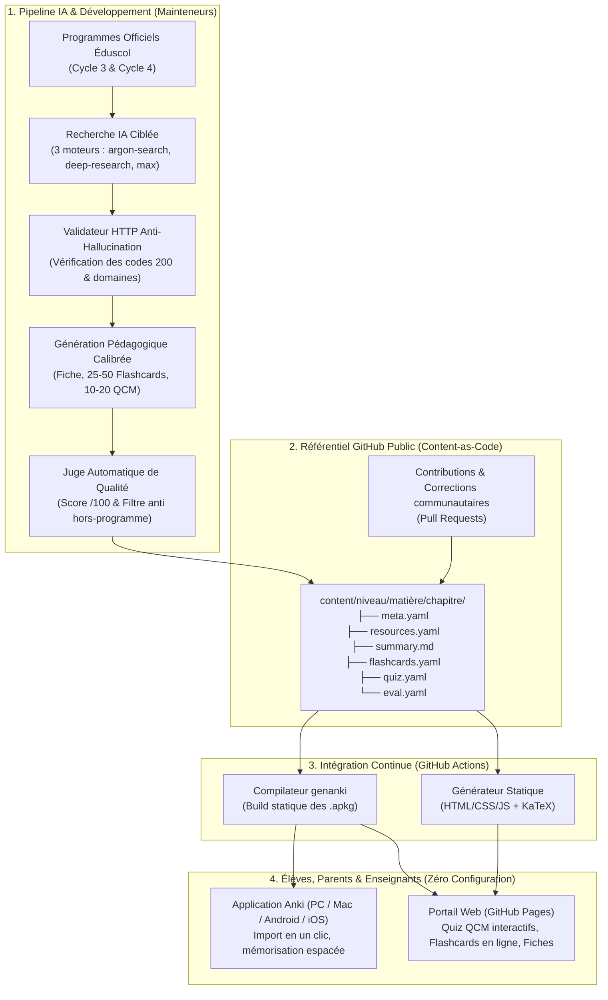

# Osarai (おさらい) 🎒✨

> **Plateforme libre, collaborative et intelligente de révisions scolaires**  
> *Conforme aux programmes officiels de l'Éducation Nationale (Collège & Lycée)*

[](LICENSE)
[](https://creativecommons.org/licenses/by-sa/4.0/)
[](https://www.python.org/)
[](#-périmètre--matières)
[](#️-les-decks-anki-hiérarchiques)
[](#-portail-web-statique-zéro-serveur)

---

## 📖 À propos du projet

### 🌸 Pourquoi le nom « Osarai » ?
**Osarai** vient du japonais **おさらい** (*osarai*, dérivé de *narau* [apprendre] et *fukushū suru* [réviser]), signifiant *« réviser ses leçons, repasser sur ce que l'on a appris »*.  
En écho direct à **Anki** (**暗記**, *mémorisation par cœur*), **Osarai** incarne la révision active, structurée et compréhensive des cours.

### 🎯 La Vision
La plupart des offres de révision scolaire au collège se heurtent à un triple problème :
1. **Les plateformes EdTech privées** (*Kartable, SchoolMouv...*) sont payantes, fermées, sans export possible et ne gèrent pas la répétition espacée (SRS).
2. **L'écosystème Anki français** est extrêmement riche pour les études supérieures (Médecine PASS/LAS, Prépas), mais **quasi inexistant ou désorganisé pour le secondaire**.
3. **Les excellentes ressources publiques et libres** (*Lumni, Lelivrescolaire.fr, MathALÉA, Forge des Communs Numériques Éducatifs*) sont dispersées.

**Osarai résout ce manque en combinant :**
- Une approche **Content-as-Code** (100 % ouvert, stocké en YAML/Markdown sous Git, sans données personnelles).
- Des **paquets Anki (`.apkg`) hiérarchiques pré-compilés**, téléchargeables en un clic avec identifiants déterministes (préservant votre historique de révision à chaque mise à jour).
- Un **portail web statique moderne** sans aucune inscription obligatoire, responsive et rapide, pour réviser instantanément (fiches, quiz interactifs, flashcards en ligne, ressources externes).
- Un **pipeline d'IA transparent et rigoureux** (`gemini-4-argon` & Deep Research), doté d'une vérification stricte anti-hallucination HTTP et d'un évaluateur automatique garantissant l'absence de hors-programme.

---

## 🏛️ Architecture & Philosophie « Content-as-Code »

Osarai sépare strictement l'outil de production du contenu publié et de son utilisation finale :



---

## 🗂️ Les Decks Anki Hiérarchiques

Tous les paquets Anki sont générés en amont avec la bibliothèque Python [`genanki`](https://github.com/kerrickstaley/genanki) et respectent l'arborescence native pliable d'Anki :

```text
Collège
└── 5ème
    ├── Histoire-Géographie
    │   ├── H1 - Byzance et l'Europe carolingienne
    │   ├── H2 - Société, Église et pouvoir politique dans l'Occident féodal
    │   └── G1 - La question démographique et l'inégal développement
    ├── SVT
    │   ├── Thème 1 - La planète Terre, l'environnement et l'action humaine
    │   └── Thème 2 - Le vivant et son évolution
    └── Mathématiques
        ├── Nombres et calculs : Fractions et nombres relatifs
        └── Espace et géométrie : Triangles et parallélogrammes
```

### ✨ Caractéristiques des cartes Anki Osarai
- **3 Granularités de téléchargement** :
  - **Par Chapitre** : pour réviser l'évaluation de la semaine.
  - **Par Matière** : pour regrouper toute l'année d'une matière.
  - **Méga-Deck par Niveau** : toute la classe de 5ème (ou 4ème, etc.) en un seul fichier structuré.
- **Identifiants déterministes (`guid`)** : mettre à jour un deck n'écrase **jamais** vos intervalles de révision et n'ajoute aucun doublon.
- **Cartes Basiques & Textes à trous (Cloze)** : formulées selon le principe d'atomicité pédagogique.
- **Niveaux de priorité** : taguées `#essentiel` (~70 % des cartes, socle du contrôle) ou `#approfondissement` (pour viser le 20/20 sans déborder du programme).
- **Rendu mathématique et scientifique** : support natif de **MathJax / LaTeX** (`\(...\)` et `\[...\]`).
- **Thème visuel soigné** : compatible mode clair / mode sombre d'Anki.

---

## 🌐 Portail Web Statique (Zéro Serveur)

Hébergé directement sur **GitHub Pages**, le portail permet un travail immédiat depuis n'importe quel écran (smartphone, tablette, ordinateur) :

1. **Fiche de Synthèse** : résumé du cours, définitions incontournables, formules, repères chronologiques et pièges à éviter.
2. **Quiz QCM Interactif** : 10 à 20 questions à 4 choix avec score en direct et **explication pédagogique détaillée** pour chaque réponse.
3. **Flashcards en Ligne** : révision rapide avec cartes rotatives 3D, filtre *Essentiel / Tout* et sauvegarde de la progression locale (`localStorage`).
4. **Index de Ressources Vérifiées** : sélection de liens pédagogiques gratuits et sans publicité intrusive (vidéos Lumni, manuels Lelivrescolaire, fiches CoopMaths/MathALÉA, articles Vikidia).

---

## 📚 Périmètre & Matières

Le projet se concentre en **Phase 1** sur le socle fondamental du Collège :

| Matière | Niveau Pilote | Niveaux Prévus |
| :--- | :---: | :---: |
| 🧮 **Mathématiques** | 5ème | 6ème, 4ème, 3ème |
| 📖 **Français** | 5ème | 6ème, 4ème, 3ème |
| 🌍 **Histoire-Géographie - EMC** | 5ème | 6ème, 4ème, 3ème |
| 🔬 **SVT (Sciences de la Vie et de la Terre)** | 5ème | 6ème, 4ème, 3ème |
| 🧪 **Physique-Chimie** | 5ème | 6ème, 4ème, 3ème |
| 🇬🇧 **Anglais (LV1)** | 5ème | 6ème, 4ème, 3ème |
| ⚙️ **Technologie** | 5ème | 6ème, 4ème, 3ème |

*(Extension naturelle vers le Lycée prévue en Phase 2).*

---

## 🛠️ Structure Cible du Projet

```text
osarai/
├── README.md                       # Présentation générale du projet
├── LICENSE                         # Licence Apache 2.0 (Code source)
├── docs/
│   └── designs/                    # Spécifications d'architecture détaillées
│       ├── 00-global-architecture.md
│       ├── 01-ai-pipeline-and-evaluation.md
│       ├── 02-anki-decks-generation.md
│       └── 03-static-web-portal.md
├── curriculum/                     # Arborescence officielle des programmes (YAML)
├── content/                        # Données pédagogiques validées (Source of Truth)
├── src/
│   └── osarai/                     # Pipeline Python, CLI, compilateurs et évaluateurs
├── tests/                          # Tests unitaires et validation d'intégrité
└── .github/workflows/              # CI/CD : validation des PRs et déploiement GitHub Pages
```

---

## 🚀 Développement & Utilisation de la CLI *(À venir)*

> [!NOTE]
> **Statut actuel :** Phase de conception terminée — initialisation du développement du pipeline Python (`osarai`).  
> Les instructions d'installation et la documentation des commandes de la CLI (génération des programmes, recherche IA, évaluation automatique, compilation des decks `.apkg` et du site statique) seront détaillées ici au fur et à mesure de leur implémentation.

```bash
# Placeholder — Interface en ligne de commande (en cours de développement)
osarai --help
```

---

## 🤝 Comment Contribuer ?

Osarai est un **commun numérique éducatif**. Toutes les contributions sont les bienvenues :

1. **Corriger une coquille ou améliorer une explication** :  
   Les contenus se trouveront dans le dossier `content/`. Vous pourrez éditer directement les fichiers `summary.md`, `flashcards.yaml` ou `quiz.yaml` sur GitHub et ouvrir une Pull Request.
2. **Proposer de nouvelles ressources libres de qualité** :  
   Ajoutez des liens vérifiés (Lumni, manuels libres, chaînes pédagogiques) dans les fichiers `resources.yaml`.
3. **Participer au code** :  
   Amélioration des modèles Anki CSS, enrichissement de la CLI, composants interactifs du site statique, ou tests unitaires.

Consultez le guide `CONTRIBUTING.md` *(à venir)* et nos [Spécifications du Pipeline & Chartes Pédagogiques](docs/designs/01-ai-pipeline-and-evaluation.md).

---

## 📑 Documentation Technique

Pour plonger dans les choix d'architecture et de conception :
- 📐 [00 — Architecture Globale & État de l'Art](docs/designs/00-global-architecture.md)
- 🤖 [01 — Pipeline IA, Moteurs de Recherche & Évaluation Automatique](docs/designs/01-ai-pipeline-and-evaluation.md)
- 🗃️ [02 — Conception & Compilation des Decks Anki (`genanki`)](docs/designs/02-anki-decks-generation.md)
- 🌐 [03 — Conception du Portail Web Statique & CI/CD](docs/designs/03-static-web-portal.md)

---

## ⚖️ Licences

- **Code source** : Sous licence [Apache License 2.0](LICENSE).
- **Contenus pédagogiques (Textes, Quiz, Flashcards)** : Sous licence [Creative Commons Attribution - Partage dans les Mêmes Conditions 4.0 International (CC BY-SA 4.0)](https://creativecommons.org/licenses/by-sa/4.0/).
- Les marques, logos et programmes officiels de l'Éducation Nationale restent la propriété de leurs détenteurs respectifs.
