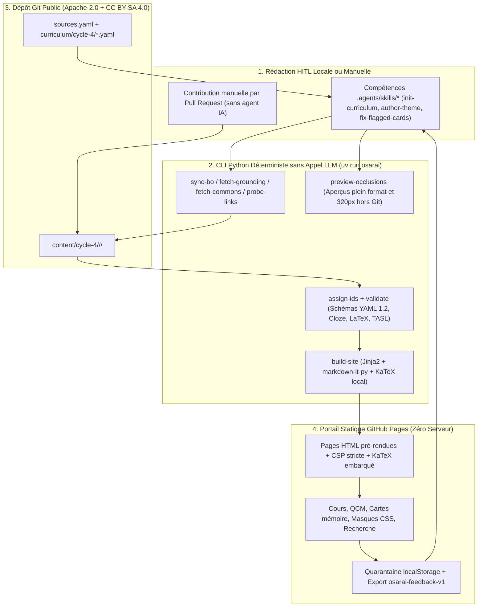

# Osarai (おさらい)

> **Plateforme libre et statique de révisions scolaires pour le Collège**  
> *Conforme aux programmes officiels de l'Éducation nationale — Pilote 5ème (Cycle 4)*

[](LICENSE)
[](LICENSE-CONTENT)
[](pyproject.toml)
[](#-périmètre-du-pilote-mvp)
[](#-portail-web-statique-zéro-serveur)

---

## À propos du projet

**Osarai** vient du japonais **おさらい** (*osarai* : *« réviser ses leçons, repasser sur ce que l'on a appris »*), en écho à **Anki** (**暗記**, *mémorisation active*).

Au collège français (11–15 ans), les élèves et parents font face à des plateformes commerciales fermées, à des ressources publiques dispersées entre plusieurs sites et licences, et à un manque de schémas et cartes interactifs indexés par thème du *Bulletin Officiel*.

**Osarai répond à ce besoin par une approche *Content-as-Code* libre et sans serveur :**
- **100 % texte clair sous Git** : fiches de synthèse en Markdown, cartes mémoire (*basic* et textes à trous *Cloze*), QCM corrigés et métadonnées d'illustrations en YAML 1.2 sous licence [`CC BY-SA 4.0`](LICENSE-CONTENT).
- **Questions visuelles à masques d'occultation CSS** : schémas de SVT et cartes de Géographie importés depuis Wikimedia Commons au palier `1280 px`, accompagnés de caches CSS non destructifs contrôlés visuellement avant publication.
- **Rédaction assistée sans coût marginal d'API** : compétences portables `SKILL.md` dans `.agents/skills/` (compatibles Antigravity, Claude Code et OpenAI Codex) exécutées avec validation humaine (*Human-in-the-Loop*, HITL), tout en prenant en charge les contributions manuelles sans agent IA.
- **Outillage Python déterministe sans appel LLM (`osarai`)** : validation hors-ligne des schémas, des formules LaTeX/KaTeX et des licences, attribution monotone d'identifiants permanents et compilation HTML statique via [`uv`](https://docs.astral.sh/uv/).

---

## Architecture « Content-as-Code »



---

## Portail Web Statique (Zéro Serveur)

Déployé sur **GitHub Pages** sans compte utilisateur, sans cookie et sans requête réseau vers un domaine tiers :

1. **Fiche de Synthèse** : résumé structuré du cours, définitions clés, formules rendues par KaTeX auto-hébergé et pièges fréquents au contrôle.
2. **Cartes Mémoire en Ligne** : cartes question/réponse, textes à trous *Cloze* dépliés par indice et schémas occultés zoomables sur mobile, avec filtre *Essentielles / À revoir uniquement*.
3. **Quiz QCM Interactif** : 10 à 20 questions à 4 choix avec explication immédiate et relance des erreurs.
4. **Ressources Externes Vérifiées** : sélection de liens contrôlés (*Lumni*, *Lelivrescolaire.fr*, *Vikidia*, *CoopMaths*, chaînes YouTube éducatives autorisées).
5. **Quarantaine Locale et Signalement** : tout élément signalé est immédiatement écarté de la séance dans `localStorage` et exportable au format `osarai-feedback-v1` (partage mobile ou GitHub Issue) ainsi qu'en sauvegarde locale `osarai-backup-v1.json`.

---

## Périmètre du Pilote MVP

La **Phase 1 (MVP)** cible le niveau pilote **5ème** (*Cycle 4*) sur deux disciplines de référence avant extension aux autres matières et niveaux du collège (`6ème`, `4ème`, `3ème`) :

| Discipline | Niveau Pilote (Phase 1) | Thèmes Pilotes | Extension Collège |
| :--- | :---: | :--- | :---: |
| **SVT (Sciences de la Vie et de la Terre)** | 5ème | *La respiration*, *La digestion* | Cycle 3 (6ème) & Cycle 4 (5ème–3ème) |
| **Histoire-Géographie** | 5ème | *La croissance démographique et ses effets* | Cycle 3 (6ème) & Cycle 4 (5ème–3ème) |

### Feuille de route Phase 2
- **Paquets Anki (`.apkg`) pré-compilés via `genanki`** : diffusion automatisée sur GitHub Releases (et méga-paquets sur AnkiWeb) appuyée sans migration sur les identifiants permanents et noms d'images plats définis dès la Phase 1.
- **Répétition espacée dans le navigateur (*SRS*)** : planificateur *FSRS* / *SM-2* côté client avec file quotidienne de cartes dues et courbe de progression locale.
- **Page dédiée « Mes données & Statistiques »** : espace centralisé de gestion de la progression locale regroupant l'export, l'import, la réinitialisation (*reset* global ou par matière/thème avec confirmation) et les statistiques détaillées d'avancement (cartes maîtrisées / à revoir, scores aux QCM, suivi par classe), permettant d'alléger les raccourcis d'en-tête du MVP.
- **Figures géométriques et schémas SVG par code Python** pour les *Mathématiques* et la *Physique-Chimie*, orchestration par lots bornée, et statistiques d'audience agrégées conformes au référentiel d'exemption de la CNIL.

---

## Arborescence du Dépôt

```text
osarai/
├── LICENSE                             # Licence Apache-2.0 (code, gabarits, compétences, CI)
├── LICENSE-CONTENT                     # Licence CC BY-SA 4.0 (contenus pédagogiques)
├── CONTRIBUTING.md                     # Gouvernance de double licence, core.symlinks et guide
├── AGENTS.md                           # Règles communes aux agents IA (CLAUDE.md -> AGENTS.md)
├── pyproject.toml                      # Configuration Python (>= 3.12) et dépendances uv
├── uv.lock                             # Verrouillage des paquets Python
├── sources.yaml                        # Politique déclarative des domaines et licences
├── docs/designs/
│   └── osarai-mvp-architecture.md      # Spécification d'architecture MVP de référence
├── .agents/skills/                     # Compétences portables (init-curriculum, author-theme, fix-flagged-cards)
├── .claude/skills/                     # Liens symboliques vers ../../.agents/skills/*
├── curriculum/                         # Manifeste BO Éduscol et découpages thématiques par matière
├── content/                            # Dossiers de thèmes validés (YAML + Markdown + WebP)
├── src/osarai/                         # CLI Python déterministe, validateurs et générateur statique
├── tests/                              # Suite de tests unitaires et d'intégration (pytest)
└── .github/                            # Modèle de PR et workflows CI / GitHub Pages / suivi des liens
```

---

## Démarrage Rapide (Développement Local & CLI)

### 1. Prérequis et installation de l'environnement (`Python >= 3.12`)
Aucun outil `Node.js` ni `Ruby` n'est requis ; [`uv`](https://docs.astral.sh/uv/) gère automatiquement l'interpréteur Python et les dépendances verrouillées :

```bash
# Installer uv si nécessaire (Linux / macOS)
command -v uv >/dev/null || curl -LsSf https://astral.sh/uv/install.sh | sh

# Cloner le dépôt (sous Windows, activer d'abord : git config --global core.symlinks true)
git clone https://github.com/Seburan/osarai.git
cd osarai

# Synchroniser l'environnement verrouillé et installer le paquet local en mode éditable
uv sync --frozen --reinstall-package osarai
```

### 2. Vérifier la qualité, les schémas et la suite de tests
```bash
uv run osarai validate
uv run ruff check src/ tests/ && uv run ruff format --check src/ tests/
uv run pytest --cov=src/osarai --cov-branch --cov-fail-under=85
```

### 3. Compiler et tester le portail statique en local
```bash
# Aperçu standard à la racine (http://localhost:8000)
uv run osarai build-site --output dist --base-url ""
uv run python -m http.server -d dist 8000

# Simulation exacte du sous-chemin GitHub Pages (http://localhost:8000/osarai/)
mkdir -p .osarai_tmp/gh_pages_sim
uv run osarai build-site --output .osarai_tmp/gh_pages_sim/osarai --base-url "/osarai"
uv run python -m http.server -d .osarai_tmp/gh_pages_sim 8000
```

### 4. Principales commandes métier (`uv run osarai --help`)
- `uv run osarai assign-ids --theme <chemin>` : attribue les identifiants permanents monotones manquants.
- `uv run osarai preview-occlusions --theme <chemin>` : génère dans `.osarai_tmp/previews/` les aperçus `--full.png` et `--mobile-320w.png`.
- `uv run osarai validate --against-ref origin/main` : valide hors-ligne les schémas YAML 1.2, LaTeX/Cloze, TASL et l'immuabilité Git.
- `uv run osarai check-urls` : vérifie les liens externes de `resources.yaml` (`oEmbed` YouTube et détection Soft-404).

---

## Contribuer & Documentation

Consultez le [Guide de Contribution (`CONTRIBUTING.md`)](CONTRIBUTING.md) et la [Spécification d'Architecture MVP (`docs/designs/osarai-mvp-architecture.md`)](docs/designs/osarai-mvp-architecture.md).

---

## Licences

- **Code source, gabarits, compétences IA et workflows** : [Apache License 2.0](LICENSE) (la bibliothèque embarquée KaTeX conserve sa licence `MIT` dans `vendor/katex/LICENSE`).
- **Contenus pédagogiques (`content/` et `curriculum/`)** : [Creative Commons Attribution - Partage dans les Mêmes Conditions 4.0 International (`CC BY-SA 4.0`)](LICENSE-CONTENT).
- **Illustrations tierces (`content/**/assets/`) et programmes officiels** : chaque illustration conserve sa licence libre d'origine documentée dans `assets.yaml`, et les programmes officiels de l'Éducation nationale relèvent de la *Licence Ouverte Etalab 2.0*.
