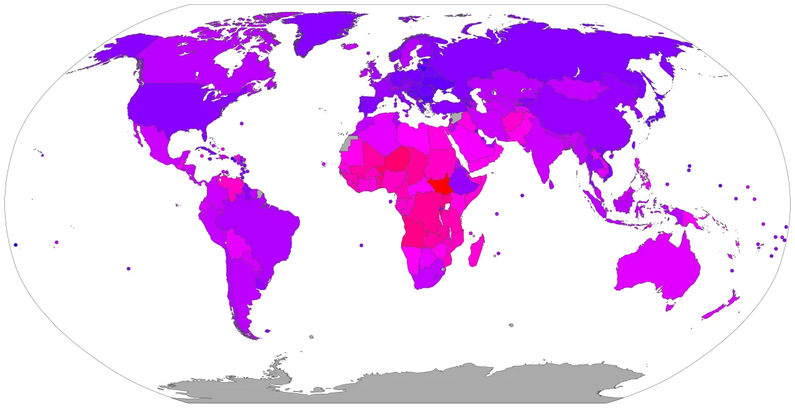
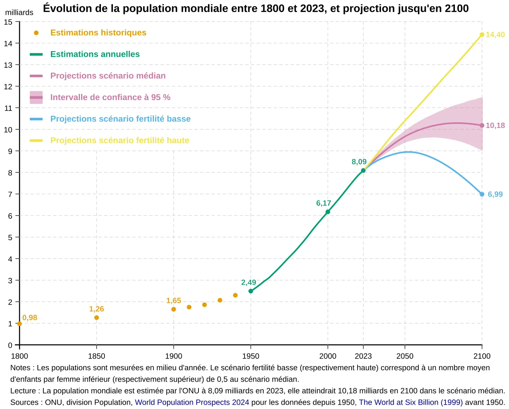

## L'essentiel à retenir

La **population mondiale** a dépassé le cap des **\(8\) milliards d'habitants** (estimée par l'ONU à environ \(8,1\) milliards en 2023, contre \(1\) milliard vers 1800 et \(2,5\) milliards en 1950). Selon le scénario médian des Nations unies, elle devrait atteindre environ **\(9,6\) milliards en 2050** puis plafonner autour de **\(10,2\) milliards vers 2100** : l'humanité continue donc d'augmenter, mais le **rythme annuel de croissance ralentit** à l'échelle mondiale (moins de \(1\,\%\) par an aujourd'hui contre plus de \(2\,\%\) dans les années 1960) grâce aux progrès de l'éducation — en particulier celle des filles —, de la santé et de l'accès à la contraception.

Derrière cette moyenne mondiale se cache une **grande diversité de situations démographiques** entre les territoires :
- **Les puissances émergentes géantes (Inde et Chine)** concentrent chacune plus de \(1,4\) milliard d'habitants. L'**Inde**, devenue le pays le plus peuplé du monde devant la Chine, connaît encore une croissance positive avec une population relativement jeune et une urbanisation rapide, mais de fortes inégalités entre villes dynamiques et campagnes rurales. La **Chine**, marquée par d'anciennes politiques de limitation des naissances, voit désormais sa population stagner puis diminuer et vieillir rapidement.
- **L'Afrique subsaharienne (ex. Nigeria)** enregistre la **plus forte croissance démographique mondiale** (plus de \(2\,\%\) par an) : le recul de la mortalité infantile combiné à une **natalité** encore élevée entraîne une très grande **jeunesse de la population** (près de la moitié des habitants ont moins de 18 ans au Nigeria, futur géant démographique dépassant \(220\) millions d'habitants).
- **Les pays développés (Europe et États-Unis)** connaissent une **croissance faible, nulle voire négative** (comme dans plusieurs États européens) et un **vieillissement de la population** lié à l'allongement de l'**espérance de vie** et à une faible fécondité (les États-Unis conservant toutefois une croissance légèrement plus soutenue que l'Europe).

Ces dynamiques démographiques posent des **défis différents** aux sociétés :
- dans les pays en forte croissance, il faut construire massivement des **écoles**, des **hôpitaux**, des **logements décents**, des réseaux d'eau potable, d'électricité et d'assainissement, créer des emplois pour les jeunes et assurer la sécurité alimentaire ;
- dans les pays vieillissants, il faut financer les **retraites**, adapter les **soins de santé** au grand âge et pallier le manque de main-d'œuvre active.

Pour autant, la croissance démographique est un **défi à relever et non un obstacle fatal** : en s'appuyant sur les **Objectifs de développement durable (ODD)** de l'ONU (notamment l'**ODD 2** *Faim « zéro »*, l'**ODD 3** *Bonne santé et bien-être* et l'**ODD 4** *Éducation de qualité*), les États, les collectivités et les ONG cherchent à concilier amélioration des conditions de vie, réduction des inégalités et respect de l'environnement (**développement durable et équitable**).

## Définitions clés

- **Croissance démographique** : augmentation de l'effectif de la population d'un territoire au cours d'une période donnée (elle dépend de l'accroissement naturel et du solde migratoire).
- **Accroissement naturel (ou solde naturel)** : différence entre le nombre de **naissances** et le nombre de **décès** sur un territoire pendant une année (\(\text{Naissances} - \text{Décès}\), ou \(\text{Taux de natalité} - \text{Taux de mortalité}\)).
- **Fécondité (indice de fécondité)** : nombre moyen d'enfants par femme en âge d'avoir des enfants (le renouvellement des générations dans les pays développés correspond à environ \(2,1\) enfants par femme).
- **Espérance de vie à la naissance** : durée de vie moyenne qu'un nouveau-né peut espérer atteindre si les conditions sanitaires et de mortalité du moment restent inchangées.
- **Vieillissement de la population** : augmentation de la part (en pourcentage) des personnes âgées (souvent \(65\) ans et plus) dans la population totale d'un pays.
- **Indice de développement humain (IDH)** : indicateur synthétique de l'ONU compris entre \(0\) et \(1\) mesurant le niveau de développement d'un pays à partir de **trois critères** : la richesse par habitant, la santé (**espérance de vie**) et le niveau d'**éducation**.
- **Développement durable** : mode de développement qui répond aux besoins des générations présentes sans compromettre la capacité des générations futures à répondre aux leurs, en articulant **trois piliers** : efficacité **économique**, équité **sociale** et protection **environnementale**.

## Schémas et repères

### Contrastes mondiaux du rythme de croissance démographique

À l'échelle planétaire, les taux annuels d'accroissement démographique les plus élevés se concentrent en **Afrique subsaharienne** (dont le **Nigeria**) et dans certaines régions d'Asie du Sud et du Moyen-Orient, tandis que l'**Europe**, l'Asie orientale (**Chine**, Japon) et l'Amérique du Nord affichent des taux faibles ou négatifs.

### Évolution historique (1800–2023) et projections ONU à l'horizon 2100

Très lente jusqu'au XIXe siècle, la croissance de la population mondiale s'est fortement accélérée après 1950 grâce aux progrès médicaux, sanitaires et agricoles, avant d'amorcer un ralentissement progressif au XXIe siècle.

### Comparaison synthétique des espaces repères au programme de 5ème

| Espace géographique | Dynamique démographique actuelle | Principaux enjeux de développement |
| :--- | :--- | :--- |
| **Inde** (puissance émergente) | \(\approx 1,4\) milliard d'hab. (1er rang mondial), croissance modérée qui ralentit | Scolarisation, santé, emploi des jeunes, gestion des métropoles et réduction des écarts villes/campagnes |
| **Chine** (puissance émergente) | \(\approx 1,4\) milliard d'hab., stagnation puis début de baisse | Vieillissement rapide, déséquilibre villes littorales / intérieur rural, enjeux environnementaux |
| **Nigeria** (Afrique de l'Ouest) | \(> 220\) millions d'hab., croissance très rapide et grande jeunesse | Accès de tous à l'école, à l'eau potable, aux soins, au logement (ex. mégapole de Lagos) et à l'alimentation |
| **Europe & États-Unis** | Croissance faible (États-Unis) à quasi nulle/négative (Europe) | Financement des retraites et de la dépendance liés au **vieillissement**, adaptation des services publics |

## Pièges fréquents au contrôle

- **Confondre « ralentissement de la croissance » et « baisse de la population mondiale »** : un taux de croissance mondial plus faible (ex. \(+0,8\,\%\) au lieu de \(+2\,\%\)) reste **positif**, ce qui signifie que le nombre total d'habitants sur Terre **continue d'augmenter** chaque année !
- **Tomber dans le catastrophisme** : une forte croissance démographique crée des tensions sur les équipements et les ressources, mais ce n'est **pas une fatalité** ; le développement économique, l'éducation des filles et les politiques publiques améliorent les conditions de vie et font baisser durablement la fécondité.
- **Opposer de façon simpliste un « Nord riche » et un « Sud pauvre »** : les trajectoires sont très variées entre **pays développés**, **puissances émergentes** (Inde, Chine, Brésil) et **pays les moins avancés (PMA)**, et de fortes inégalités sociales existent **à l'intérieur même de chaque pays** (entre métropoles et campagnes, ou entre quartiers d'une même ville).
- **Confondre PIB et IDH** : le **PIB** ne mesure que la production de richesses économiques, tandis que l'**IDH** prend aussi en compte la **santé** (espérance de vie) et l'**éducation** des habitants.
