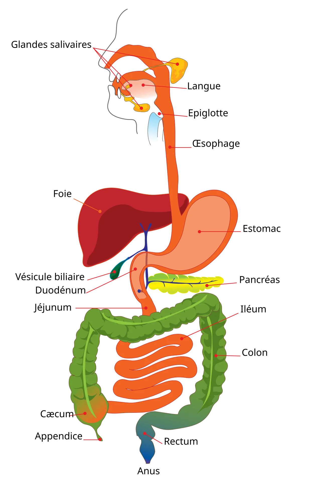
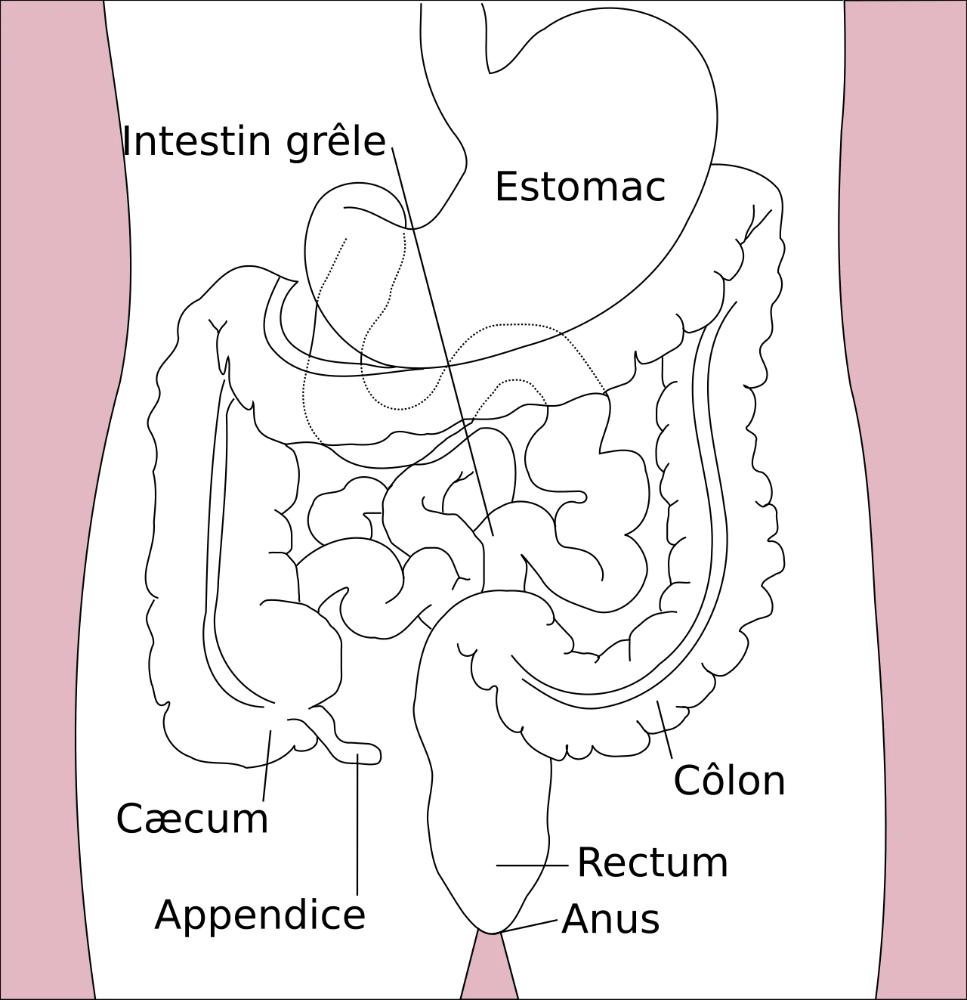

## L'essentiel à retenir

Pour fonctionner, grandir et se renouveler, les cellules de nos organes ont besoin de **nutriments** (comme le glucose) transportés par le sang. Or, la plupart des **aliments** que nous mangeons sont constitués d'éléments trop complexes et insolubles pour traverser directement la paroi du tube digestif : la **digestion** est l'ensemble des transformations qui simplifient ces aliments en **nutriments solubles**.

L'**appareil digestif humain** comprend :
- le **tube digestif**, long conduit continu que traversent les aliments : **bouche** \(\rightarrow\) **œsophage** \(\rightarrow\) **estomac** \(\rightarrow\) **intestin grêle** \(\rightarrow\) **gros intestin (côlon et rectum)** \(\rightarrow\) **anus** ;
- des **glandes digestives** (comme les **glandes salivaires**, la paroi de l'estomac et de l'intestin, le **pancréas** et le **foie** qui fabrique la bile stockée dans la vésicule biliaire) qui déversent des liquides dans le tube digestif **sans que les aliments ne passent à l'intérieur** du foie ou du pancréas.

Au fil de leur progression (assurée par des contractions musculaires appelées **péristaltisme**), les aliments subissent deux actions complémentaires :
1. une **action mécanique** : **mastication** par les dents dans la bouche et **brassage** par les contractions de la paroi de l'estomac et de l'intestin, qui fragmentent les aliments et facilitent le contact avec les liquides digestifs ;
2. une **action chimique** : comme l'ont démontré les expériences historiques de **Réaumur** (tube métallique perforé) et de **Spallanzani** (digestion *in vitro* à \(37\,^\circ\text{C}\)), les **sucs digestifs** (salive, suc gastrique, suc pancréatique, suc intestinal) contiennent des substances actives appelées **enzymes digestives** qui transforment chimiquement les aliments en **nutriments**.

Dans l'**intestin grêle**, les nutriments (ainsi que l'eau et les sels minéraux) traversent la paroi intestinale pour rejoindre le sang : c'est l'**absorption intestinale**. L'intestin grêle est une **surface d'échange** remarquable grâce à ses nombreux replis couverts de millions de **villosités intestinales** à paroi très fine et richement irriguées par des **capillaires sanguins**.

Ce qui n'est pas digéré (comme certaines fibres végétales) passe dans le **gros intestin (côlon)**, où l'eau restante est réabsorbée pour former les **excréments (selles)** évacués par le rectum et l'anus. Tout au long de l'intestin vit un **microbiote intestinal** composé de milliards de micro-organismes non pathogènes qui aident à digérer certains résidus alimentaires, fabriquent des vitamines et protègent l'organisme. Enfin, une **alimentation équilibrée et variée**, adaptée à l'âge et à l'activité physique, prévient les carences comme le surpoids et préserve la santé.

## Définitions clés

- **Tube digestif** : conduit ouvert aux deux extrémités (de la bouche à l'anus) dans lequel circulent et sont transformés les aliments.
- **Suc digestif** : liquide sécrété par un organe ou une glande digestive (salive, suc gastrique, suc pancréatique, suc intestinal) contenant des enzymes digestives.
- **Enzyme digestive** : substance présente dans un suc digestif, capable d'assurer à \(37\,^\circ\text{C}\) la transformation chimique d'aliments complexes en nutriments solubles.
- **Nutriments** : éléments simples et solubles (glucose, acides aminés, etc., ainsi que l'eau, les vitamines et les sels minéraux) issus de la digestion et capables de passer dans le sang pour nourrir les cellules.
- **Absorption intestinale** : passage des nutriments depuis l'intérieur (lumière) de l'intestin grêle vers le sang des capillaires sanguins à travers la paroi intestinale.
- **Villosité intestinale** : minuscule repli microscopique (de \(0,5\) à \(1,5\,\text{mm}\)) tapissant la paroi interne de l'intestin grêle, à paroi très fine et riche en capillaires, qui démultiplie la surface d'absorption.
- **Microbiote intestinal** : ensemble des milliards de micro-organismes (principalement des bactéries bénéfiques) hébergés dans l'intestin et indispensables à une bonne digestion et à la protection de l'organisme.

## Schémas et repères

### Organisation d'ensemble de l'appareil digestif humain

Il est essentiel de distinguer les organes **traversés par les aliments** (bouche, œsophage, estomac, intestin grêle — subdivisé en duodénum, jéjunum et iléum — puis côlon, rectum et anus) et les **organes annexes** (glandes salivaires, foie, vésicule biliaire, pancréas) qui déversent leurs sécrétions dans le tube digestif.

### Repérage de l'estomac, de l'intestin grêle et du gros intestin

Long d'environ \(6\,\text{m}\) et replié au centre de l'abdomen, l'**intestin grêle** est le lieu majeur de la fin de la digestion chimique et de l'**absorption des nutriments** dans le sang, tandis que le **côlon** (gros intestin) qui l'encadre réabsorbe l'eau et concentre les déchets non digérés.

### Bilan des étapes dans le tube digestif

| Organe du tube digestif | Action mécanique | Action chimique / échanges principaux |
| :--- | :--- | :--- |
| **Bouche** | Mastication par les dents, mélange par la langue | Salive (enzymes salivaires) amorçant la digestion |
| **Œsophage** | Progression par contractions (déglutition) | Simple transit vers l'estomac |
| **Estomac** | Brassage puissant de la paroi musculaire | Suc gastrique acide riche en enzymes digestives |
| **Intestin grêle** | Brassage et progression lente | Sucs pancréatique et intestinal + bile ; **absorption des nutriments dans le sang** |
| **Gros intestin (côlon)** | Progression et compactage | Réabsorption d'eau, fermentations par le **microbiote**, formation des selles |

## Pièges fréquents au contrôle

- **Croire que les aliments passent dans le foie ou le pancréas** : jamais ! Ce sont des **glandes annexes** reliées au début de l'intestin grêle par de petits canaux ; seules leurs sécrétions (bile, suc pancréatique) rejoignent le tube digestif.
- **Imaginer un « tuyau imperméable continu » de la bouche à l'anus** : la quasi-totalité d'un aliment digéré ne finit **pas** dans les selles, mais traverse la paroi perméable des **villosités de l'intestin grêle** pour passer dans le **sang** ! Seules les matières non digestibles (fibres) poursuivent jusqu'à l'anus.
- **Penser qu'il existe deux tuyaux séparés pour les solides et les liquides** : eau et aliments empruntent **exactement le même tube digestif** ; l'urine, elle, est fabriquée par les **reins** en filtrant les déchets du **sang** (et non reliée directement à l'estomac).
- **Confondre digestion mécanique et digestion chimique** : broyer un aliment en petits morceaux ne suffit pas à le rendre soluble ; l'action chimique des **enzymes digestives** est indispensable pour obtenir des **nutriments** capables de franchir la paroi intestinale.
- **Croire que tous les microbes sont dangereux** : les bactéries du **microbiote intestinal** sont des alliées indispensables à notre digestion et à notre santé ; une alimentation variée riche en fibres (fruits, légumes, légumineuses, céréales complètes) favorise son équilibre.
