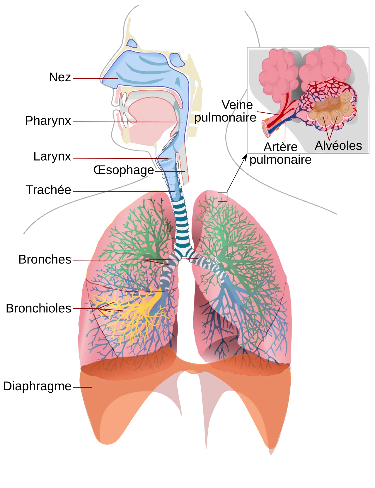
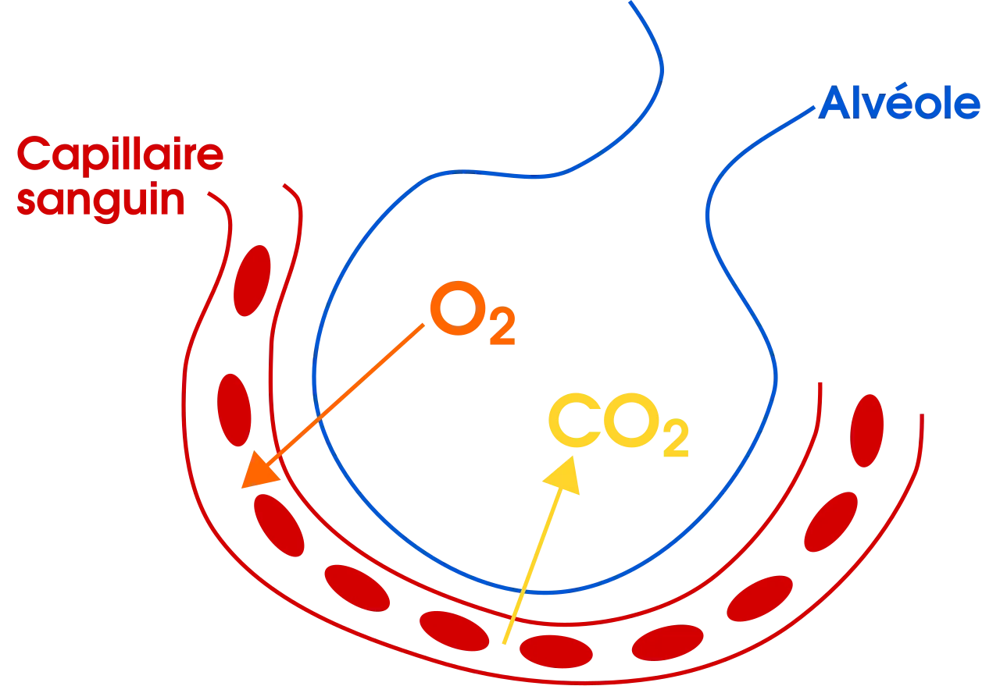

## L'essentiel à retenir

Toutes les cellules de nos organes (et en particulier les cellules musculaires) ont besoin en permanence d'énergie pour fonctionner. Elles produisent cette énergie en réalisant des échanges avec le sang : elles prélèvent du **dioxygène** (\(\text{O}_2\)) ainsi que des **nutriments** (comme le glucose) et rejettent un déchet gazeux, le **dioxyde de carbone** (\(\text{CO}_2\)).

Lors d'un **effort physique**, les muscles travaillent davantage : leurs besoins en \(\text{O}_2\) et en nutriments augmentent, tout comme leurs rejets de \(\text{CO}_2\). L'organisme s'adapte immédiatement en augmentant le **rythme respiratoire** (nombre de mouvements respiratoires par minute) et le **rythme cardiaque** (nombre de battements du cœur par minute), dans la limite de ses capacités maximales.

Chez l'être humain, le renouvellement de l'air dans les **poumons** est assuré par la **ventilation pulmonaire** (inspiration et expiration grâce aux contractions du **diaphragme** et des muscles des côtes). L'air inspiré contient environ \(21\,\%\) de \(\text{O}_2\) et \(0,03\,\%\) de \(\text{CO}_2\), tandis que l'air expiré n'en contient plus qu'environ \(16\,\%\) de \(\text{O}_2\) mais plus de \(4\,\%\) de \(\text{CO}_2\) (le **diazote** \(\text{N}_2\), proche de \(78\,\%\), n'est pas utilisé par l'organisme).

Au bout des **bronchioles**, dans les **alvéoles pulmonaires**, le \(\text{O}_2\) de l'air alvéolaire traverse une paroi extrêmement fine pour passer dans le sang des **capillaires sanguins**, tandis que le \(\text{CO}_2\) fait le trajet inverse du sang vers l'air alvéolaire avant d'être expiré.

Dans le monde animal, l'organe respiratoire dépend du milieu de vie mais repose toujours sur une surface fine et étendue :
- **respiration aérienne** : **poumons** chez les mammifères, oiseaux ou amphibiens adultes ; réseau de **trachées** ramifiées amenant directement l'air aux organes chez les insectes ;
- **respiration aquatique** : **branchies** composées de nombreux filaments riches en vaisseaux sanguins chez les poissons ou les crustacés, permettant de prélever le \(\text{O}_2\) dissous dans l'eau.

Enfin, la fumée de **tabac** (goudrons, nicotine, monoxyde de carbone), le vapotage et les polluants atmosphériques irritent les bronches, détruisent les cils protecteurs, encrassent les alvéoles et diminuent durablement les échanges gazeux tout en favorisant l'asthme, la bronchite chronique et les cancers pulmonaires.

## Définitions clés

- **Ventilation pulmonaire** : alternance d'inspirations (entrée d'air dans les poumons) et d'expirations (sortie d'air) assurant le renouvellement de l'air alvéolaire.
- **Trachée, bronches et bronchioles** : conduits successifs de plus en plus fins acheminant l'air depuis le nez ou la bouche jusqu'aux sacs alvéolaires des deux poumons.
- **Alvéole pulmonaire** : minuscule sac microscopique situé à l'extrémité d'une bronchiole (environ \(300\) millions dans les deux poumons), lieu des échanges gazeux entre l'air et le sang.
- **Capillaire sanguin** : vaisseau sanguin microscopique à paroi très fine entourant chaque alvéole ou traversant les organes, permettant les échanges avec le sang.
- **Surface d'échange** : zone de contact efficace entre deux milieux, caractérisée par trois propriétés : une **très grande surface totale** (environ \(75\,\text{m}^2\) pour l'ensemble des alvéoles humaines), une **paroi très fine** et une **riche irrigation sanguine**.
- **Branchies** : organes respiratoires plumeux et richement vascularisés permettant aux animaux aquatiques (poissons, moules, écrevisses) de prélever le \(\text{O}_2\) dissous dans l'eau.
- **Trachées (chez les insectes)** : fins tubes rigides ouverts sur l'extérieur par des stigmates, conduisant directement l'air jusqu'aux organes sans que le sang transporte les gaz respiratoires.

## Schémas et repères

### Trajet de l'air dans l'appareil respiratoire humain

Lors de l'inspiration, l'air entre par le **nez** (ou la bouche), traverse le **pharynx** puis le **larynx**, descend dans la **trachée**, se répartit dans les deux **bronches** (une par poumon), se ramifie dans les **bronchioles** et aboutit aux **alvéoles pulmonaires**.

### Les échanges gazeux au niveau d'une alvéole pulmonaire

Le sang qui arrive aux alvéoles est pauvre en \(\text{O}_2\) et riche en \(\text{CO}_2\). Au contact de l'air alvéolaire renouvelé, le \(\text{O}_2\) passe de l'alvéole vers le sang du capillaire, tandis que le \(\text{CO}_2\) passe du sang vers l'alvéole : le sang repartant vers les organes est donc enrichi en \(\text{O}_2\) et appauvri en \(\text{CO}_2\).

### Repères expérimentaux à connaître

| Gaz ou réactif | Air inspiré | Air expiré | Mise en évidence au laboratoire |
| :--- | :---: | :---: | :--- |
| Dioxygène (\(\text{O}_2\)) | \(\approx 21\,\%\) | \(\approx 16\,\%\) | Mesuré avec une sonde **oxymétrique** (oxymètre). |
| Dioxyde de carbone (\(\text{CO}_2\)) | \(\approx 0,03\,\%\) | \(\approx 4\,\%\) | Trouble l'**eau de chaux** (initialement limpide). |
| Diazote (\(\text{N}_2\)) | \(\approx 78\,\%\) | \(\approx 78\,\%\) | Quantité inchangée : gaz non utilisé par nos organes. |

## Pièges fréquents au contrôle

- **Confondre « respirer » et « ventiler »** : la ventilation n'est que le mouvement mécanique d'entrée et de sortie d'air dans les poumons ; la respiration désigne les **échanges gazeux** (prélèvement de \(\text{O}_2\) et rejet de \(\text{CO}_2\)) jusqu'aux organes.
- **Croire que l'air expiré ne contient plus du tout de \(\text{O}_2\)** : c'est faux ! L'air expiré contient encore environ \(16\,\%\) de \(\text{O}_2\) (c'est d'ailleurs ce qui rend possible le bouche-à-bouche en secourisme).
- **Écrire que l'air passe directement dans le sang** : ce n'est **pas l'air entier** qui traverse la paroi des alvéoles (sinon des bulles d'air boucheraient les vaisseaux), mais uniquement le gaz **dioxygène dissous** (\(\text{O}_2\)).
- **Confondre trachée humaine et trachées d'insecte** : chez l'humain, il y a **une seule trachée** menant aux bronches et aux poumons ; chez le criquet ou l'asticot, un réseau ramifié de **trachées** distribue l'air directement à tous les organes sans poumons.
- **Oublier l'une des trois caractéristiques d'une surface d'échange** : pour expliquer pourquoi les alvéoles sont efficaces, cite toujours les **trois arguments** ensemble : **grande surface totale**, **finesse de la paroi** et **riche vascularisation** en capillaires sanguins.
