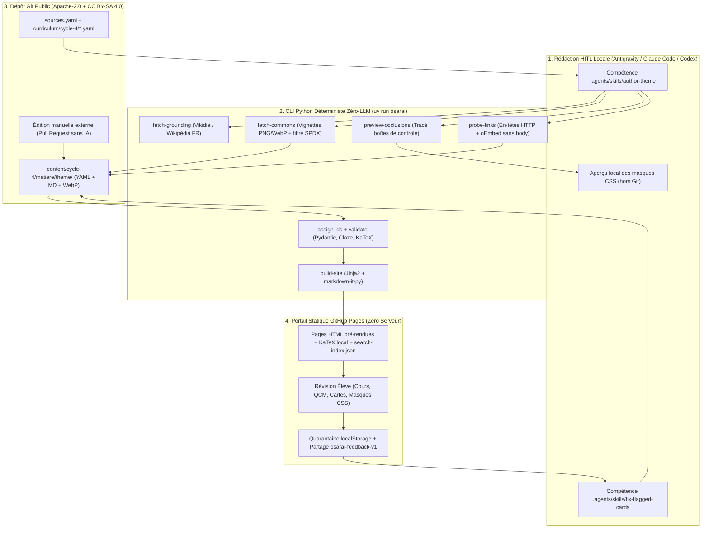

# Osarai MVP : Plateforme Statique de Révisions du Collège Pilotée par Agents IA

*   **Auteur :** Severin Ferrand
*   **Statut :** Proposé (*Proposed*)
*   **Date :** 2026-11-15

--------------------------------------------------------------------------------

## Vue d'ensemble

Osarai est une plateforme libre et statique de révisions scolaires pour les élèves du collège français (11 à 15 ans), lancée en pilote sur le niveau *5ème* (première année du *Cycle 4*, qui regroupe la *5ème*, la *4ème* et la *3ème*) pour préparer les évaluations en classe dans des matières telles que les *SVT* (*Sciences de la Vie et de la Terre* : *La Respiration*, *La Digestion*) et l'*Histoire-Géographie* (Géographie : *La croissance démographique et ses effets*). Tous les cours, cartes mémoire (*flashcards*), questionnaires à choix multiples (*QCM*) et métadonnées d'illustrations sont stockés sous Git dans des fichiers texte YAML et Markdown sous licence Creative Commons Attribution - Partage dans les Mêmes Conditions 4.0 (`CC BY-SA 4.0`), tandis que le code source est sous licence `Apache-2.0`.

Ce document remplace intégralement les quatre ébauches initiales du dépôt (`docs/designs/00-global-architecture.md` à `03-static-web-portal.md`). Au lieu d'appeler des interfaces de programmation (API) payantes de grands modèles de langage (LLM) depuis Python, la rédaction des contenus et la vérification visuelle des schémas et cartes libres issus de Wikimedia Commons s'exécutent de manière interactive avec validation humaine (*Human-in-the-Loop*, ou HITL) grâce à des compétences portables au format standard `SKILL.md` versionnées dans le dépôt (`.agents/skills/`). L'auteur principal les exécute dans Antigravity sur son forfait Gemini existant, et les contributeurs externes peuvent appliquer exactement le même principe avec leur propre forfait existant dans **Antigravity (Gemini), Claude Code (Claude) ou OpenAI Codex (ChatGPT/Codex)**, sans facturation d'API à l'usage.

En complément, une interface en ligne de commande (CLI) Python autonome et sans aucun appel LLM (`osarai`) valide les schémas de données, contrôle les licences, attribue des identifiants permanents et compile des pages HTML statiques pré-rendues déployées sur GitHub Pages, sans serveur dorsal, sans compte utilisateur et sans traceur tiers. Cet outillage Python est géré avec [`uv`](https://docs.astral.sh/uv/), un gestionnaire moderne tout-en-un de projets, de bibliothèques et d'environnements virtuels Python (écrit en Rust) qui remplace à la fois `pip` et `venv`, installe automatiquement la version requise de Python si elle est absente de la machine et garantit des exécutions reproductibles via un fichier de verrouillage (`uv.lock`).

## Le Problème

### État de l'art et limites actuelles

Les familles et enseignants du collège se heurtent à quatre limites dans les outils de révision existants :

1.  **Plateformes EdTech commerciales** (*Kartable*, *SchoolMouv*, *Maxicours*) : payantes sur abonnement, fermées, sans export ouvert ni identifiants stables permettant la répétition espacée.
2.  **Ressources gratuites publiques ou éditoriales** (*Lumni*, *Lelivrescolaire.fr*, *Vikidia*, *CoopMaths*) : contenus de référence mais dispersés entre plusieurs sites, sans banque unifiée de cartes mémoire actives ni de *QCM* corrigés. De plus, *Lelivrescolaire.fr* diffuse ses manuels sous licence non commerciale (`CC BY-NC-SA`), que les règles Creative Commons interdisent de fusionner dans une œuvre dérivée sous `CC BY-SA 4.0`, tandis que *Lumni* est sous droits réservés.
3.  **Outils libres de la Forge des Communs Numériques Éducatifs** (*cartesMD*, *Markpage*) : fournissent des moteurs d'affichage unitaires à partir d'un fichier Markdown isolé, mais pas un portail multi-matières structuré sur les programmes officiels avec recherche transversale et signalement d'erreurs.
4.  **Paquets partagés Anki existants** : très développés en France pour les études de santé et les classes préparatoires, mais quasi absents, non vérifiés, purement textuels pour le collège, et non organisés par cycle officiel ou par thème — ce qui complique le ciblage des révisions pour un contrôle précis.

### Limites des quatre ébauches initiales d'Osarai

La confrontation des quatre documents initiaux avec l'usage réel dès le premier jour — une élève de *5ème* de 12 ans révisant ses contrôles hebdomadaires avec son parent — a mis en évidence cinq blocages concrets :

*   **Coût API récurrent face aux forfaits d'agents IA existants** : orchestrer en Python le kit logiciel `google-genai` et les agents autonomes `deep-research` entraîne un coût par chapitre (jusqu'à 1 \$ à 7 \$ par exécution) et consulte librement des pages propriétaires susceptibles de contaminer la licence `CC BY-SA 4.0`, alors que la rédaction interactive dans un agent de code (Antigravity, Claude Code, Codex) s'impute directement sur le forfait déjà souscrit par l'auteur ou le contributeur.
*   **Progression pluriannuelle non séquentielle du Cycle 4** : les *Bulletins Officiels (BO)* et les *Repères annuels de progression* publiés sur *Éduscol* par le ministère de l'Éducation nationale définissent plusieurs disciplines du *Cycle 4* (*SVT*, *Physique-Chimie*, *Technologie*, *Mathématiques*) sur trois ans plutôt qu'en chapitres nationaux numérotés (`Chapitre 1, 2, 3`). Figer l'année et un numéro de chapitre dans les dossiers et identifiants casse les URL et l'historique des cartes dès qu'un enseignant traite un thème dans un autre ordre ou une autre année du cycle.
*   **Paradoxe des schémas et cartes pédagogiques** : les contrôles de sciences et de géographie reposent sur des schémas et des cartes, or la quasi-totalité des illustrations francophones sur Wikimedia Commons affichent directement le nom des organes ou territoires sur l'image — dévoilant la réponse si l'image est affichée telle quelle au recto d'une question, tandis que les fonds de cartes ou schémas muets libres sont rares.
*   **Blocage du signalement d'erreurs pour un enfant de 12 ans** : s'appuyer uniquement sur l'ouverture d'une URL GitHub Issues pré-remplie (`/issues/new`) échoue lorsqu'une élève de 12 ans (en dessous de l'âge minimal de 13 ans des conditions d'utilisation de GitHub et du seuil de consentement numérique de 15 ans du *RGPD* — Règlement Général sur la Protection des Données — en France) révise sur une tablette non connectée à GitHub, et échoue avec une erreur `HTTP 414 URI Too Long` dès qu'une dizaine de notes accentuées en français sont encodées dans l'URL.
*   **Automatisation prématurée** : construire un juge automatique par IA noté sur 100, un exécuteur par lots sur toute une matière et trois niveaux de compilation binaire Anki (`.apkg`) avant d'avoir éprouvé 3 à 5 thèmes réels avec une élève ajoute du code non validé alors que les révisions initiales se font intégralement dans le navigateur web.

### Approche retenue, coûts et critères de réussite du pilote

*   **Nouvelle approche** : séparer strictement **la rédaction assistée par agent IA avec validation humaine (HITL)** (compétences portables dans `.agents/skills/` compatibles Antigravity, Claude Code et Codex, ancrées sur des extraits officiels sous *Licence Ouverte Etalab 2.0* et des sources compatibles `CC BY-SA 4.0`) et **l'outillage Python déterministe sans LLM** (`osarai` validant les schémas, contrôlant les licences, superposant des masques d'occultation CSS non destructifs sur les schémas et cartes Wikimedia Commons et pré-générant les pages HTML statiques).
*   **Coût en ressources** : 0 \$ de coût marginal d'API LLM (couvert par le forfait existant de l'auteur ou du contributeur sous Antigravity, Claude ou Codex), 0 \$ d'hébergement et d'intégration continue (dépôt public GitHub, GitHub Actions et GitHub Pages), et un seul environnement logiciel local (`Python 3.12+` via [`uv`](https://docs.astral.sh/uv/), sans `Node.js` ni `Ruby`).
*   **Examen de validation du pilote (critères mesurables)** :
    1.  Rédiger et publier 3 à 5 thèmes autonomes de *5ème* couvrant au minimum les *SVT* (*La Respiration*, *La Digestion*) et la *Géographie* (*La croissance démographique et ses effets*), avec zéro notion hors-programme de niveau lycée et 100 % des crédits *TASL* (*Title, Author, Source URL, License* — Titre, Auteur, URL source, Licence) vérifiés automatiquement.
    2.  Mener des séances réelles de révision parent-enfant sur tablette ou téléphone où toute carte ou question défectueuse repérée est immédiatement mise en quarantaine localement en un clic et transmise à la compétence de correction de l'agent IA du parent sans connexion GitHub sur l'appareil de l'élève.
    3.  Exécuter 100 % des validations déterministes hors-ligne (schémas, formules MathJax/KaTeX, textes à trous *Cloze* et nommage plat des images) sur chaque *Pull Request* en moins de 30 secondes afin que la compilation Anki `.apkg` en Phase 2 ne nécessite aucune migration des fichiers YAML ou des images.

## Objectifs

*   **Remplacer intégralement les ébauches initiales** : supprimer `docs/designs/00-global-architecture.md` à `03-static-web-portal.md` et aligner `README.md`, `LICENSE-CONTENT` et `CONTRIBUTING.md` sur cette architecture MVP unique.
*   **Structurer les cours en unités thématiques par cycle** : organiser les contenus en thèmes autonomes (`content/cycle-4/<matiere>/<slug-theme>/`, et `content/cycle-3/` pour la *6ème*) étiquetés avec le repère annuel indicatif (`reperes_level: 5eme | 4eme | 3eme`) et les limites explicites du programme (`scope_exclusions`), testés en mode HITL sur 3 à 5 thèmes de *5ème* (*La Respiration*, *La Digestion*, *La croissance démographique et ses effets*).
*   **Produire les contenus sans coût marginal d'API via des compétences portables** : fournir les compétences au standard `SKILL.md` dans `.agents/skills/` (`init-curriculum`, `author-theme` et `fix-flagged-cards`), utilisables aussi bien dans Antigravity (forfait Gemini) que dans Claude Code (forfait Claude) ou OpenAI Codex (forfait ChatGPT/Codex), appuyées sur des extraits officiels *Etalab 2.0* vérifiés et versionnés dans `curriculum/` (~1 000 à 2 000 jetons par thème).
*   **Garantir la conformité stricte à la licence `CC BY-SA 4.0`** : appliquer mécaniquement en Python les règles de `sources.yaml` pour que les textes d'appui et images intégrées proviennent exclusivement de licences compatibles `CC BY-SA 4.0` (*Etalab 2.0*, `CC0`, Domaine public, `CC BY`, `CC BY-SA` vérifiées via identifiants *SPDX* — *Software Package Data Exchange*), tandis que les sites `CC BY-NC-SA` (*Lelivrescolaire.fr*) ou propriétaires (*Lumni*, *YouTube*) ne sont interrogés que sur leurs en-têtes HTTP ou `oEmbed` pour les liens externes de `resources.yaml`.
*   **Permettre les questions visuelles (schémas et cartes) sans dévoiler la réponse** : télécharger des rendus matriciels francisés de Wikimedia Commons (`<= 150 Ko`, noms de fichiers plats préfixés par thème) et supporter des masques d'occultation CSS en pourcentage (`occlusions: [{x, y, w, h}]`) contrôlés via un aperçu visuel HITL avant validation.
*   **Fournir une CLI Python unique et sans LLM (`osarai`)** : gérer la validation, l'attribution monotone des identifiants (`card_id` et `question_id`), les utilitaires médias/liens et la génération HTML statique (`Jinja2` + `markdown-it-py`) uniquement avec `Python` et [`uv`](https://docs.astral.sh/uv/), permettant l'intégration continue hors-ligne et les contributions manuelles sans aucun agent IA.
*   **Déployer un portail web statique adapté aux mineurs et sans pistage** : compiler une vraie page HTML par thème (URL propres, aperçus de liens dans les messageries et indexation par les moteurs de recherche) avec KaTeX auto-hébergé localement (aucune requête vers un réseau de diffusion tiers), recherche transversale sur le *Cycle 4* insensible aux accents, filtre de révision `"À revoir"`, mise en quarantaine locale immédiate des cartes signalées, et partage en un clic (Web Share / presse-papiers) complété par un lien GitHub Issue plafonné à `5 500` octets.

## Hors-Périmètre (Non-Objectifs)

*   **Aucun kit logiciel LLM payant ni clé API** : aucune dépendance `google-genai`, aucun fichier secret `.env`, ni banc d'essai `deep-research` dans le code Python.
*   **Aucune chaîne d'outils `Node.js` ou `Ruby`** : aucun `package.json`, `node_modules`, Astro ou Jekyll dans le dépôt ou l'intégration continue.
*   **Aucune orchestration automatique par lots en Phase 1 (MVP)** : la génération sans surveillance sur une matière entière et les sous-agents critiques isolés sont reportés en Phase 2 après validation sur de vrais contrôles de *5ème*.
*   **Aucun évaluateur par juge IA sur 100 ni boucle `--auto-fix`** : `evaluator.py` et `eval.yaml` sont exclus du MVP ; les contrôles structurels et pédagogiques déterministes s'exécutent dans `osarai validate`.
*   **Aucune compilation binaire Anki `.apkg` (`genanki`) dans le MVP** : la génération des paquets `.apkg` et leur diffusion sur GitHub Releases / AnkiWeb sont reportées en Phase 2 (la Phase 1 impose dès le départ des identifiants, noms d'images plats et syntaxes Cloze/MathJax compatibles sans migration).
*   **Aucun tracé SVG programmatique ni génération d'images par IA dans le MVP** : reportés en Phase 2 au profit des schémas et cartes Wikimedia Commons vérifiés avec masques d'occultation CSS.
*   **Aucun serveur dorsal, compte utilisateur, ni outil d'audience dans le MVP (Phase 1)** : zéro base de données distante, authentification ou cookie ; l'ajout d'une mesure d'audience agrégée est reporté après la phase de test (Phase 2, lors de l'ouverture au grand public).

## Parcours Utilisateurs Critiques (CUJ)

### CUJ 1 : Élève de 5ème révisant cours, QCM et schémas/cartes masqués avant un contrôle

*   **Étant donné** : Les thèmes pilotes du *Cycle 4* en *SVT* (*La Respiration*, *La Digestion*) et en *Histoire-Géographie* (*La croissance démographique et ses effets*) sont publiés sur GitHub Pages, et une élève de *5ème* ouvre Osarai sur tablette ou smartphone sans compte, avec le filtre de classe réglé par défaut sur `5ème`.
*   **Quand** : L'élève recherche `"digestion"` ou `"croissance démographique"` (ou parcourt `5ème > SVT` / `5ème > Histoire-Géographie`), lit la *Fiche de Synthèse* pré-rendue en HTML (avec schémas ou cartes légendés en français et formules KaTeX), répond à un *QCM* interactif de 10 à 20 questions, puis révise les cartes mémoire (incluant des textes à trous *Cloze* ainsi que des schémas anatomiques ou cartes géographiques dont les légendes cibles sont couvertes par des masques CSS) en marquant les cartes ratées `"À revoir"`.
*   **Alors** : Les masques d'occultation cachent les légendes cibles et replient le crédit de l'image au recto, puis révèlent le schéma ou la carte complète, l'explication et le crédit *TASL* au retournement ; la sélection `"À revoir"` persiste dans le stockage local versionné du navigateur (`localStorage`) sur plusieurs soirs ; et aucune requête réseau ne part vers un serveur tiers.

### CUJ 2 : Mise en quarantaine d'une question erronée et partage au parent sans compte GitHub

*   **Étant donné** : Lors d'une séance sur une tablette non connectée à GitHub, l'élève (ou son parent à côté d'elle) repère un choix de réponse ambigu ou un masque décalé sur la question `c4-svt-la-respiration-q0004`.
*   **Quand** : L'élève touche **« Signaler une erreur »** sur cet élément, choisit un motif ou saisit une note courte, puis ouvre le tiroir de signalements et touche **« Copier / Partager le signalement »** (ou **« Ouvrir une Issue GitHub »** depuis l'ordinateur connecté du parent).
*   **Alors** : L'élément `c4-svt-la-respiration-q0004` est immédiatement retiré de sa session active de révision dans `localStorage` (indexé par `(item_id, content_hash)` pour réapparaître automatiquement dès qu'une correction publiée modifie son empreinte) ; le partage mobile / presse-papiers produit un bloc structuré `osarai-feedback-v1` directement exploitable par la compétence `fix-flagged-cards` de l'agent IA du parent ou d'un mainteneur (Antigravity, Claude Code ou Codex) ; l'URL GitHub Issue reste plafonnée à `<= 5 500` octets encodés (évitant toute erreur `HTTP 414`) ; et le panier n'est vidé qu'après confirmation explicite.

### CUJ 3 : Rédaction interactive d'un nouveau thème via un agent IA (Antigravity, Claude Code ou Codex — HITL)

*   **Étant donné** : Les attendus et exclusions officiels sous *Etalab 2.0* pour le *Cycle 4* (*SVT*, *Histoire-Géographie*) sont enregistrés dans `curriculum/cycle-4/`, et `sources.yaml` sépare les domaines d'appui compatibles `CC BY-SA 4.0` des domaines réservés aux liens sortants.
*   **Quand** : L'auteur ou un contributeur lance la compétence `.agents/skills/author-theme/SKILL.md` dans son agent IA (Antigravity sur forfait Gemini, Claude Code sur forfait Claude ou Codex sur forfait ChatGPT) pour `la-croissance-demographique-et-ses-effets`, exécute les sous-commandes préfixées `uv run osarai ...` pour récupérer l'article *Vikidia* et les vignettes PNG/WebP francisées de Wikimedia Commons, rédige `meta.yaml`, `summary.md`, `assets.yaml`, `flashcards.yaml` et `quiz.yaml`, inspecte l'aperçu visuel des boîtes d'occultation CSS, vérifie les liens sortants (*Lumni*, *Lelivrescolaire.fr*) via `probe-links` (en-têtes uniquement), puis exécute `uv run osarai validate` et `uv run osarai build-site`.
*   **Alors** : Seuls des textes compatibles `CC BY-SA 4.0` et des images à licence *SPDX* autorisée entrent dans le contexte et dans Git ; les compteurs monotones `card_id` et `question_id` sont incrémentés sans collision ; la relecture visuelle HITL confirme que chaque masque couvre la légende française sans couper les flèches ou repères ; et la fusion sur `main` publie la page HTML pré-rendue via GitHub Actions.

### CUJ 4 : Contribution manuelle externe par Pull Request sans agent IA

*   **Étant donné** : Un enseignant ou parent n'utilisant aucun agent IA (ni Antigravity, ni Claude Code, ni Codex) corrige une formulation dans `content/cycle-4/svt/la-respiration/flashcards.yaml` (ou ajoute une carte manuellement sans renseigner de champ `id`) et ouvre une *Pull Request* sur GitHub.
*   **Quand** : GitHub Actions exécute `.github/workflows/ci.yml` (`uv run osarai validate` et `uv run osarai build-site`, en ne lançant `check-urls` sur le réseau que si `resources.yaml` ou `sources.yaml` est modifié).
*   **Alors** : La validation hors-ligne s'achève en quelques secondes sans blocage lié aux pare-feux des sites publics ; si un identifiant manque ou si une balise Cloze/KaTeX est mal formée, le journal indique le prochain identifiant monotone attendu depuis `meta.yaml` (ou la commande `uv run osarai assign-ids`) avec le fichier et la ligne exacts ; et la contribution sur `content/` relève explicitement de `CC BY-SA 4.0` via `LICENSE-CONTENT` et `CONTRIBUTING.md`.

--------------------------------------------------------------------------------

## Plan Technique (Architecture)

### 1. Vue d'ensemble des flux et séparation des couches

L'architecture découple quatre responsabilités indépendantes :

1.  **Couche d'édition assistée (optionnelle, locale)** : les compétences `SKILL.md` dans `.agents/skills/` guident un agent IA (Antigravity, Claude Code ou Codex) et l'humain (HITL) pour produire ou corriger un thème en s'appuyant exclusivement sur les sous-commandes réseau filtrées de la CLI `osarai`.
2.  **Couche référentielle Git (`Content-as-Code`)** : stocke en texte clair les programmes officiels découpés (`curriculum/`), la politique de sources (`sources.yaml`), et les dossiers de thèmes validés (`content/`).
3.  **Couche déterministe Python (`src/osarai/`)** : pare-feu de licences, téléchargeur de vignettes Wikimedia Commons, générateur d'aperçus d'occultation, validateur hors-ligne (`Pydantic` + `ruamel.yaml`) et compilateur statique (`Jinja2` + `markdown-it-py`).
4.  **Couche de diffusion statique (GitHub Pages)** : pages HTML pré-rendues accompagnées de [`KaTeX`](https://katex.org/) auto-hébergé et d'îlots JavaScript autonomes gérant la progression locale et la quarantaine des signalements :
    *   **[`KaTeX`](https://katex.org/) auto-hébergé** : bibliothèque libre (créée par Khan Academy) qui transforme à l'écran les formules mathématiques ou chimiques écrites en texte LaTeX (`\frac{3}{4}`, `10^6`, `\text{CO}_2`) en formules typographiées nettes, compatibles avec la syntaxe MathJax d'Anki. L'auto-héberger signifie copier ses fichiers et polices dans notre propre site GitHub Pages afin qu'aucune requête ne parte vers un serveur externe.
    *   **Îlots JavaScript (*Islands Architecture*)** : approche où chaque page du site reste du HTML statique ordinaire (le menu et le cours écrit sont lisibles sans JavaScript), et où seuls les blocs nécessitant une interaction (le bloc QCM, le paquet de cartes à retourner, la barre de recherche et la fenêtre de signalement) sont pilotés par de petits scripts ciblés indépendants, plutôt que de transformer tout le site en une lourde application JavaScript.



### 2. Arborescence du dépôt, double licence et portabilité multi-agents

Pour éviter l'effet de la clause 5 de la licence `Apache-2.0` (qui soumet par défaut toute contribution externe à `Apache-2.0`), le dépôt sépare explicitement la licence logicielle de la licence éditoriale :

*   `LICENSE` (`Apache-2.0`) : couvre `src/`, `tests/`, `.agents/`, `.claude/`, `AGENTS.md`, `pyproject.toml` et `.github/`.
*   `LICENSE-CONTENT` (`CC BY-SA 4.0` texte intégral) et `CONTRIBUTING.md` : stipulent explicitement que toute création ou modification sous `content/` et `curriculum/` est soumise sous `CC BY-SA 4.0`, tandis que les fichiers binaires non modifiés dans `content/**/assets/` conservent leur licence *SPDX* d'origine (`CC0-1.0`, `CC-BY-*`, `CC-BY-SA-*`) documentée dans `assets.yaml`.

Pour garantir qu'Antigravity, Claude Code et OpenAI Codex exécutent exactement les mêmes instructions sans duplication de texte :

*   Les compétences canoniques résident dans `.agents/skills/<nom>/SKILL.md` (emplacement natif lu par Antigravity et OpenAI Codex).
*   Le dossier `.claude/skills/<nom>` pointe par lien symbolique relatif (`../../.agents/skills/<nom>`) vers ces mêmes compétences pour Claude Code, et un fichier racine `AGENTS.md` (complété par un lien symbolique `CLAUDE.md -> AGENTS.md`) rappelle les invariants du projet (interdiction de modifier les ID existants, passage obligatoire par `uv run osarai validate`).

```text
osarai/
├── LICENSE                             # Licence Apache-2.0 (code, gabarits, compétences, CI)
├── LICENSE-CONTENT                     # Licence CC BY-SA 4.0 (contenus pédagogiques)
├── CONTRIBUTING.md                     # Règles de contribution et clause de double licence
├── AGENTS.md                           # Consignes communes aux agents IA (CLAUDE.md -> AGENTS.md)
├── README.md                           # Présentation alignée sur l'architecture MVP
├── pyproject.toml                      # Dépendances Python gérées par uv (Python >= 3.12)
├── uv.lock                             # Verrouillage déterministe des paquets Python
├── sources.yaml                        # Politique de domaines et licences SPDX autorisées
├── .agents/
│   └── skills/
│       ├── init-curriculum/SKILL.md    # Découpage HITL d'une matière depuis les PDF Éduscol
│       ├── author-theme/SKILL.md       # Rédaction HITL d'un thème en 2 phases étanches
│       └── fix-flagged-cards/SKILL.md  # Correction ciblée depuis un rapport osarai-feedback-v1
├── .claude/
│   └── skills/                         # Liens symboliques vers ../../.agents/skills/*
├── curriculum/
│   ├── sources/
│   │   └── bo_manifest.yaml            # URL officielles Éduscol, dates et empreintes SHA-256 des PDF BO
│   └── cycle-4/
│       ├── svt.yaml                    # Découpage thématique BO + exclusions hors-programme
│       └── histoire-geographie.yaml
├── content/
│   └── cycle-4/
│       ├── svt/
│       │   ├── la-respiration/
│       │   │   ├── meta.yaml
│       │   │   ├── summary.md
│       │   │   ├── assets.yaml
│       │   │   ├── flashcards.yaml
│       │   │   ├── quiz.yaml
│       │   │   ├── resources.yaml
│       │   │   └── assets/
│       │   │       └── c4-svt-la-respiration--alveoles.webp
│       │   └── la-digestion/
│       └── histoire-geographie/
│           └── la-croissance-demographique-et-ses-effets/
├── src/
│   └── osarai/                         # CLI Python zéro-LLM, schémas Pydantic et gabarits Jinja2
├── tests/                              # Tests unitaires et de bout en bout (pytest)
└── .github/workflows/                  # ci.yml, deploy.yml, link-rot.yml
```

*Remarque sur l'indexation des matières* : aucun fichier d'index redondant n'est placé dans `content/cycle-4/svt/` ou `content/cycle-4/histoire-geographie/`. C'est le fichier `curriculum/<cycle>/<matiere>.yaml` correspondant qui fait office d'index canonique et ordonné des thèmes de la matière : lors de la compilation du site, `site_builder.py` suit l'ordre défini dans `curriculum/` pour lister les thèmes dont le dossier est présent sous `content/`, et `osarai validate` rejette tout dossier de thème sous `content/` qui ne serait pas déclaré dans `curriculum/`.

### 3. Modèles de données et contrats YAML (`schemas.py`)

Tous les fichiers YAML sont lus et écrits via `ruamel.yaml` en mode sûr **YAML 1.2** (`YAML(typ="safe")`) et validés par `Pydantic v2`. L'usage de YAML 1.2 évite le piège classique de YAML 1.1 (`PyYAML`) où des symboles scientifiques ou rapports non quotés comme `NO` (monoxyde d'azote), `ON` ou `1:20` sont silencieusement convertis en booléens ou en entiers sexagésimaux.

#### 3.1 Politique de provenance (`sources.yaml`)

`sources.yaml` distingue deux listes fermées de domaines :

*   **`grounding_and_media_sources`** (`allow_grounding: true` et/ou `allow_embed_media: true`) : domaines dont les textes ou médias peuvent alimenter la rédaction et être intégrés au dépôt, sous réserve d'un identifiant *SPDX* appartenant à la liste blanche stricte `["Etalab-2.0", "CC0-1.0", "Public-domain", "CC-BY-2.0", "CC-BY-2.5", "CC-BY-3.0", "CC-BY-4.0", "CC-BY-SA-2.0", "CC-BY-SA-2.5", "CC-BY-SA-3.0", "CC-BY-SA-4.0"]`. Inclut `eduscol.education.gouv.fr` (ainsi que `eduscol.education.fr` et `education.gouv.fr` pour les PDF du *Bulletin Officiel*), `data.education.gouv.fr`, `fr.vikidia.org`, `fr.wikipedia.org`, `commons.wikimedia.org`, `coopmaths.fr`.
*   **`outbound_only_sources`** (`allow_grounding: false`, `allow_embed_media: false`) : domaines autorisés **uniquement** comme hyperliens externes dans `resources.yaml` (`lumni.fr`, `lelivrescolaire.fr`, `sesamath.net`, `youtube.com` / `youtu.be` restreint à une liste blanche de noms de chaînes `allowed_oembed_authors` tels que *Lumni*, *Yvan Monka*, *Les Bons Profs*, *C'est pas sorcier*).

#### 3.2 Récupération et découpage des programmes officiels (`bo_manifest.yaml` & `curriculum/<cycle>/<matiere>.yaml`)

Sur le portail ministériel Éduscol (par exemple [`https://eduscol.education.gouv.fr/4362/enseigner-au-cycle-4`](https://eduscol.education.gouv.fr/4362/enseigner-au-cycle-4)), les programmes consolidés du *Cycle 4*, les *Attendus de fin d'année* et les *Repères annuels de progression* sont publiés sous forme de fichiers PDF de 30 à 100 pages par discipline (et non d'une API JSON découpée par thème). Leur récupération et leur structuration s'effectuent une seule fois par matière en trois étapes outillées :

1.  **Découverte des liens PDF sur la page Éduscol** : la commande `uv run osarai sync-bo --discover-url https://eduscol.education.gouv.fr/4362/enseigner-au-cycle-4` télécharge la page sommaire (`httpx`) et extrait de manière déterministe toutes les balises `<a href="...pdf">` accompagnées de leur intitulé.
2.  **Téléchargement vérifié et extraction texte hors Git** : les URL des PDF officiels retenus pour une matière (programme du cycle + repères annuels) sont inscrites dans `curriculum/sources/bo_manifest.yaml`. La commande `uv run osarai sync-bo --subject svt` télécharge alors chaque PDF dans `.osarai_tmp/bo_pdfs/` (hors Git pour ne pas alourdir le dépôt de binaires lourds), enregistre/vérifie son empreinte `sha256` dans `bo_manifest.yaml`, et extrait le texte brut page par page via `pypdf` dans `.osarai_tmp/bo_texts/cycle-4-svt.md`.
3.  **Découpage thématique HITL** : la compétence `.agents/skills/init-curriculum/SKILL.md` lit `.osarai_tmp/bo_texts/cycle-4-svt.md` et structure les tranches thématiques légères (~1 000 à 2 000 jetons par thème) versionnées dans `curriculum/cycle-4/svt.yaml`, puis vérifie le résultat avec `uv run osarai validate` :

```yaml
# Contrat de structure : curriculum/cycle-4/svt.yaml
schema_version: 1
cycle: "cycle-4"
subject: "svt"
subject_label: "Sciences de la Vie et de la Terre (SVT)"
bo_sources:
  - title: "Programme du Cycle 4 — SVT (BO n°31 du 30 juillet 2020)"
    url: "https://eduscol.education.gouv.fr/..."
    license_spdx: "Etalab-2.0"
    sha256: "..."
themes:
  - theme_slug: "la-respiration"
    title: "La respiration et les échanges gazeux"
    macro_theme_bo: "Le corps humain et la santé"
    reperes_levels: ["5eme"]
    attendus_bo:
      - "Relier les besoins des cellules d'un organe et l'approvisionnement en dioxygène."
      - "Expliquer le rôle des alvéoles pulmonaires dans les échanges gazeux avec le sang."
    scope_exclusions:
      - "Respiration cellulaire mitochondriale et synthèse d'ATP (programme de Lycée)."
      - "Pressions partielles des gaz et courbes de dissociation de l'hémoglobine."
```

#### 3.3 Contrats des 6 fichiers d'un thème (`content/<cycle>/<matiere>/<slug-theme>/`)

Chaque dossier de thème publié contient exactement six fichiers sources et un sous-dossier optionnel `assets/` :

1.  **`meta.yaml`** :
    *   Identité canonique : `schema_version: 1`, `cycle` (`cycle-3` | `cycle-4`), `subject`, `subject_code` (`svt`, `hg`, `maths`, `pc`, `fr`, `en`, `techno`), `theme_slug`, `title`.
    *   Calibrage pédagogique : `reperes_levels` (liste non vide parmi `6eme`, `5eme`, `4eme`, `3eme`), `scope_exclusions` (copié/affiné depuis `curriculum/`), `qa_status` (`hitl_verified` | `field_tested`).
    *   Notions clés : `key_concepts` — liste d'objets `{concept_id, label, reperes_level}` où chaque `concept_id` est un identifiant court unique au sein du thème (ex. `echanges-alveolaires`).
    *   Traçabilité des sources textuelles : `sources_used` — liste `{title, url, source_domain, license_spdx, revision_or_date}` affichée automatiquement en pied de page pour respecter l'obligation d'attribution `CC BY-SA`.
    *   Compteurs monotones d'identifiants : `last_card_seq: int >= 0` et `last_quiz_seq: int >= 0`. Ces deux entiers mémorisent le dernier numéro attribué et ne diminuent jamais, même si les dernières cartes ou questions sont supprimées. Leur rôle est d'empêcher qu'un identifiant supprimé (par exemple `c0030` retiré car erroné) ne soit réattribué plus tard à une toute nouvelle carte (`c0029 + 1`), ce qui fausserait la quarantaine locale dans le navigateur ou écraserait en Phase 2 l'intervalle de révision Anki d'un élève ayant déjà étudié l'ancienne `c0030` (la nouvelle carte recevra donc `c0031`).
2.  **`assets.yaml`** (liste vide `assets: []` si le thème n'a pas encore d'image) :
    *   Chaque entrée définit : `asset_id` (ex. `alveole-schema`), `filename` devant obligatoirement respecter le motif plat `<code-cycle>-<subject_code>-<theme_slug>--<asset_id>.<webp|png>` (ex. `c4-svt-la-respiration--alveole-schema.webp`, garantissant zéro collision dans le dossier plat `collection.media/` d'Anki en Phase 2), `width` (entier px), `height` (entier px), `sha256`, `commons_title` (`File:...`), `source_url`, `license_spdx`, `license_url`, `author`, `title`, `modifications_note` (optionnel) et `hitl_verified: true`.
3.  **`summary.md`** :
    *   Cours synthétique structuré en sections fixes (`## L'essentiel à retenir`, `## Définitions clés`, `## Schémas et repères`, `## Pièges fréquents au contrôle`).
    *   Formules exclusivement délimitées par `\(...\)` (en ligne) et `\[...\]` (bloc).
    *   Insertion d'illustrations via une syntaxe locale stricte `` pointant vers un fichier déclaré dans `assets.yaml` ; toute URL distante `http://` ou `https://` dans une image est rejetée par `validate`.
4.  **`flashcards.yaml`** (20 à 50 cartes) :
    *   Champs par carte : `id` (`<code-cycle>-<subject_code>-<theme_slug>-c<NNNN>`, ex. `c4-svt-la-respiration-c0001`), `concept_id` (référence obligatoire vers `meta.yaml`), `reperes_level`, `priority` (`essentiel` | `approfondissement`), `type` (`basic` | `cloze`), `front`, `back` (vide uniquement si `type: cloze`, où `front` porte la phrase à trous `{{c1::réponse::indice optionnel}}`), `explanation` (optionnel), `asset_id` (optionnel), `asset_role` (`front_occluded` | `back_reference` | `none`), et `occlusions` (liste d'objets `{id, x, y, w, h, label}` avec `0 <= x, y, w, h <= 100`, `x + w <= 100`, `y + h <= 100`, obligatoire si et seulement si `asset_role == "front_occluded"`).
    *   Invariants syntaxiques et pédagogiques vérifiés par `schemas.py` :
        *   Longueur de réponse concise : avertissement au-delà de `250` caractères et rejet strict au-delà de `500` caractères pour éviter les paragraphes récités par cœur.
        *   Anti-collision Cloze / KaTeX : interdiction formelle pour une balise `{{cN::...}}` de couper un délimiteur `\(...\)` ou `\[...\]` (une formule mathématique ou chimique doit être intégralement englobée dans le trou : `{{c1::\(\text{CO}_2\)}}`), et vérification de l'espace de sécurité avant les doubles accolades fermantes (`{{c1::\frac{1}{2} }}`).
        *   Anti-divulgation Cloze : la chaîne cachée dans `{{cN::réponse}}` (hors mots outils de moins de 3 lettres) ne doit pas réapparaître telle quelle en clair dans le reste du champ `front` ni dans `occlusions[].label`.
5.  **`quiz.yaml`** (10 à 20 QCM) :
    *   Champs par question : `id` (`...-q<NNNN>`, ex. `c4-svt-la-respiration-q0001`), `concept_id`, `reperes_level`, `difficulty` (`facile` | `moyen` | `difficile`), `question`, `choices` (liste de 4 chaînes distinctes après normalisation des espaces), `answer_index` (`0` à `3`), `explanation` (obligatoire, non vide), `asset_id` (optionnel) et `occlusions` (optionnel pour interroger une zone numérotée ou masquée sur une carte ou un schéma).
6.  **`resources.yaml`** (3 à 6 ressources externes) :
    *   Champs par lien : `title`, `url` (HTTPS uniquement, paramètres `utm_*` / `fbclid` / wrappers de redirection interdits), `source_domain` (doit exister dans `sources.yaml`), `type` (`video` | `cours` | `exercice` | `article`), `author_or_channel` (obligatoire pour YouTube et vérifié contre `allowed_oembed_authors`), et `last_verified_at` (date ISO `YYYY-MM-DD`).

### 4. CLI Python déterministe (`osarai`) et contrat de sous-commandes

Pour faciliter l'approbation par préfixe des commandes réseau dans le bac à sable (*sandbox*) des agents IA sans ouvrir d'accès arbitraire à Internet, toutes les opérations passent par le préfixe fixe `uv run osarai <verbe>`, acceptent `--json` pour renvoyer des diagnostics structurés concis, et utilisent des codes de sortie typés :

*   `0` : Succès.
*   `2` : Erreur de validation de schéma, d'identifiant ou de règle pédagogique.
*   `3` : Limitation de débit distante (`HTTP 429`), incluant `retry_after_seconds` dans la sortie JSON.
*   `4` : Violation de la politique de licence ou de domaine (`sources.yaml`).
*   `5` : Ressource distante introuvable (`404` / `410` / Soft-404).

| Sous-commande | Réseau | À quoi sert la commande (usage concret) | Garde-fous techniques |
| :--- | :---: | :--- | :--- |
| `uv run osarai sync-bo [--discover-url <url>] [--subject <matiere>]` | Oui (`*.education.gouv.fr`) | **Récupérer et extraire les programmes officiels (une seule fois par matière)** : liste les liens PDF d'une page Éduscol (ex. `enseigner-au-cycle-4`) avec `--discover-url`, ou télécharge les PDF officiels déclarés dans `bo_manifest.yaml`, vérifie leur `sha256` et les convertit en texte Markdown local (`.osarai_tmp/bo_texts/`) pour préparer `curriculum/<cycle>/<matiere>.yaml`. | Confiné aux domaines officiels `*.education.gouv.fr` / `eduscol.education.fr` (*Etalab 2.0*), stockage des PDF lourds hors Git (`.osarai_tmp/bo_pdfs/`) et extraction locale déterministe (`pypdf`). |
| `uv run osarai fetch-grounding --url <url>` | Oui (Liste A) | **Récupérer la documentation source d'un cours** : télécharge le texte propre d'un article encyclopédique libre (*Vikidia* ou *Wikipédia FR*) pour servir de base factuelle à l'agent IA lors de la rédaction d'un thème. | Refuse tout domaine absent de `grounding_and_media_sources` (`allow_grounding: true`), passe par l'API MediaWiki, supprime le HTML/scripts et renvoie la licence *SPDX*. |
| `uv run osarai fetch-commons --file <File:...> --theme <chemin> --asset-id <slug>` | Oui (`wikimedia.org`) | **Importer un schéma ou une carte libre** : télécharge une illustration depuis Wikimedia Commons en version française, vérifie que sa licence est autorisée, la redimensionne et enregistre automatiquement ses crédits d'auteur dans `assets.yaml`. | Envoie un `User-Agent` conforme Wikimedia, demande le rendu francisé (`iiurlwidth=1200&iiurlparam=langfr-1200px`), filtre la licence *SPDX*, nettoie le HTML des métadonnées et compresse en WebP/PNG `<= 150 Ko` (`Pillow`) sous nom plat préfixé. |
| `uv run osarai preview-occlusions --theme <chemin>` | Non | **Contrôler visuellement les masques sur un schéma** : génère une image de vérification temporaire où les boîtes cachées `{x, y, w, h}` sont dessinées en rouge par-dessus le schéma, pour vérifier avant publication que les étiquettes sont bien couvertes sans couper les flèches. | Écrit uniquement hors dépôt Git (`.osarai_tmp/previews/`) afin de ne jamais polluer l'historique avec des images de travail. |
| `uv run osarai probe-links --url <url> [...]` | Oui (Liste A+B) | **Vérifier les liens externes (« Pour aller plus loin »)** : teste que les vidéos ou pages d'exercices candidats (*Lumni*, *Lelivrescolaire.fr*, *YouTube*) existent réellement et ne tombent pas sur une page supprimée avant de les inscrire dans `resources.yaml`. | Lecture HTTP limitée à 64 Ko (`httpx`), 2 requêtes max par domaine, test `youtube.com/oembed`, rejet des Soft-404. **Ne renvoie jamais le texte `<body>`** (uniquement URL canonique, statut et titre) pour empêcher toute copie de contenu non libre. |
| `uv run osarai assign-ids --theme <chemin>` | Non | **Numéroter automatiquement les nouvelles cartes et questions** : attribue un identifiant permanent (`c0001`, `q0001`...) à toute carte ou question fraîchement créée (par un agent IA ou un contributeur humain) qui n'en possède pas encore. | Préserve la mise en forme YAML (`ruamel.yaml`), part strictement de `last_card_seq + 1` / `last_quiz_seq + 1` et incrémente `meta.yaml` sans jamais toucher aux ID existants. |
| `uv run osarai validate [--theme <chemin>] [--check-git-head]` | Non | **Vérifier qu'un thème (ou tout le dépôt) est sans erreur technique** : contrôle hors-ligne la validité des fichiers YAML, des formules mathématiques, des textes à trous, des images et des licences avant un commit ou sur une *Pull Request*. | Vérifie les schémas Pydantic, la couverture à 100 % des `concept_id`, l'absence de conflit Cloze/KaTeX, le `sha256` des images, et (avec `--check-git-head` en CI) bloque tout renommage ou suppression silencieuse d'ID existant sur `main`. |
| `uv run osarai check-urls [--diff <ref>] [--json-report <chemin>]` | Oui | **Détecter les liens externes devenus morts dans le temps** : re-teste sur Internet les liens déjà publiés dans `resources.yaml` (soit uniquement ceux modifiés dans une PR avec `--diff`, soit sur tout le dépôt une fois par semaine). | Réutilise le moteur anti-Soft-404 et `oEmbed` de `probe-links` et distingue les pannes temporaires (`429`/`5xx`) des pages définitivement supprimées (`404`/`410`). |
| `uv run osarai build-site [--output dist] [--base-url /osarai]` | Non | **Construire le site web complet prêt à publier** : transforme tous les cours, QCM, cartes mémoire et schémas en un dossier `dist/` de pages HTML statiques consultables localement ou déployables sur GitHub Pages. | Compile les gabarits `Jinja2` + `markdown-it-py`, déplie les cartes Cloze multi-trous, génère `search-index.json` sans accents et copie localement les fichiers KaTeX sans appel réseau. |

### 5. Compétences portables d'agents IA (`.agents/skills/`)

Les trois compétences du MVP sont écrites comme des protocoles d'exécution déterministes compatibles avec Antigravity, Claude Code et Codex :

1.  **`init-curriculum` (`.agents/skills/init-curriculum/SKILL.md`) — Initialisation d'une matière depuis Éduscol** :
    *   Exécutée une seule fois lors de l'ouverture d'une nouvelle matière (ex. *SVT* ou *Histoire-Géographie* au *Cycle 4*).
    *   Lance `uv run osarai sync-bo --discover-url https://eduscol.education.gouv.fr/4362/enseigner-au-cycle-4`, retient avec validation humaine (HITL) les PDF officiels de la discipline (programme consolidé + repères annuels / attendus), les inscrit dans `curriculum/sources/bo_manifest.yaml`, exécute `uv run osarai sync-bo --subject <matiere>` pour télécharger les PDF et extraire leur texte officiel dans `.osarai_tmp/bo_texts/`, puis rédige `curriculum/<cycle>/<matiere>.yaml` et valide le schéma via `uv run osarai validate`.
2.  **`author-theme` (`.agents/skills/author-theme/SKILL.md`) — Protocole étanche en 2 phases** :
    *   **Phase 1 — Cadrage, visuels et rédaction sous `CC BY-SA 4.0`** :
        1.  Lire la tranche du thème dans `curriculum/<cycle>/<matiere>.yaml` (attendus + exclusions hors-programme).
        2.  Récupérer le texte d'appui via `uv run osarai fetch-grounding` (en privilégiant *Vikidia FR* pour le calibrage collège, et *Wikipédia FR* uniquement en complément factuel borné par `scope_exclusions`).
        3.  Rechercher 1 à 3 schémas ou cartes pertinents sur Wikimedia Commons, les importer via `uv run osarai fetch-commons`, et inspecter visuellement le fichier `.webp`/`.png` téléchargé pour vérifier la lisibilité et la langue française.
        4.  Rédiger `meta.yaml`, `summary.md`, `flashcards.yaml` (avec coordonnées `occlusions` sur les cartes visuelles) et `quiz.yaml`.
        5.  Exécuter `uv run osarai preview-occlusions`, inspecter visuellement les aperçus générés, ajuster les coordonnées `{x, y, w, h}` si une étiquette dépasse ou coupe une flèche, et demander la validation humaine (HITL) des aperçus et du périmètre.
    *   **Phase 2 — Sélection isolée des ressources externes (`resources.yaml`)** :
        1.  Uniquement **après** l'enregistrement de `summary.md`, `flashcards.yaml` et `quiz.yaml` (afin qu'aucun contenu externe ne puisse influencer leur rédaction), rechercher 3 à 6 liens pédagogiques externes (*Lumni*, *Lelivrescolaire.fr*, *Vikidia*, *CoopMaths*, chaînes YouTube autorisées) et les soumettre à `uv run osarai probe-links`.
        2.  Écrire `resources.yaml` à partir des URL canoniques validées (`status == 200`), puis exécuter `uv run osarai assign-ids`, `uv run osarai validate` et `uv run osarai build-site`.
3.  **`fix-flagged-cards` (`.agents/skills/fix-flagged-cards/SKILL.md`)** :
    *   Prend en entrée un bloc texte/JSON `osarai-feedback-v1` collé par le parent (ou issu d'une Issue GitHub).
    *   Localise chaque élément par son `id` immuable, vérifie si le `content_hash` signalé correspond toujours à la version courante, corrige le texte, les choix QCM ou le masque `occlusions` **sur place en conservant le même `id`**, relance `preview-occlusions` si nécessaire et valide via `uv run osarai validate`.

### 6. Portail Web Statique (`Jinja2` + KaTeX auto-hébergé + Îlots JS/CSS modernes)

Lors de la construction (`uv run osarai build-site`), le module `site_builder.py` pré-génère une arborescence HTML complète sans serveur :

*   **Pages HTML pré-rendues et référencement** :
    *   `dist/index.html` : accueil présentant le sélecteur de classe (`6ème`, `5ème`, `4ème`, `3ème`), la barre de recherche transversale et l'accès direct aux matières disponibles.
    *   `dist/<cycle>/<matiere>/index.html` : liste des thèmes de la matière filtrable par repère annuel (`5ème` par défaut).
    *   `dist/<cycle>/<matiere>/<slug-theme>/index.html` : page complète du thème contenant des balises `<title>`, `<meta name="description">` et OpenGraph (`og:title`, `og:description`) propres au thème (assurant des aperçus explicites dans WhatsApp/Messages et une indexation directe sur les moteurs de recherche). L'onglet *Fiche de Synthèse* est converti en HTML dès le build via `markdown-it-py` + plugin `texmath` (protégeant les expressions `\(...\)` et `\[...\]` contre l'interprétation des tirets bas `_` en italique Markdown), et le pied de page génère automatiquement le bloc légal *« Sources et crédits CC BY-SA 4.0 »* à partir de `meta.yaml` et `assets.yaml`.
*   **Zéro requête tierce (conformité RGPD mineurs)** :
    *   Les fichiers `katex.min.js`, `katex.min.css` et les polices `.woff2` sont embarqués localement dans le dépôt et copiés dans `dist/assets/vendor/katex/`. Aucune police Google Fonts, aucun CDN externe et aucun script de suivi ne sont chargés.
*   **Expansion Cloze, masques d'occultation CSS et îlots interactifs** :
    *   Au moment du build, `site_builder.py` intègre dans chaque page de thème un bloc `<script type="application/json" id="theme-data">` contenant les QCM et les cartes mémoire pré-traitées : une note Cloze comportant `K` indices distincts (`{{c1::...}}`, `{{c2::...}}`) est dépliée en `K` cartes de révision indépendantes (`<card_id>#c1`, `<card_id>#c2`), et chaque élément reçoit une empreinte courte `content_hash` (8 premiers caractères hexadécimaux du SHA-256 de son contenu normalisé) ainsi que le `build_sha` Git courant.
    *   Les schémas masqués sont affichés dans un conteneur CSS verrouillé par `aspect-ratio: <width> / <height>` sur lequel chaque entrée de `occlusions` superpose un `<div>` positionné en pourcentages (`left: x%`, `top: y%`, `width: w%`, `height: h%`). Au recto, les boîtes sont opaques et le crédit *TASL* est replié dans une balise native `<details>` intitulée *« Crédits de l'illustration »* (sans exposer le titre du fichier) ; au retournement (ou après validation du QCM), les boîtes deviennent transparentes avec un contour discret et le crédit complet est affiché.
    *   Tous les composants HTML/CSS/JS côté client (navigation clavier, retournement de carte, tiroir natif `<dialog>`, thème clair/sombre respectant `prefers-color-scheme`, cibles tactiles mobiles `>= 44px`) sont implémentés en suivant les guides de la compétence `modern-web-guidance`.
*   **Recherche transversale Cycle 4 (`dist/search-index.json`)** :
    *   `site_builder.py` génère un fichier unique `dist/search-index.json` (`< 150 Ko` même à l'échelle de 350 thèmes) contenant uniquement `{url, cycle, subject_label, title, reperes_levels, concepts_text_normalized}` où les chaînes sont pré-normalisées sans accents (`unicodedata.normalize("NFKD")` en Python) afin qu'une saisie élève `"alveole"` ou `"demographie"` trouve instantanément le thème correspondant même s'il est rattaché à une autre année du *Cycle 4*.
*   **Persistance `localStorage`, quarantaine immédiate et export double canal** :
    *   Les clés navigateur sont préfixées et versionnées : `osarai:v1:grade` (classe active, `5eme` par défaut), `osarai:v1:progress:<theme_slug>` (état `"connu"` / `"a_revoir"` par carte et score QCM) et `osarai:v1:flags` (liste d'objets `{theme_slug, item_id, item_type, content_hash, build_sha, reason, note, flagged_at}`).
    *   Dès qu'un élément figure dans `osarai:v1:flags` avec un `content_hash` identique à celui de la page courante, l'îlot JS le retire immédiatement de la pile active de révision (*quarantaine locale*). Si une mise à jour ultérieure du site modifie le texte ou le masque de cet élément, son `content_hash` change : la carte réintègre automatiquement les révisions et l'entrée du panier est marquée *« Corrigée depuis votre signalement »*.
    *   Le tiroir `<dialog>` de signalement propose :
        1.  **« Copier / Partager le signalement »** : invoque `navigator.share({ title, text })` sur tablette/mobile (AirDrop, Messages, WhatsApp, courriel vers le parent) ou copie dans le presse-papiers un bloc Markdown/JSON balisé `osarai-feedback-v1`.
        2.  **« Ouvrir une Issue GitHub »** : construit l'URL `/issues/new?title=...&body=...` en mesurant la taille réelle encodée (`encodeURIComponent`). Si l'URL dépasse `5 500` octets, le script copie automatiquement le rapport complet dans le presse-papiers, ouvre une URL courte listant uniquement les identifiants concernés et invite l'utilisateur à coller le détail.
        3.  **« Vider la liste »** : suppression explicite avec confirmation (aucun effacement automatique à l'ouverture d'un lien externe).

### 7. Intégration continue et déploiement à deux vitesses (`.github/workflows/`)

1.  **Validation sur Pull Request (`.github/workflows/ci.yml`)** :
    *   Exécute `uv sync --frozen`, `ruff check`, `pytest`, `uv run osarai validate --check-git-head` et `uv run osarai build-site` (avec vérification KaTeX sans erreur). Durée cible : `< 30` secondes, 100 % hors-ligne pour toute PR ne touchant que des textes, cartes ou code.
    *   Étape conditionnelle : si `git diff --name-only origin/main...HEAD` inclut `sources.yaml` ou un fichier `**/resources.yaml`, exécute `uv run osarai check-urls --diff origin/main`.
2.  **Publication GitHub Pages (`.github/workflows/deploy.yml`)** :
    *   Déclenché à chaque fusion sur `main` (et via `workflow_dispatch`). Exécute `uv run osarai validate` puis `uv run osarai build-site --base-url "/osarai"` (ajusté dynamiquement via `actions/configure-pages`), et déploie directement l'archive `dist/` avec `actions/upload-pages-artifact` et `actions/deploy-pages` (contournant nativement Jekyll).
3.  **Surveillance hebdomadaire des liens morts (`.github/workflows/link-rot.yml`)** :
    *   Tâche planifiée (`cron` hebdomadaire) exécutant `uv run osarai check-urls --json-report link-report.json`. Pour éviter les faux positifs dus aux pare-feux anti-robots sur les IP de centres de données (`HTTP 403` ou `429`), seuls les échecs définitifs (`404`, `410`, vidéo YouTube `oEmbed 404` ou redirection Soft-404 vers l'accueil) ouvrent ou mettent à jour une unique Issue GitHub dédiée `[Maintenance] Liens externes indisponibles`.

--------------------------------------------------------------------------------

## Alternatives Envisagées

### Alternative 1 : CLI Python payante appelant l'API `google-genai` et banc d'essai `deep-research` à 3 moteurs

*   **Avantages** : exécution scriptable de bout en bout en ligne de commande sans interface d'agent de code ; exploration web autonome multi-requêtes.
*   **Inconvénients** : facturation API récurrente à chaque génération (jusqu'à 1 \$ à 7 \$ par thème avec `deep-research`), gestion de clés API secrètes, et impossibilité de confiner strictement la navigation autonome d'un agent `deep-research` aux seuls domaines compatibles `CC BY-SA 4.0`.
*   **Raison du rejet** : Rejeté par l'auteur : entraîne un coût par thème superflu alors que l'auteur et les contributeurs disposent déjà d'un forfait d'agent IA (Antigravity, Claude Code ou Codex), et expose les synthèses à une contamination par des sources propriétaires ou `CC BY-NC-SA`.

### Alternative 2 : Orchestration automatique par lots sans surveillance sur une matière entière dès le MVP

*   **Avantages** : permettrait d'écouler un reliquat de quota hebdomadaire pour générer d'un trait 15 à 25 thèmes d'une discipline.
*   **Inconvénients** : chaque sous-agent multi-tours refacture son contexte cumulé (~250 000 à 500 000 jetons par thème), risquant d'épuiser le quota interactif nécessaire la veille d'un contrôle réel ; surtout, générer 25 thèmes avant d'en avoir testé 3 à 5 sur de vraies évaluations de *5ème* obligerait à tout régénérer dès les premiers retours d'usage.
*   **Raison du rejet** : Rejeté par l'auteur : reporté à l'itération suivante afin de valider d'abord la compétence de rédaction unitaire avec validation humaine (HITL) sur quelques thèmes réels.

### Alternative 3 : Extraction de sites éducatifs propriétaires ou `CC BY-NC-SA` avec citation et formulaire de retrait (*opt-out*)

*   **Avantages** : accès immédiat aux cours rédigés sur *Lelivrescolaire.fr* (`CC BY-NC-SA`), *Lumni* ou *Les Bons Profs*.
*   **Inconvénients** : en droit d'auteur français, un mécanisme de notification et retrait (*notice and takedown*) ne protège qu'un hébergeur de contenus tiers, pas un éditeur qui ingère et adapte lui-même des textes protégés ; de plus, les clauses *ShareAlike* de `CC BY-SA 4.0` et `CC BY-NC-SA 4.0` sont juridiquement incompatibles dans une même œuvre dérivée.
*   **Raison du rejet** : Rejeté par l'auteur : risque juridique de contrefaçon et d'incompatibilité de licences ; remplacé par une séparation stricte dans `sources.yaml` entre sources d'appui compatibles `CC BY-SA 4.0` et sources limitées aux liens externes.

### Alternative 4 : Tracé SVG direct par LLM ou génération d'images par IA pour les cartes et l'anatomie dans le MVP

*   **Avantages** : création à la demande d'illustrations sur mesure sans dépendre du catalogue existant de Wikimedia Commons.
*   **Inconvénients** : les LLM générant du code SVG brut produisent régulièrement des coordonnées géométriques fausses (angles inexacts, étiquettes superposées), et les modèles génératifs d'images inventent des frontières historiques, déforment l'anatomie et orthographient mal les légendes en français.
*   **Raison du rejet** : Rejeté par l'auteur : risque élevé d'enseigner des repères spatiaux ou anatomiques faux à un élève ; reporté au profit de la réutilisation de schémas vérifiés de Wikimedia Commons équipés de masques d'occultation CSS.

### Alternative 5 : Restriction des questions visuelles aux seules images naturellement muettes sur Wikimedia Commons

*   **Avantages** : aucun système de masques d'occultation CSS ni de vérification de coordonnées `{x, y, w, h}` à maintenir.
*   **Inconvénients** : les schémas francophones de *SVT* ou cartes de *Géographie* dépourvus de légendes (« fonds muets ») sont très minoritaires sur Wikimedia Commons, ce qui priverait la quasi-totalité des cartes mémoire et QCM d'illustrations au recto.
*   **Raison du rejet** : Rejeté par l'auteur : trop peu de visuels naturellement muets disponibles ; remplacé par l'expérimentation de masques d'occultation CSS en pourcentage sur les schémas francophones légendés.

### Alternative 6 : Arborescence séquentielle `Chapitre 1, 2, 3` verrouillée par niveau scolaire

*   **Avantages** : navigation linéaire familière calquée sur un sommaire de manuel papier.
*   **Inconvénients** : au *Cycle 4* (*5ème*, *4ème*, *3ème*), le *Bulletin Officiel* laisse aux équipes enseignantes le choix de l'ordre des thèmes et de leur répartition annuelle ; lier les dossiers et les `card_id` (`5e-svt-ch1-c001`) à une année et un numéro de chapitre fausse le ciblage des révisions et casse les URL et identifiants Anki en cas de reclassement.
*   **Raison du rejet** : Rejeté par l'auteur : inadapté à la liberté pédagogique des enseignants au collège ; remplacé par des unités thématiques autonomes recherchables sur l'ensemble du *Cycle 4*.

### Alternative 7 : Évaluateur automatique à 4 piliers par juge IA (`/100`) et boucle `--auto-fix` dans le MVP

*   **Avantages** : fournit une note synthétique automatisée et réécrit sans intervention humaine les cartes jugées hors-programme.
*   **Inconvénients** : calibrer un barème sur 100 avant tout test réel avec une élève de *5ème* optimise un score abstrait, consomme des jetons supplémentaires et risque de dégrader les identifiants de cartes lors des réécritures automatiques.
*   **Raison du rejet** : Rejeté par l'auteur : prématuré avant les premiers tests réels parent-enfant ; remplacé dans le MVP par les validations déterministes zéro-LLM de `osarai validate` et le signalement direct depuis l'application web.

### Alternative 8 : Compilation binaire Anki `.apkg` dès le MVP et téléversement automatisé sur AnkiWeb

*   **Avantages** : offre immédiatement la répétition espacée native dans l'application Anki et la visibilité du catalogue public AnkiWeb.
*   **Inconvénients** : les premières séances de test avec l'élève cible se déroulent intégralement sur le portail web ; par ailleurs, AnkiWeb ne propose aucune API publique de téléversement automatisable en intégration continue et supprime automatiquement les paquets partagés enregistrant peu de téléchargements sur 3 mois.
*   **Raison du rejet** : Rejeté par l'auteur : non utilisé lors du pilote initial ; la compilation `genanki` est reportée en Phase 2 (avec diffusion automatisée sur GitHub Releases et dépôt manuel ponctuel de méga-paquets sur AnkiWeb), tout en imposant dès le jour 1 des identifiants et noms d'images plats compatibles Anki.

### Alternative 9 : Générateur de site statique Jekyll (Ruby + Liquid)

*   **Avantages** : pris en charge historiquement par défaut sur les branches GitHub Pages sans configuration d'action personnalisée.
*   **Inconvénients** : impose d'installer un environnement `Ruby` / `Gemfile` en plus de Python, et la syntaxe des cartes à trous Anki (`{{c1::réponse}}`) entre directement en collision avec les délimiteurs `{{ ... }}` du moteur de gabarits Liquid de Jekyll.
*   **Raison du rejet** : Rejeté par l'auteur : conflit syntaxique direct avec les cartes Cloze et ajout d'une chaîne logicielle Ruby superflue.

### Alternative 10 : Coquille HTML unique vide chargeant des fichiers JSON côté client (`Option A`)

*   **Avantages** : économise ~150 lignes de gabarits HTML en Python en ne générant que des fichiers `.json`.
*   **Inconvénients** : impose des URL à ancre (`#/...`) ou une redirection `404.html` sur GitHub Pages, supprime les titres d'aperçu par leçon lors du partage d'un lien dans WhatsApp/Messages (`og:title`) et dégrade l'indexation des fiches de cours par Google.
*   **Raison du rejet** : Rejeté par l'auteur : perte des aperçus de liens par thème et du référencement naturel des pages de cours ; remplacé par le pré-rendu HTML statique en Python (`Option B`).

### Alternative 11 : Double chaîne d'outils Python CLI + Astro / `Node.js` (`Option C`)

*   **Avantages** : serveur de développement avec rechargement instantané, découpage en composants `.astro` typés et intégration directe d'outils Node comme `Pagefind`.
*   **Inconvénients** : oblige chaque machine de développement et chaque workflow GitHub Actions à installer et maintenir deux écosystèmes (`Python`/`uv` et `Node.js`/`npm`/`node_modules`), et duplique les schémas de données entre `schemas.py` et TypeScript.
*   **Raison du rejet** : Rejeté par l'auteur : surcharge de maintenance liée au double environnement logiciel alors que le rendu final pour l'élève est identique à l'`Option B` (100 % Python `Jinja2` + CSS/JS modernes).

### Alternative 12 : Mise à jour incrémentale sur place des quatre documents `docs/designs/00..03` existants

*   **Avantages** : conserve le découpage historique en quatre fichiers thématiques.
*   **Inconvénients** : les quatre ébauches initiales répètent dans chaque fichier les mêmes schémas obsolètes basés sur le kit payant `google-genai`, les chapitres numérotés et les builds `.apkg` dès le jour 1, créant un risque élevé d'incohérences résiduelles lors de la lecture par un agent IA.
*   **Raison du rejet** : Rejeté par l'auteur : remplacement complet retenu afin de disposer d'une source de vérité unique et cohérente.

--------------------------------------------------------------------------------

## Exigences Non Fonctionnelles

### Sécurité, vie privée et protection des mineurs (RGPD)

*   **Zéro collecte de données personnelles dans le MVP et cadre CNIL pour la Phase 2** : durant la phase pilote (Phase 1), le portail GitHub Pages ne dépose aucun cookie, n'exécute aucun script d'analyse d'audience et n'effectue aucune requête vers des serveurs tiers (polices et bibliothèque [`KaTeX`](https://katex.org/) auto-hébergées dans `dist/assets/vendor/katex/`, images Wikimedia Commons servies localement depuis le dépôt). Lors de l'ouverture ultérieure au grand public (Phase 2), la balise de mesure d'audience ajoutée pour suivre la fréquentation devra obligatoirement reposer sur une solution **sans cookie exemptée de consentement au sens de la CNIL** (Commission Nationale de l'Informatique et des Libertés — par exemple *Plausible*, *Umami* ou *Matomo* configuré sans cookie ni suivi individuel), afin d'éviter un bandeau de consentement cookies et l'exigence légale du double consentement parent-enfant pour les élèves de moins de 15 ans (article 45 de la loi Informatique et Libertés).
*   **Protection contre l'injection de prompt indirecte et les scripts intersites (XSS)** : `osarai fetch-commons`, `fetch-grounding` et `probe-links` suppriment toutes les balises HTML/scripts issues des métadonnées wiki (`extmetadata`) ou titres web externes avant de les afficher à l'agent IA ou de les enregistrer en YAML. Lors du build HTML, `Jinja2` active l'échappement automatique (`autoescape=True`) et `markdown-it-py` interdit le HTML brut (`html=False`).
*   **Confinement des écritures et domaines réseau** : les sous-commandes CLI réseau refusent toute URL dont le nom d'hôte n'appartient pas à `sources.yaml` et confinent toute écriture de fichier à l'intérieur du dossier du thème ciblé (protection contre la traversée de répertoires `../`).

### Performance, empreinte de stockage et budget de quota

*   **Poids des pages et budget GitHub Pages (plafond de 1 Go)** : chaque illustration importée par `fetch-commons` est plafonnée à `<= 150 Ko` en WebP/PNG (`1200 px` max). Même à l'échelle complète du collège (350 thèmes $\times$ 3 illustrations $\approx$ 1 050 fichiers), le volume total des médias reste inférieur à `160 Mo`, bien en deçà de la limite de `1 Go` de GitHub Pages.
*   **Réactivité mobile et recherche** : `dist/search-index.json` est plafonné à `< 150 Ko` non compressé (`< 40 Ko` en gzip) pour garantir un filtrage instantané sur smartphone ou tablette d'entrée de gamme.
*   **Économie de jetons dans les agents IA** : le découpage préalable de `curriculum/<cycle>/<matiere>.yaml` (~1 000 à 2 000 jetons par thème au lieu de PDF ministériels de 80 pages) maintient la consommation d'une rédaction HITL unitaire autour de 200 000 à 400 000 jetons cumulés par thème.

### Déploiement, compatibilité ascendante et retour arrière

*   **Invariants de compatibilité Phase 1 $\rightarrow$ Phase 2 Anki** : les identifiants monotones (`c4-svt-la-respiration-c0001`), le nommage plat des images (`c4-svt-la-respiration--alveole.webp`) et l'encodage MathJax/Cloze sont figés dès la Phase 1 pour éviter toute migration destructive lors de l'activation de `genanki` en Phase 2.
*   **Retour arrière (*Rollback*)** : le site et les contenus étant intégralement déclaratifs sous Git, annuler une publication défectueuse s'effectue en une seule commande `git revert <sha>` poussée sur `main`, déclenchant la recompilation et le redéploiement complet de `dist/` sur GitHub Pages en moins d'une minute.

--------------------------------------------------------------------------------

### Ressources Complémentaires

*   **Programmes officiels (*Licence Ouverte Etalab 2.0*)** : portail ministériel [Éduscol — Enseigner au Cycle 4](https://eduscol.education.gouv.fr/4362/enseigner-au-cycle-4) et catalogue ouvert [`data.education.gouv.fr`](https://data.education.gouv.fr/).
*   **Outillage technique** : documentation officielle du gestionnaire Python [`uv`](https://docs.astral.sh/uv/), du moteur de rendu mathématique [`KaTeX`](https://katex.org/) et de l'[API MediaWiki `imageinfo` de Wikimedia Commons](https://www.mediawiki.org/wiki/API:Imageinfo).

### Améliorations Futures (Feuille de route Phase 2)

*   **Compilation binaire Anki (`.apkg`) via `genanki`** : génération automatique de paquets par thème, par matière et par classe (en pré-calculant des images masquées ou en ciblant le type de note *Image Occlusion* natif d'Anki), publiés automatiquement sur **GitHub Releases** à chaque version (sans impacter la limite de 1 Go de GitHub Pages) et déposés manuellement sous forme de méga-paquets semestriels sur **AnkiWeb** pour la découvrabilité.
*   **Orchestration par lots séquentielle bornée** : compétence d'exécution par lots (`--max-themes 3..5`) écrivant dans un dossier de travail atomique (`.osarai_staging/`) et déléguant la vérification du respect strict du *Bulletin Officiel* à un sous-agent critique isolé du texte encyclopédique source.
*   **Figures géométriques et schémas générés par code Python** : génération déterministe de figures de géométrie (triangles, symétries, repères) et circuits électriques en SVG via scripts Python vérifiés visuellement pour couvrir les thèmes de *Mathématiques* et *Physique-Chimie* pauvres en schémas Wikimedia Commons.
*   **Mesure d'audience publique sans cookie (exemptée CNIL)** : après validation du pilote et ouverture au grand public, ajout optionnel dans le gabarit de base `Jinja2` (`--analytics-domain` lors du `build-site`) d'une balise légère de statistiques agrégées sans cookie ni données personnelles (*Plausible*, *Umami* ou *Matomo* en mode exempté CNIL) pour mesurer le trafic et l'intérêt par niveau, matière et thème sans bandeau cookies.
*   **Répétition espacée dans le navigateur (*SRS*) et courbe de progression** : évolution du module web de cartes mémoire vers un planificateur de répétition espacée côté client inspiré d'AnkiWeb (algorithme ouvert *FSRS* — *Free Spaced Repetition Scheduler* — ou *SM-2*, appuyé directement sur les `card_id` permanents définis en Phase 1) avec file quotidienne de cartes dues (« À réviser aujourd'hui »), évaluation graduée et graphique d'évolution de la maîtrise par matière/thème stockés dans `IndexedDB` / `localStorage`. Comme un site statique sans serveur ni compte est lié à un seul navigateur (et que Safari sur iPad/iPhone peut purger le stockage local après 7 jours d'inactivité hors mode application d'écran d'accueil *PWA*), cette brique devra inclure un export/import de sauvegarde en fichier `.json` local pour éviter toute perte d'historique pendant les vacances scolaires.

--------------------------------------------------------------------------------

## Plan d'Implémentation Détaillé

L'implémentation est découpée en quatre jalons incrémentaux ; chaque jalon laisse le dépôt dans un état cohérent, compilable et intégralement vérifiable par tests automatisés.

### Fichiers Cibles à Créer, Modifier ou Supprimer

#### Jalon 1 : Gouvernance légale, socle Python `uv` et validation hors-ligne

##### 1. `docs/designs/00-global-architecture.md`, `docs/designs/01-ai-pipeline-and-evaluation.md`, `docs/designs/02-anki-decks-generation.md`, `docs/designs/03-static-web-portal.md` (`Supprimer`)

*   **Type / Portée** : Documentation d'architecture obsolète.
*   **Modifications prévues** : Suppression complète des quatre fichiers initiaux basés sur l'API payante `google-genai`, les chapitres séquentiels et la compilation `.apkg` dès le jour 1, afin qu'aucun contributeur ni agent IA ne lise d'instructions contradictoires avec la présente spécification.

##### 2. `LICENSE-CONTENT` (`Créer`)

*   **Type / Portée** : Fichier de licence éditoriale.
*   **Modifications prévues** : Ajout du texte intégral officiel de la licence Creative Commons Attribution - Partage dans les Mêmes Conditions 4.0 International (`CC BY-SA 4.0`) applicable à `curriculum/` et `content/` (hors médias tiers non modifiés sous `assets/` qui conservent leur licence *SPDX* d'origine).

##### 3. `CONTRIBUTING.md` (`Créer`)

*   **Type / Portée** : Charte de contribution et gouvernance de double licence.
*   **Modifications prévues** : Rédaction en français du guide couvrant (a) la clause explicite décorrélant toute contribution sur `content/` et `curriculum/` de la section 5 de [`LICENSE`](../../LICENSE) (`Apache-2.0`) au profit de `LICENSE-CONTENT` (`CC BY-SA 4.0`), (b) la procédure de correction manuelle sur GitHub sans agent IA, et (c) l'utilisation optionnelle des compétences `.agents/skills/` sous Antigravity, Claude Code ou Codex.

##### 4. `.gitignore` (`Modifier`)

*   **Type / Portée** : Configuration Git.
*   **Modifications prévues** : Suppression des entrées obsolètes liées aux clés API Gemini (`.env`) et à `.osarai_cache/` ; ajout de `dist/`, `.osarai_tmp/`, `.venv/`, `__pycache__/`, `.pytest_cache/`, `.ruff_cache/` et `.coverage`.

##### 5. `README.md` (`Modifier`)

*   **Type / Portée** : Documentation racine du dépôt.
*   **Modifications prévues** : Alignement complet de la présentation, du diagramme Mermaid, de l'arborescence cible, des commandes `uv run osarai`, des liens vers `docs/designs/osarai-mvp-architecture.md` (en remplacement des 4 anciens fichiers) et de la section Licences sur l'architecture MVP (en présentant explicitement les paquets `.apkg` et le mode SRS navigateur comme évolutions de Phase 2).

##### 6. `pyproject.toml` et `uv.lock` (`Créer`)

*   **Type / Portée** : Configuration de paquet et verrouillage Python (`uv`).
*   **Modifications prévues** : Définition du paquet `osarai` (`requires-python = ">=3.12"`), du script CLI `[project.scripts] osarai = "osarai.cli:app"`, de la configuration `ruff` et `pytest`, et des dépendances bornées : `pydantic>=2.10,<3`, `ruamel.yaml>=0.18,<1`, `typer>=0.15,<1`, `httpx>=0.28,<1`, `pillow>=11.0,<12`, `pypdf>=5.0,<6`, `jinja2>=3.1,<4`, `markdown-it-py>=3.0,<4`, `mdit-py-plugins>=0.4,<1` ; groupe de développement `[dependency-groups] dev` : `pytest>=8.3,<9`, `pytest-cov>=6.0,<7`, `respx>=0.22,<1`, `ruff>=0.9,<1`. Génération du fichier verrouillé `uv.lock`.

##### 7. `sources.yaml` (`Créer`)

*   **Type / Portée** : Politique déclarative des domaines et licences.
*   **Modifications prévues** : Définition des listes `allowed_spdx_licenses`, `grounding_and_media_sources` (`eduscol.education.gouv.fr`, `eduscol.education.fr`, `education.gouv.fr`, `data.education.gouv.fr`, `fr.vikidia.org`, `fr.wikipedia.org`, `commons.wikimedia.org`, `coopmaths.fr`) et `outbound_only_sources` (`lumni.fr`, `lelivrescolaire.fr`, `sesamath.net`, `youtube.com` / `youtu.be` avec `allowed_oembed_authors`).

##### 8. `src/osarai/__init__.py` (`Créer`)

*   **Type / Portée** : Module racine du paquet Python.
*   **Modifications prévues** : Exposition de `__version__ = "0.1.0"` et de l'énumération des codes de retour CLI `ExitCode` (`OK = 0`, `VALIDATION_ERROR = 2`, `RATE_LIMITED = 3`, `LICENSE_DISALLOWED = 4`, `UPSTREAM_NOT_FOUND = 5`).

##### 9. `src/osarai/yaml_io.py` (`Créer`)

*   **Type / Portée** : Lecture/écriture YAML 1.2 et calcul d'empreintes.
*   **Modifications prévues** : Fonctions `load_yaml(path) -> Any` (`YAML(typ="safe")` en norme YAML 1.2), `dump_yaml_roundtrip(path, updater_fn)` conservant les commentaires et l'indentation lors de l'ajout d'identifiants, et `compute_content_hash(data: Mapping) -> str` retournant les 8 premiers caractères hexadécimaux du SHA-256 canonique JSON trié.

##### 10. `src/osarai/schemas.py` (`Créer`)

*   **Type / Portée** : Modèles de validation `Pydantic v2`.
*   **Modifications prévues** : Définition des classes `SourcesPolicy`, `CurriculumFile`, `ThemeMeta`, `AssetEntry`, `AssetsFile`, `OcclusionBox`, `Flashcard`, `FlashcardsFile`, `QuizQuestion`, `QuizFile` et `ResourcesFile`. Intègre les validateurs déterministes : format des identifiants, bornes `0 <= x, y, w, h <= 100` des `occlusions`, interdiction de chevauchement entre `{{cN::...}}` et `\(...\)` / `\[...\]`, espace de sécurité avant `}}`, absence de divulgation du texte Cloze dans le reste du recto, plafond `back <= 500` caractères (et signalement `> 250`), 4 choix distincts par QCM, et nommage plat `<code_cycle>-<subject_code>-<theme_slug>--<asset_id>.<webp|png>`.

##### 11. `src/osarai/id_manager.py` (`Créer`)

*   **Type / Portée** : Gestionnaire d'identifiants monotones.
*   **Modifications prévues** : Implémentation de `assign_missing_ids(theme_dir: Path) -> AssignResult` (attribue les `id` manquants dans `flashcards.yaml` et `quiz.yaml` en incrémentant `last_card_seq` et `last_quiz_seq` dans `meta.yaml`) et `check_immutable_ids_against_git(repo_root: Path, git_ref: str) -> list[ValidationIssue]` (détecte toute réattribution ou mutation d'ID par rapport à `git_ref`).

##### 12. `src/osarai/validator.py` (`Créer`)

*   **Type / Portée** : Moteur de validation hors-ligne du dépôt.
*   **Modifications prévues** : Fonction `validate_target(repo_root: Path, theme_dir: Path | None, check_git_head: bool) -> ValidationReport` vérifiant l'enregistrement du thème dans `curriculum/<cycle>/<matiere>.yaml`, la validité de ses 6 fichiers, la couverture à 100 % des `key_concepts` par au moins une carte et un QCM, l'absence d'URL distantes dans les images de `summary.md`, la concordance `sha256` et taille `<= 150 Ko` des fichiers `assets/`, et la conformité des domaines à `sources.yaml`. Formate des messages d'erreur actionnables indiquant le fichier, l'identifiant et le prochain numéro monotone disponible.

##### 13. `tests/test_schemas_and_validator.py` (`Créer`)

*   **Type / Portée** : Tests unitaires (`pytest`).
*   **Modifications prévues** : Couverture des cas nominaux et cas limites : préservation de `NO` et `1:20` en YAML 1.2, rejet d'une balise Cloze coupant `\(...\)`, non-réutilisation d'un numéro après suppression de la dernière carte (`c0030` supprimée $\rightarrow$ `c0031`), détection d'un ID modifié par rapport à `git HEAD`, rejet d'une image distante dans `summary.md` et rejet d'un domaine absent de `sources.yaml`.

#### Jalon 2 : Utilitaires réseau filtrés, import Wikimedia Commons et aperçu d'occultation

##### 14. `src/osarai/bo_sync.py` (`Créer`)

*   **Type / Portée** : Découverte, téléchargement vérifié et extraction texte des programmes Éduscol.
*   **Modifications prévues** : Implémentation de (a) `discover_eduscol_pdfs(page_url: str, sources: SourcesPolicy) -> list[DiscoveredPdfLink]` qui télécharge la page sommaire (ex. `https://eduscol.education.gouv.fr/4362/enseigner-au-cycle-4` via `httpx` en refusant tout domaine hors `*.education.gouv.fr` / `eduscol.education.fr`) et extrait tous les liens `<a href="...pdf">` et leurs intitulés ; et (b) `sync_and_extract_bo(manifest_path: Path, subject: str | None) -> list[PdfExtractionMetadata]` qui télécharge chaque PDF officiel déclaré dans `curriculum/sources/bo_manifest.yaml` vers `.osarai_tmp/bo_pdfs/`, vérifie ou inscrit son `sha256` dans `bo_manifest.yaml`, et extrait son texte page par page via `pypdf` dans `.osarai_tmp/bo_texts/<cycle>-<matiere>.md`.

##### 15. `src/osarai/grounding_fetcher.py` (`Créer`)

*   **Type / Portée** : Pare-feu réseau de récupération documentaire (`CC BY-SA` / *Etalab 2.0*).
*   **Modifications prévues** : Fonction `fetch_grounding(url: str, sources: SourcesPolicy) -> GroundingDocument` rejetant avec `ExitCode.LICENSE_DISALLOWED` tout domaine non marqué `allow_grounding: true`, interrogeant l'API MediaWiki (`action=query&prop=extracts|revisions&explaintext=1&format=json`) pour *Vikidia* et *Wikipédia FR*, supprimant tout HTML résiduel et retournant le texte brut avec `revision_id` et licence *SPDX*.

##### 16. `src/osarai/commons_fetcher.py` (`Créer`)

*   **Type / Portée** : Importateur et validateur d'illustrations Wikimedia Commons.
*   **Modifications prévues** : Fonction `fetch_commons_image(commons_file: str, theme_dir: Path, asset_id: str, sources: SourcesPolicy) -> AssetEntry` envoyant un `User-Agent` conforme, appelant l'API `imageinfo` (`iiprop=url|size|sha1|mime|extmetadata&iiurlwidth=1200&iiurlparam=langfr-1200px`), validant la licence *SPDX* (`CC0-1.0`, `Public-domain`, `CC-BY-2.0..4.0`, `CC-BY-SA-2.0..4.0`) et la présence de `Artist`, supprimant les balises HTML des métadonnées, convertissant le rendu téléchargé en `.webp` `<= 150 Ko` via `Pillow` sous le nom plat préfixé dans `assets/`, et inscrivant les crédits *TASL* dans `assets.yaml`.

##### 17. `src/osarai/occlusion_preview.py` (`Créer`)

*   **Type / Portée** : Générateur local d'aperçus visuels des masques CSS.
*   **Modifications prévues** : Fonction `generate_occlusion_previews(theme_dir: Path, out_dir: Path) -> list[Path]` dessinant via `Pillow.ImageDraw` les rectangles `{x, y, w, h}` en rouge translucide avec leur étiquette `id` dans `.osarai_tmp/previews/<item_id>.png` pour toutes les cartes et QCM utilisant `occlusions`.

##### 18. `src/osarai/url_checker.py` (`Créer`)

*   **Type / Portée** : Vérificateur HTTP anti-Soft-404 et sonde sans corps de page.
*   **Modifications prévues** : Fonction asynchrone `probe_urls(urls: Sequence[str], sources: SourcesPolicy) -> list[UrlProbeResult]` utilisant `httpx.AsyncClient(follow_redirects=True)`, `asyncio.Semaphore(2)` par domaine, lecture streamée limitée aux 64 premiers Ko pour extraire uniquement `<title>` et `<h1>` (corps `<body>` jeté), appel à `https://www.youtube.com/oembed` pour valider l'existence et la chaîne des vidéos YouTube, nettoyage des paramètres `utm_*` et rejet des redirections vers `/` ou pages d'erreur `404`/`introuvable`.

##### 19. `src/osarai/cli.py` (`Créer`)

*   **Type / Portée** : Point d'entrée CLI `Typer`.
*   **Modifications prévues** : Câblage des 9 sous-commandes (`sync-bo`, `fetch-grounding`, `fetch-commons`, `preview-occlusions`, `probe-links`, `assign-ids`, `validate`, `check-urls`, `build-site`) avec option globale `--json` et traduction systématique des exceptions métier vers `ExitCode`.

##### 20. `tests/test_network_and_media_helpers.py` (`Créer`)

*   **Type / Portée** : Tests unitaires simulés (`pytest` + `respx`).
*   **Modifications prévues** : Vérification de la découverte des liens `.pdf` sur `eduscol.education.gouv.fr/4362/enseigner-au-cycle-4` et de l'extraction `pypdf` dans `bo_sync`, du rejet `ExitCode.LICENSE_DISALLOWED` sur un lien `lelivrescolaire.fr` passé à `fetch-grounding`, du rejet d'un fichier Wikimedia `GFDL-only`, de la neutralisation d'une balise `<script>` dans `extmetadata.Artist`, de l'absence de tout texte `<body>` dans la sortie de `probe-links`, de la détection d'une vidéo YouTube supprimée (`oEmbed 404`), et de la génération des aperçus PNG dans `occlusion_preview`.

#### Jalon 3 : Portail statique `Jinja2`, KaTeX auto-hébergé et îlots CSS/JS modernes

##### 21. `src/osarai/site_builder.py` (`Créer`)

*   **Type / Portée** : Compilateur du site statique.
*   **Modifications prévues** : Fonction `build_site(repo_root: Path, output_dir: Path, base_url: str = "") -> BuildSummary` parcourant `curriculum/` pour ordonner les matières et thèmes présents dans `content/`, convertissant `summary.md` en HTML via `markdown-it-py` + plugin `texmath` (`html=False`), dépliant chaque carte Cloze multi-trous en entrées virtuelles `<card_id>#c1..#cK`, calculant `content_hash` et `build_sha`, générant `dist/search-index.json` normalisé `NFKD` sans accents, rendant les gabarits `Jinja2` (`autoescape=True`) et copiant KaTeX, CSS, JS et illustrations `.webp`/`.png` dans `dist/`.

##### 22. `src/osarai/templates/base.html`, `src/osarai/templates/home.html`, `src/osarai/templates/subject.html`, `src/osarai/templates/theme.html` (`Créer`)

*   **Type / Portée** : Gabarits HTML5 `Jinja2`.
*   **Modifications prévues** : Structure sémantique responsive avec sélecteur de classe (`6ème`–`3ème`), champ de recherche transversale, métadonnées OpenGraph par thème (`og:title`, `og:description`), onglets accessibles (*Fiche de Synthèse*, *Quiz QCM*, *Cartes mémoire*, *Ressources externes*), bloc `<script type="application/json" id="theme-data">`, tiroir natif `<dialog>` du panier de signalements et pied de page légal *TASL* `CC BY-SA 4.0`.

##### 23. `src/osarai/web_assets/css/main.css` (`Créer`)

*   **Type / Portée** : Feuille de style CSS moderne (sans framework).
*   **Modifications prévues** : Mise en page mobile-first rédigée en appliquant les guides de `modern-web-guidance` : variables CSS clair/sombre (`color-scheme: light dark`), conteneur d'image verrouillé par `aspect-ratio` avec calques `.occlusion-box` positionnés en pourcentages, animation de retournement respectant `@media (prefers-reduced-motion: reduce)`, habillage du `<dialog>` natif et cibles tactiles `>= 44px`.

##### 24. `src/osarai/web_assets/js/search.js`, `src/osarai/web_assets/js/quiz.js`, `src/osarai/web_assets/js/flashcards.js`, `src/osarai/web_assets/js/feedback.js` (`Créer`)

*   **Type / Portée** : Îlots JavaScript modulaires autonomes (ES Modules natifs).
*   **Modifications prévues** :
    *   `search.js` : chargement paresseux de `search-index.json` et filtrage insensible aux accents sur tout le *Cycle 4*.
    *   `quiz.js` : tirage/filtrage par difficulté, correction immédiate avec explication, affichage des masques d'occultation éventuels, relance des questions ratées et sauvegarde du score dans `osarai:v1:progress:<theme_slug>`.
    *   `flashcards.js` : filtrage par `reperes_level` (bandeau d'annonce si des cartes `4ème`/`3ème` sont masquées), filtre *Toutes* / *Essentielles* / *À revoir uniquement*, dévoilement des masques CSS et ouverture du `<details>` de crédit au verso, persistance `"connu"` / `"a_revoir"` dans `localStorage`, et appel automatique à KaTeX `renderMathInElement` (`throwOnError: false` côté client, déjà validé au build).
    *   `feedback.js` : bouton *« Signaler une erreur »* sur chaque carte/QCM mettant immédiatement l'élément en quarantaine locale dans `osarai:v1:flags` (indexé par `(item_id, content_hash)` avec détection automatique des corrections amont), export `navigator.share` / presse-papiers au format structuré `osarai-feedback-v1`, génération d'URL GitHub `/issues/new` plafonnée à `5 500` octets encodés, et confirmation explicite avant vidage du panier.

##### 25. `src/osarai/web_assets/vendor/katex/katex.min.js`, `src/osarai/web_assets/vendor/katex/katex.min.css`, `src/osarai/web_assets/vendor/katex/contrib/auto-render.min.js`, `src/osarai/web_assets/vendor/katex/fonts/*.woff2` (`Créer`)

*   **Type / Portée** : Ressources tierces libres embarquées (licence MIT).
*   **Modifications prévues** : Intégration locale des binaires minifiés et polices `.woff2` officielles de [`KaTeX`](https://katex.org/) afin de garantir zéro requête vers un serveur externe lors des révisions.

##### 26. `tests/test_site_builder.py` (`Créer`)

*   **Type / Portée** : Tests d'intégration du générateur statique (`pytest`).
*   **Modifications prévues** : Compilation complète d'un jeu d'essai dans `tmp_path`, vérification de l'application du préfixe `--base-url /osarai`, de l'absence de toute URL `http://` ou `https://` dans les attributs `src`/`href` des scripts, styles et images, du dépliage exact d'une carte Cloze à 2 trous en 2 entrées distinctes, de la présence des crédits *TASL* en pied de page, et de la recherche sans accents dans `search-index.json`.

#### Jalon 4 : Compétences d'agents IA, CI/CD GitHub Actions et thèmes pilotes *5ème*

##### 27. `AGENTS.md` et `CLAUDE.md` (`Créer`)

*   **Type / Portée** : Instructions permanentes pour les agents IA du dépôt.
*   **Modifications prévues** : Rédaction de `AGENTS.md` (et création du lien symbolique relatif `CLAUDE.md -> AGENTS.md`) documentant les invariants obligatoires : utilisation exclusive des commandes `uv run osarai ...`, interdiction de modifier les `id` existants ou les compteurs monotones à la main, respect strict de `sources.yaml`, et appel obligatoire à `modern-web-guidance` avant toute retouche HTML/CSS/JS.

##### 28. `.agents/skills/init-curriculum/SKILL.md`, `.agents/skills/author-theme/SKILL.md`, `.claude/skills/init-curriculum` et `.claude/skills/author-theme` (`Créer`)

*   **Type / Portée** : Compétences portables d'initialisation de matière et de rédaction HITL d'un thème.
*   **Modifications prévues** :
    *   `init-curriculum` : procédure d'initialisation d'une discipline depuis `https://eduscol.education.gouv.fr/4362/enseigner-au-cycle-4` via `uv run osarai sync-bo --discover-url ...`, sélection HITL des PDF officiels dans `bo_manifest.yaml`, extraction texte via `sync-bo --subject ...` et génération validée de `curriculum/<cycle>/<matiere>.yaml`.
    *   `author-theme` : procédure pas-à-pas en deux phases étanches (Phase 1 : lecture de `curriculum/`, `fetch-grounding`, `fetch-commons`, rédaction des fichiers et validation visuelle HITL via `preview-occlusions` ; Phase 2 : découverte et filtrage sans corps de page via `probe-links`, `assign-ids`, `validate`, `build-site`).
    *   Liens symboliques correspondants sous `.claude/skills/` pointant vers `../../.agents/skills/*`.

##### 29. `.agents/skills/fix-flagged-cards/SKILL.md` et `.claude/skills/fix-flagged-cards` (`Créer`)

*   **Type / Portée** : Compétence portable de correction depuis un signalement élève/parent.
*   **Modifications prévues** : Procédure d'analyse d'un bloc `osarai-feedback-v1` (ou d'une Issue GitHub), édition ciblée sur place sans changement d'`id`, vérification des masques via `preview-occlusions` et revalidation `uv run osarai validate`, avec lien symbolique `.claude/skills/fix-flagged-cards -> ../../.agents/skills/fix-flagged-cards`.

##### 30. `.github/workflows/ci.yml`, `.github/workflows/deploy.yml`, `.github/workflows/link-rot.yml` (`Créer`)

*   **Type / Portée** : Pipelines d'intégration et de déploiement continus GitHub Actions.
*   **Modifications prévues** :
    *   `ci.yml` : validation hors-ligne sur chaque PR (`uv sync --frozen`, `ruff`, `pytest`, `osarai validate --check-git-head`, `osarai build-site`) + exécution conditionnelle de `osarai check-urls --diff origin/main` uniquement si `sources.yaml` ou un `resources.yaml` est modifié.
    *   `deploy.yml` : compilation et déploiement sur GitHub Pages via `actions/configure-pages`, `actions/upload-pages-artifact` et `actions/deploy-pages` à chaque fusion sur `main`.
    *   `link-rot.yml` : vérification planifiée hebdomadaire ouvrant/mettant à jour une unique Issue GitHub en cas de lien externe définitivement mort.

##### 31. `curriculum/sources/bo_manifest.yaml`, `curriculum/cycle-4/svt.yaml`, `curriculum/cycle-4/histoire-geographie.yaml` (`Créer`)

*   **Type / Portée** : Référentiels officiels des programmes scolaires (*Etalab 2.0*).
*   **Modifications prévues** : Production via la compétence `init-curriculum` et `uv run osarai sync-bo` à partir de `https://eduscol.education.gouv.fr/4362/enseigner-au-cycle-4` : enregistrement des URL PDF officielles et empreintes `sha256` des *Bulletins Officiels* et *Repères annuels* du *Cycle 4* dans `bo_manifest.yaml`, et découpage structuré des thèmes de *SVT* et d'*Histoire-Géographie* incluant leurs attendus et `scope_exclusions` pour le niveau *5ème*.

##### 32. Dossiers des 3 thèmes pilotes de *5ème* sous `content/cycle-4/` (`Créer`)

*   **Type / Portée** : Contenus pédagogiques pilotes validés en mode HITL (`CC BY-SA 4.0`).
*   **Modifications prévues** : Production complète via la compétence `author-theme` des trois dossiers pilotes (`content/cycle-4/svt/la-respiration/`, `content/cycle-4/svt/la-digestion/`, et `content/cycle-4/histoire-geographie/la-croissance-demographique-et-ses-effets/`), contenant chacun `meta.yaml`, `summary.md`, `assets.yaml`, `flashcards.yaml`, `quiz.yaml`, `resources.yaml` et leurs schémas/cartes `.webp` vérifiés dans `assets/`.

### Plan de Vérification

*   **Compilation et Build Statique** : `uv sync --frozen && uv run osarai validate && uv run osarai build-site --output dist --base-url /osarai` (code de retour `0`, zéro avertissement KaTeX ou schéma).
*   **Tests Unitaires et d'Intégration** : `uv run pytest` couvrant les validateurs YAML 1.2, la monotonie des ID, les mocks HTTP/Wikimedia/oEmbed, les aperçus d'occultation et le générateur HTML `Jinja2`.
*   **Analyse Statique et Formatage** : `uv run ruff check src/ tests/ && uv run ruff format --check src/ tests/`.
*   **Exigence de Couverture de Tests** : `>= 85 %` de couverture de branches sur `src/osarai/` vérifiée via `uv run pytest --cov=osarai --cov-branch --cov-fail-under=85`.
*   **Vérification de Bout en Bout (E2E) et Pilote Réel** : ouverture locale du dossier `dist/` servi par `uv run python -m http.server -d dist 8000` sur ordinateur et tablette/smartphone pour vérifier : (1) zéro requête réseau externe dans l'inspecteur navigateur, (2) l'alignement exact des masques d'occultation CSS sur les schémas de *SVT* et cartes de *Géographie*, et (3) la mise en quarantaine immédiate d'une carte signalée et la réception du bloc `osarai-feedback-v1` par partage mobile.

--------------------------------------------------------------------------------

<!-- Provenance: Indicates initial structural drafting via EGM. -->

*Drafted with EGM*
