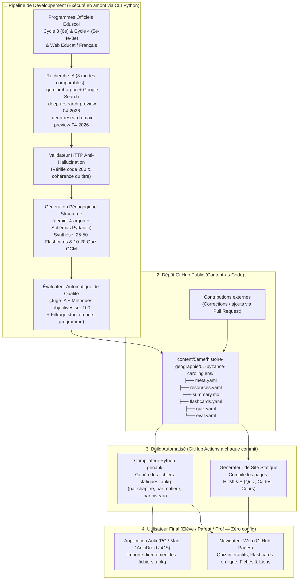

# 00 — Architecture Globale, Vision & État de l'Art

## 1. Vision & Objectifs du Projet

L'objectif est de créer une **plateforme ouverte, générique et collaborative de révisions scolaires — démarrant par l'ensemble du Collège (6ème, 5ème, 4ème, 3ème) et conçue dès le départ pour s'étendre au Lycée (2nde, 1ère, Terminale)** — hébergée sur GitHub et utilisable gratuitement par n'importe quel élève, parent ou enseignant, **sans qu'aucune compétence technique, ni scan manuel, ni clé API ne soit requise pour l'utilisateur final**.

Le projet vise à produire et distribuer :
1. **Un référentiel structuré national** calqué sur les programmes officiels de l'Éducation Nationale (Bulletin Officiel Cycle 3, Cycle 4, et extensible aux programmes du Lycée général et technologique).
2. **Un index de ressources externes gratuites et vérifiées** pour chaque chapitre (Lumni, Lelivrescolaire.fr, MathALÉA/CoopMaths, Vikidia, chaînes YouTube pédagogiques de référence).
3. **Des fiches de synthèse, banques de Quiz (QCM avec explications) et Flashcards** générées en amont via notre pipeline d'IA (`deep-research-max-preview-04-2026`, `deep-research-preview-04-2026` et `gemini-4-argon`), évaluées automatiquement, et stockées proprement dans Git.
4. **Des paquets Anki (`.apkg`) hiérarchiques pré-compilés** (`Collège::5ème::Matière::Chapitre`, et demain `Lycée::2nde::Matière::Chapitre`) téléchargeables en un clic, avec identifiants déterministes (pour préserver l'historique de révision lors des mises à jour).
5. **Un portail Web statique (GitHub Pages)** permettant de faire les quiz en ligne, réviser les flashcards, lire les fiches de révision, consulter les liens externes et télécharger les decks Anki.

---

## 2. Nom du Projet : **Osarai** (おさらい)

Le projet est baptisé **Osarai** (`osarai`) :
- **Origine & Signification** : Vient du japonais **おさらい** (*osarai* — lié à 習う *narau* [apprendre] et 復習する *fukushū suru* [réviser]), qui signifie *« réviser ses leçons / repasser sur ce que l'on a appris »*.
- **Écho direct à Anki** : Tout comme **Anki** vient du japonais **暗記する** (*anki suru* : mémoriser par cœur), **Osarai** incarne la révision structurée et compréhensive des cours.
- **Évolutivité** : Court (6 lettres), universel et indépendant du niveau scolaire (couvre le **Collège** aujourd'hui et s'étendra naturellement au **Lycée** demain).
- **Identifiant technique (CLI / Package Python / Namespace Anki)** : `osarai`.

---

## 3. État de l'Art : Existe-t-il déjà des solutions similaires ?

Il existe de nombreuses briques dans l'écosystème éducatif français, mais **aucune ne combine l'approche « Open-Source Content-as-Code + Decks Anki hiérarchiques prêts à l'emploi + Indexation IA multi-sources + Quiz interactifs » pour le collège** :

| Catégorie | Acteurs existants | Forces | Limites / Pourquoi ce projet apporte du neuf |
| :--- | :--- | :--- | :--- |
| **Plateformes EdTech commerciales** | **Kartable, SchoolMouv, Les Bons Profs, Maxicours** | Très complets, alignés sur le BO de la 6e à la 3e, fiches + quiz + vidéos. | Fermés, payants (abonnements mensuels), aucun export Anki (`.apkg`) ou Markdown, pas de véritable répétition espacée (SRS). |
| **Plateformes gratuites d'éditeurs** | **Afterclasse** (Lelivrescolaire.fr), **Lumni** (France TV) | Contenus gratuits de grande qualité, conformes aux programmes. | Pas d'export Anki, pas de centralisation multi-sources, révision passive ou QCM basiques non adaptatifs. |
| **La Forge des Communs Numériques Éducatifs** | **`forge.apps.education.fr`** (*cartesMD*, *Text2Quiz*, *Markpage*, *MathALÉA*) | Outils libres exceptionnels créés par des profs (conversion Markdown $\rightarrow$ Flashcards/Anki/Quiz). | La Forge fournit les **moteurs logiciels** ou les cours isolés d'un enseignant, mais **pas de référentiel centralisé 6e-3e toutes matières**. |
| **Écosystème Anki & Flashcards** | **AnkiWeb**, **Quizlet**, **Wooflash**, **Digiflashcards** | Répétition espacée redoutable (Anki), milliers de decks sur Quizlet. | Sur AnkiWeb, les decks français sont quasi exclusivement pour Médecine (PASS/LAS) ou Prépa. Pour le collège (surtout 6e/5e/4e), c'est quasi désert ou truffé de fautes sur Quizlet. |

> [!TIP]
> **Opportunité de synergie :** Ce projet peut à la fois **indexer** les meilleures ressources gratuites existantes (*Lumni, Lelivrescolaire.fr, MathALÉA, Vikidia, Yvan Monka*) et proposer un export compatible avec l'écosystème libre, tout en comblant le vide des decks Anki structurés pour le collège.

---

## 4. Architecture Globale & Flux de Données (« Content-as-Code »)

Nous séparons strictement **4 couches** :
1. **L'usine de génération et d'évaluation (exécutée par les mainteneurs en développement)** qui utilise l'API Gemini pour rechercher, rédiger, vérifier les liens et évaluer la qualité pédagogique.
2. **Le dépôt GitHub Public (Source of Truth)** qui contient uniquement des fichiers texte propres (`YAML` / `Markdown`), sans aucune donnée personnelle, ouverts aux contributions externes (Pull Requests).
3. **La compilation et distribution (GitHub Actions)** qui construit statiquement les fichiers `.apkg` Anki et le site web à chaque commit.
4. **L'utilisation finale (Élève, Parent, Enseignant)** via un simple navigateur web (GitHub Pages) ou l'application Anki (PC/Mac/Android/iOS).



---

## 5. Périmètre des Matières & Stratégie de Montée en Charge

### 5.1 Socle Fondamental (7 Matières retenues pour la Phase 1)
1. **Mathématiques**
2. **Français**
3. **Histoire-Géographie - EMC**
4. **SVT (Sciences de la Vie et de la Terre)**
5. **Physique-Chimie**
6. **Anglais (LV1)**
7. **Technologie**

*(Les matières secondaires ou LV2 comme Espagnol, Allemand, Latin, Arts Plastiques, Éducation Musicale pourront être ajoutées en Phase 2 selon la même structure).*

### 5.2 Stratégie de Déploiement Incrémental (Pilote $\rightarrow$ Passage à l'échelle)
Couvrir les 4 niveaux $\times$ 7 matières représente environ **300 à 350 chapitres**. Pour garantir une qualité irréprochable avant de générer en masse :
- **Étape 1** : Développement complet du pipeline (`curriculum`, `research`, `generate`, `evaluate`, `benchmark`, `build-anki`, `build-site`).
- **Étape 2** : Génération de l'arborescence officielle des programmes (`curriculum/6eme.yaml`, `5eme.yaml`, `4eme.yaml`, `3eme.yaml`).
- **Étape 3 (Pilote 5ème)** : Génération et benchmark des **3 moteurs de recherche** sur **Histoire-Géographie (5ème)** et **SVT (5ème)**, suivie de l'évaluation automatique de la qualité et de la compilation des decks `.apkg` et du site web.
- **Étape 4 (Passage à l'échelle)** : Une fois le meilleur moteur et le calibrage validés sur Histoire-Géo et SVT, exécution en lot sur toutes les matières de 5ème, puis 6ème, 4ème et 3ème.

---

## 6. Structure Complète du Dépôt GitHub

```text
/
├── docs/
│   └── designs/                    # Documentation d'architecture et de conception (living docs)
│       ├── 00-global-architecture.md
│       ├── 01-ai-pipeline-and-evaluation.md
│       ├── 02-anki-decks-generation.md
│       └── 03-static-web-portal.md
├── curriculum/                     # Arborescence officielle des programmes (6e, 5e, 4e, 3e)
│   ├── 6eme.yaml
│   ├── 5eme.yaml
│   ├── 4eme.yaml
│   └── 3eme.yaml
├── content/                        # Données pédagogiques générées et validées (Source of Truth)
│   └── 5eme/
│       ├── histoire-geographie/
│       │   └── 01-byzance-et-europe-carolingienne/
│       │       ├── meta.yaml       # Métadonnées, thème BO officiel, compétences, notions clés
│       │       ├── resources.yaml  # Liens vérifiés HTTP 200 (Lumni, Lelivrescolaire, Vidéos...)
│       │       ├── summary.md      # Fiche de révision synthétique (dates, définitions, résumé)
│       │       ├── flashcards.yaml # 25–50 Cartes Anki (Basic & Cloze) avec IDs stables
│       │       ├── quiz.yaml       # 10–20 QCM à 4 choix avec explications détaillées
│       │       └── eval.yaml       # Rapport d'évaluation automatique de qualité (score /100)
│       └── svt/
├── src/                            # Pipeline Python d'automatisation, d'évaluation et de build
│   └── osarai/
│       ├── cli.py                  # Interface CLI (curriculum, research, generate, evaluate, benchmark, build)
│       ├── schemas.py              # Modèles Pydantic stricts
│       ├── curriculum_builder.py   # Génération de l'arborescence officielle par niveau
│       ├── researcher.py           # Intégration des 3 modes de recherche Gemini
│       ├── url_checker.py          # Vérification HTTP asynchrone anti-hallucination
│       ├── generator.py            # Génération structurée (summary, flashcards, quiz) via gemini-4-argon
│       ├── evaluator.py            # Évaluation automatique de la qualité et filtre hors-programme
│       ├── anki_builder.py         # Compilation des fichiers .apkg hiérarchiques via genanki
│       └── site_builder.py         # Génération du site statique (HTML/JS/CSS) pour GitHub Pages
├── tests/                          # Tests unitaires et validation d'intégrité
└── .github/workflows/              # CI/CD : Validation YAML, build Anki (.apkg) & déploiement GitHub Pages
```

