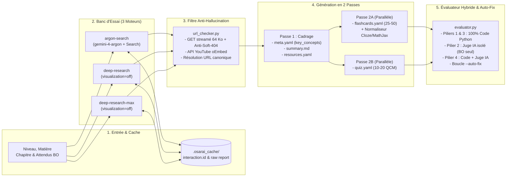

# 01 — Pipeline IA : Recherche, Génération Dynamique & Évaluation Automatique

## 1. Objectif du Pipeline IA

Le pipeline IA transforme les programmes officiels de l'Éducation Nationale en ressources de révision complètes, sourcées et conformes au niveau scolaire de l'élève, tout en évitant quatre écueils classiques des pipelines basés sur les LLMs :
1. **L'hallucination de liens web et les "Soft-404"** (URLs inventées, vidéos YouTube supprimées renvoyant pourtant HTTP 200, ou redirections silencieuses vers la page d'accueil).
2. **La dérive hors-programme** (générer des flashcards trop complexes ou hors du périmètre de la leçon, comme observé parfois avec NotebookLM lorsqu'on lui demande 50 cartes).
3. **La dégradation de fin de génération (*Lazy LLM*) et les erreurs de syntaxe Anki/LaTeX** (collisions d'accolades `}}}` entre Cloze et MathJax, oubli des balises `{{c1::...}}`).
4. **La corruption de l'historique Anki et l'instabilité de l'évaluation** (renumérotation accidentelle des IDs de cartes ou biais d'auto-complaisance du juge IA).

---

## 2. Les 3 Moteurs de Recherche, Résilience & Cache (`researcher.py`)

Pour déterminer l'approche offrant le meilleur rapport **Qualité pédagogique / Validité des liens / Temps d'exécution / Coût API**, le module `researcher.py` supporte **3 moteurs configurables** via `--research-mode` (basés sur le SDK officiel `google-genai >= 2.30.1` et l'**Interactions API**) :

| Mode | Modèle / Agent Gemini (Interactions API) | Fonctionnement | Durée & Coût indicatifs |
| :--- | :--- | :--- | :--- |
| **`argon-search`** | `model="gemini-4-argon"` + `tools=[{"type": "google_search"}]` | Recherche web directe pilotée par le modèle de raisonnement le plus puissant. | **15–45 s** (~0,05 $ – 0,15 $ / chapitre). Idéal pour la rapidité et l'itération. |
| **`deep-research`** | `agent="deep-research-preview-04-2026"` (`background=True`) | Agent autonome effectuant de multiples requêtes croisées et synthétisant un rapport cité. | **5–15 min** (~1 $ – 3 $ / chapitre). Exploration web approfondie. |
| **`deep-research-max`** | `agent="deep-research-max-preview-04-2026"` (`background=True`) | Agent de recherche à exhaustivité maximale explorant des dizaines de sources. | **10–25 min** (~3 $ – 7 $ / chapitre). Couverture maximale pour le banc d'essai. |

### 2.1 Contraintes Spécifiques de l'Interactions API & Optimisations
1. **Sortie de recherche unifiée (Texte sourcé + Annotations)** :
   - Les agents `deep-research-*` ne supportant pas le paramètre `response_format` (JSON Schema), les 3 moteurs produisent un dossier de recherche en **Markdown libre accompagné des métadonnées de citations**.
   - Les URLs candidates sont extraites à la fois des **annotations natives de Grounding** (`step.content[].annotations` où `type == "url_citation"`) et des liens Markdown présents dans le texte.
2. **Désactivation des images superflues sur Deep Research** :
   - Par défaut, l'agent Deep Research active `visualization="auto"` (générant des images en base64 coûteuses en tokens et en latence). Nous forçons systématiquement :
     ```python
     agent_config={
         "type": "deep-research",
         "visualization": "off",
         "collaborative_planning": False,
     }
     ```
3. **Persistance immédiate & Reprise sur interruption (`.osarai_cache/`)** :
   - Dès la création d'une interaction en arrière-plan (`background=True`, qui impose `store=True` côté serveur), l'`interaction.id` est immédiatement sauvegardé dans `.osarai_cache/<niveau>/<matiere>/<chapitre>/research_<mode>_state.json`.
   - En cas de coupure réseau ou d'arrêt du script (`Ctrl+C`), relancer la commande reprend le polling via `client.interactions.get(interaction_id)` sans relancer ni repayer l'agent.
   - Une fois terminé, le rapport brut et les citations extraites sont mis en cache sur disque afin de découpler totalement la phase de recherche de la phase de génération.



---

## 3. Validation HTTP Anti-Hallucination (`url_checker.py`)

Un simple test `HTTP 200` laisse passer des vidéos YouTube supprimées et des pages d'erreur déguisées (*Soft-404*). Le module `url_checker.py` applique un protocole de vérification asynchrone en 4 règles :

1. **Vérification spécifique YouTube via oEmbed (sans clé API)** :
   - Sur YouTube, une vidéo supprimée, privée ou inventée renvoie malgré tout `HTTP 200 OK` sur `youtube.com/watch?v=...`.
   - Pour tout lien `youtube.com` ou `youtu.be`, `url_checker.py` interroge l'endpoint officiel :
     `GET https://www.youtube.com/oembed?url={video_url}&format=json`
   - Cet endpoint renvoie un vrai `HTTP 404 / 401 / 403` si la vidéo est indisponible, et retourne le `title` exact ainsi que `author_name` (permettant de valider qu'il s'agit d'une chaîne pédagogique reconnue comme *Lumni, Yvan Monka, Les Bons Profs*, etc.).
2. **Détection des *Soft-404* et des redirections vers l'accueil** :
   - Suit la chaîne de redirections (`follow_redirects=True`) pour résoudre les URLs intermédiaires (notamment les redirections de Grounding) et obtenir l'**URL finale canonique** nettoyée des paramètres de tracking (`utm_*`).
   - Rejette toute URL dont la redirection finale retombe sur la racine du site (`/`, `/accueil`) alors que l'URL initiale ciblait une ressource profonde.
   - Extrait `<title>`, `<meta property="og:title">` et `<h1>` et rejette la page si le titre contient des marqueurs d'erreur (`404`, `introuvable`, `page non trouvée`, `erreur`).
3. **Lecture partielle (`stream=True`) & En-têtes réalistes** :
   - Utilise `GET` en mode streamé en ne lisant que les **64 premiers Ko** de la réponse (suffisant pour parser `<head>` sans télécharger de gros fichiers) avec un `User-Agent` navigateur standard et `Accept-Language: fr-FR,fr;q=0.9` afin d'éviter les faux négatifs `HTTP 403` des pare-feux anti-bots.
4. **Limitation de concurrence par domaine** :
   - Utilise un `asyncio.Semaphore(2)` par nom de domaine pour ne jamais saturer les serveurs éducatifs publics (*lumni.fr, lelivrescolaire.fr, eduscol.education.fr, coopmaths.fr*).

---

## 4. Génération Structurée en 2 Passes & Normalisation Anki (`generator.py` & `schemas.py`)

Générer en un seul appel JSON monolithique la fiche de synthèse, les ressources, 50 flashcards et 20 QCM (~15 000 tokens de sortie partagés avec les `thinking` tokens) provoque une baisse de qualité sur les dernières cartes (*effet Lazy LLM*). La génération avec `gemini-4-argon` est donc **découpée en 2 passes (avec parallélisation de la Passe 2)** :

### 4.1 Passe 1 : Extraction des Notions Clés (`concept_id`), Synthèse & Ressources
À partir du Bulletin Officiel et du dossier de recherche vérifié, un premier appel génère :
1. **La liste des notions atomiques exigibles (`meta.yaml -> key_concepts`)** :
   - Chaque notion reçoit un **identifiant slug stable** (`concept_id`, ex: `basileus`, `schisme-1054`, `absorption-intestinale`), un titre et sa catégorie (*Définition*, *Repère chronologique/spatial*, *Formule/Mécanisme*, *Piège classique*).
2. **La sélection des ressources externes (`resources.yaml`)** :
   - Sélectionne uniquement parmi les URLs validées par `url_checker.py` (3 à 6 liens pertinents).
3. **La fiche de révision complète (`summary.md`)** :
   - Structurée clairement (*Ce qu'il faut retenir*, *Définitions clés*, *Repères / Formules*, *Erreurs fréquentes au contrôle*).

### 4.2 Passe 2A & Passe 2B (Exécutées en parallèle via `asyncio.gather`)
À partir de `meta.yaml` (`key_concepts`) et `summary.md`, deux appels structurés indépendants sont lancés simultanément :

- **Passe 2A — Flashcards (`flashcards.yaml` : 25 à 50 cartes)** :
  - Calibrées dynamiquement à raison de $1.5 \times$ à $2 \times$ le nombre de `key_concepts`.
  - Chaque carte est **obligatoirement rattachée à un `concept_id`** de `meta.yaml`.
  - Répartition de `priority` : ~70 % `essentiel` (socle du contrôle) et ~30 % `approfondissement` (pour viser 18–20/20 sans sortir du programme).
- **Passe 2B — Quiz (`quiz.yaml` : 10 à 20 QCM)** :
  - Chaque QCM est également **rattaché à un `concept_id`**, comporte 4 choix distincts, 1 seule bonne réponse, 3 distracteurs plausibles basés sur les confusions fréquentes des élèves, un niveau de difficulté (`facile`, `moyen`, `difficile`), et une **explication pédagogique détaillée**.

### 4.3 Attribution Déterministe & Stabilité des IDs Anki
Pour garantir qu'une mise à jour ou une suppression de carte n'écrase jamais la progression Anki d'un élève sur une autre question :
- **Le LLM ne génère jamais les IDs techniques (`5e-hg-h1-c001`)** : c'est `generator.py` qui les attribue en Python.
- **Réconciliation lors des mises à jour** : Si un fichier `flashcards.yaml` existe déjà pour le chapitre, `generator.py` apparie les cartes par `(concept_id, type)` et similarité textuelle pour conserver leurs IDs existants. Toute nouvelle carte reçoit un ID strictement supérieur au maximum historique (`max_id + 1`), sans jamais réattribuer l'ID d'une carte supprimée.

### 4.4 Normaliseur & Validateur Syntaxique Anki / MathJax (`schemas.py`)
Les modèles Pydantic dans `schemas.py` intègrent un validateur déterministe (`@model_validator`) qui sécurise chaque carte avant sauvegarde :
1. **Conversion automatique en MathJax Anki** : Convertit tout `$...$` ou `$$...$$` résiduel en syntaxe `\(...\)` et `\[...\]` compatible nativement avec Anki et KaTeX.
2. **Correction de la collision d'accolades Cloze + MathJax (`}}}`)** : Dans Anki, `{{c1::\frac{1}{2}}}` casse le parseur Cloze à cause des trois accolades fermantes consécutives. Le validateur insère automatiquement un espace de sécurité : `{{c1::\frac{1}{2} }}`.
3. **Validation stricte du type `cloze` vs `basic`** : Vérifie par expression régulière (`r"\{\{c\d+::.+?\}\}"`) que toute carte `type: cloze` comporte au moins un trou valide (sinon Anki affiche une erreur de rendu) et qu'une carte `type: basic` n'en comporte pas.
4. **Protection des backslashes LaTeX** : Répare les séquences JSON/YAML où `\frac`, `\text` ou `\beta` auraient été altérés en caractères de contrôle ASCII (`\f`, `\t`, `\b`).

---

## 5. Évaluation Automatique Hybride & Boucle `--auto-fix` (`evaluator.py`)

Pour éviter le **biais d'auto-complaisance** (un LLM évaluant sa propre sortie avec le même contexte) et garantir un **Score Global sur 100 points reproductible** lors des benchmarks, `evaluator.py` combine **calculs mathématiques déterministes en Python** et **jugement IA unitaire sous voile d'ignorance** :

### Pilier 1 : Validité Technique & Qualité des Ressources Web (20 points — 100 % Code Python)
Calculé de manière déterministe à partir du rapport de `url_checker.py` :
- **Validité HTTP & oEmbed (10 pts)** : $10 \times \frac{\text{URLs valides (HTTP 200 / oEmbed OK)}}{\text{Total URLs}}$. Tout lien mort est écarté avant publication.
- **Autorité des domaines éducatifs (10 pts)** : Part des ressources issues de domaines ou chaînes de confiance reconnus (*lumni.fr, lelivrescolaire.fr, eduscol.education.fr, vikidia.org, coopmaths.fr, sesamath.net*, chaînes YouTube éducatives vérifiées).

### Pilier 2 : Conformité au Bulletin Officiel & Absence de Hors-Programme (30 points — Juge IA Isolé)
Évalué par un appel indépendant à `gemini-4-argon` agissant comme **Inspecteur Pédagogique en "Voile d'Ignorance"** :
- **Isolation du contexte** : Le juge reçoit **uniquement** le texte officiel des attendus du Bulletin Officiel (`curriculum/<niveau>.yaml`) et les cartes/QCM générés — **jamais** le dossier de recherche web (qui est la source principale des dérives hors-programme).
- **Verdict unitaire structuré** : Au lieu de donner une note globale subjective, le juge évalue chaque carte et chaque QCM individuellement (`in_scope: bool` + justification citant l'attendu du BO).
- **Formule déterministe** : Le score sur 30 est calculé en Python avec une pénalité stricte pour chaque item hors-programme (`flagged_out_of_scope_ids`).

### Pilier 3 : Exhaustivité de la Couverture du Chapitre (20 points — 100 % Code Python)
Grâce au champ `concept_id` présent sur chaque flashcard et chaque QCM, ce pilier est calculé **sans aucun appel LLM** :
- **Couverture des notions clés (12 pts)** : Pourcentage des `key_concepts` de `meta.yaml` couverts par au moins une flashcard **et** une question de quiz.
- **Équilibre des formats et priorités (8 pts)** : Respect de la répartition entre types de cartes (`basic` vs `cloze`) et niveaux de priorité (~70 % `essentiel` / ~30 % `approfondissement`).

### Pilier 4 : Qualité Pédagogique & Formulation Anki (30 points — Hybride Code + Juge IA)
- **Contrôles déterministes d'atomicité et de forme (10 pts — Code Python)** :
  - Vérifie la concision des réponses Anki (pénalise les versos dépassant 250 caractères qui réciterait un paragraphe entier), la validité syntaxique MathJax/Cloze, l'absence de doublons et l'unicité des 4 choix de chaque QCM.
- **Qualité des distracteurs et des explications (20 pts — Juge IA)** :
  - Évalue la plausibilité pédagogique des 3 mauvaises réponses des QCM (absence de distracteurs caricaturaux) et la clarté des explications.

### Boucle d'Auto-Correction (`--auto-fix` / `--auto-prune`)
Lorsqu'une carte ou un QCM est signalé comme hors-programme (`flagged_out_of_scope_ids`) ou non-atomique :
1. **Si sa suppression ne compromet ni la couverture du `concept_id` (Pilier 3) ni le seuil minimal de cartes (25)** : la carte est directement retirée (`prune`).
2. **Si la carte était la seule à couvrir une notion clé du BO (ou fait passer le paquet sous le seuil minimal)** : le pipeline déclenche une **réécriture ciblée (`rewrite`)** de cette carte pour la ramener dans les limites strictes du programme du niveau, puis recalcule le score final dans `eval.yaml`.
