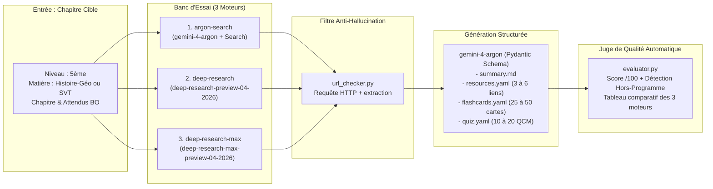

# 01 — Pipeline IA : Recherche, Génération Dynamique & Évaluation Automatique

## 1. Objectif du Pipeline IA

Le pipeline IA transforme les programmes officiels de l'Éducation Nationale en ressources de révision complètes, sourcées et conformes au niveau scolaire de l'élève, tout en évitant deux écueils fréquents des LLMs :
1. **L'hallucination de liens web** (URLs inventées ou mortes).
2. **La dérive hors-programme** (générer des flashcards trop complexes ou hors du périmètre de la leçon, comme observé parfois avec NotebookLM lorsqu'on lui demande 50 cartes).

---

## 2. Les 3 Moteurs de Recherche & Banc d'Essai (`benchmark`)

Pour déterminer l'approche offrant le meilleur rapport **Qualité pédagogique / Validité des liens / Temps d'exécution / Coût API**, le module `researcher.py` supporte **3 moteurs configurables** via `--research-mode` :

| Mode | Modèle / Agent Gemini (Interactions API) | Fonctionnement | Cas d'usage |
| :--- | :--- | :--- | :--- |
| **`argon-search`** | `model="gemini-4-argon"` + `tools=[{"type": "google_search"}]` | Recherche web directe pilotée par le modèle de raisonnement le plus puissant. | Très rapide (15–30s), idéal si la qualité égale celle des agents Deep Research. |
| **`deep-research`** | `agent="deep-research-preview-04-2026"` (`background=True`) | Agent autonome effectuant de multiples requêtes croisées et synthétisant un rapport cité. | Équilibre entre profondeur d'exploration web et temps d'exécution (1–3 min). |
| **`deep-research-max`** | `agent="deep-research-max-preview-04-2026"` (`background=True`) | Agent de recherche à exhaustivité maximale explorant des dizaines de sources. | Couverture maximale des ressources en ligne (Lumni, Lelivrescolaire, etc.). |

---

## 3. Calibrage Dynamique du Volume (Flashcards & Quiz)

Au lieu d'imposer un nombre fixe rigide (qui créerait du remplissage artificiel sur un petit chapitre ou manquerait des notions sur un gros chapitre), la génération fonctionne en **deux passes** avec `gemini-4-argon` :

### Passe 1 : Extraction des Unités de Connaissance Exigibles (`notions_cles`)
À partir du dossier de recherche et du Bulletin Officiel, le modèle liste explicitement toutes les **briques atomiques exigibles** du chapitre :
- **Définitions & Vocabulaire** (ex: *basileus, schisme, fief, suzerain, vassal* ou *nutriment, enzyme, absorption intestinale*).
- **Repères chronologiques / spatiaux / scientifiques** (dates clés, cartes, formules mathématiques ou chimiques).
- **Mécanismes & Relations de cause à effet** (questions de compréhension).
- **Erreurs fréquentes / Pièges classiques** au collège.

### Passe 2 : Génération Proportionnelle à la Densité du Chapitre
Le nombre de flashcards et de questions de quiz est calculé dynamiquement selon le nombre $N$ de notions clés identifiées dans le chapitre :
- **Flashcards (`flashcards.yaml`) : entre 25 et 50 cartes par chapitre**
  - Environ $1.5 \times$ à $2 \times$ le nombre de notions atomiques (ex: une carte de définition + une carte de mise en situation ou texte à trous).
  - Chaque carte porte un attribut `priority` :
    - `essentiel` (~70 % des cartes) : ce qu'il faut absolument maîtriser pour le contrôle.
    - `approfondissement` (~30 % des cartes) : détails utiles pour viser l'excellence (18–20/20), tout en restant **strictement dans le programme de l'année**.
- **Quiz (`quiz.yaml`) : entre 10 et 20 QCM par chapitre**
  - Proportionnel à la densité du chapitre.
  - Chaque QCM comporte 4 choix, 1 seule réponse exacte, 3 distracteurs plausibles basés sur les confusions fréquentes des élèves, un niveau de difficulté (`facile`, `moyen`, `difficile`), et une **explication pédagogique détaillée**.
- **Support MathJax / LaTeX** :
  - Toutes les expressions mathématiques ($\frac{a}{b}$, $\sqrt{x}$, puissances, équations) et formules scientifiques sont formatées en syntaxe MathJax standard `\(...\)` (inline) et `\[...\]` (bloc), compatible nativement avec **Anki** (PC, Mac, AnkiDroid, iOS) et **KaTeX** sur le site web.

---

## 4. Évaluation Automatique de la Qualité (`evaluator.py`)

Pour évaluer objectivement les contenus générés (et comparer les 3 moteurs de recherche), la commande ` evaluate` calcule un **Score Global sur 100 points** réparti en 4 piliers :

### Pilier 1 : Validité Technique & Qualité des Ressources Web (20 points)
Calculé de manière 100 % déterministe par `url_checker.py` :
- **Validité HTTP (10 pts)** : Pourcentage de liens dans `resources.yaml` répondant avec un statut HTTP 200 valide (sans redirection vers une page 404 ou page d'accueil générique). Tout lien mort est automatiquement supprimé avant publication.
- **Autorité des domaines éducatifs (10 pts)** : Part des ressources provenant de domaines de confiance reconnus (*lumni.fr, lelivrescolaire.fr, eduscol.education.fr, vikidia.org, coopmaths.fr, sesamath.net*, chaînes YouTube éducatives vérifiées).

### Pilier 2 : Conformité au Bulletin Officiel & Absence de Hors-Programme (30 points)
Évalué par un appel indépendant à `gemini-4-argon` agissant comme **Inspecteur Pédagogique (LLM-as-a-Judge)** avec le texte officiel des attendus de fin d'année Éduscol :
- Analyse chaque flashcard et chaque QCM pour détecter toute notion **hors-périmètre** (notion appartenant à une classe supérieure ou détail encyclopédique inutile).
- Retourne la liste exacte des identifiants de cartes hors-sujet (`flagged_out_of_scope_ids`).
- **Auto-nettoyage (`--auto-prune`)** : Les cartes signalées comme hors-programme peuvent être automatiquement retirées ou réécrites.

### Pilier 3 : Exhaustivité de la Couverture du Chapitre (20 points)
- Vérifie que chaque notion clé du chapitre (`meta.yaml -> key_concepts`) est couverte par au moins une flashcard et évaluée dans le quiz.
- Vérifie l'équilibre entre les types de cartes (`basic` Question/Réponse vs `cloze` Texte à trous).

### Pilier 4 : Qualité Pédagogique & Formulation Anki (30 points)
- **Principe d'atomicité Anki (15 pts)** : Une carte ne doit tester qu'une seule idée précise, avec une réponse courte et non ambiguë (pénalise les cartes demandant de réciter un long paragraphe).
- **Qualité des QCM et explications (15 pts)** : Les 3 mauvaises réponses ne doivent pas être caricaturales, et l'explication doit expliquer *pourquoi* la bonne réponse est juste.

