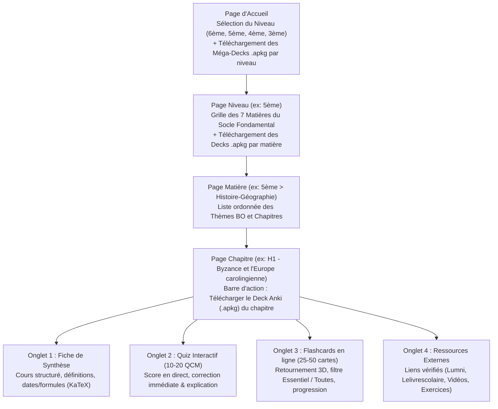

# 03 — Portail Web Statique (GitHub Pages) & CI/CD

## 1. Objectif du Portail Web

Bien que les paquets Anki (`.apkg`) soient imbattables pour la mémorisation à long terme, l'élève (ou le parent qui l'interroge) a souvent besoin d'un accès immédiat depuis un navigateur sur tablette, smartphone ou ordinateur **sans rien installer** :
- Pour lire la **fiche de synthèse** du chapitre.
- Pour faire un **Quiz QCM interactif** de 10 à 20 questions et vérifier immédiatement s'il est prêt pour son contrôle.
- Pour faire défiler rapidement les **Flashcards en ligne**.
- Pour ouvrir les **vidéos et exercices externes vérifiés** (Lumni, Lelivrescolaire, etc.).
- Pour **télécharger le fichier `.apkg`** du chapitre, de la matière ou de la classe.

---

## 2. Architecture Statique (Zéro Serveur, Hébergement Gratuit GitHub Pages)

Le module `site_builder.py` compile l'ensemble du dossier `content/` et `curriculum/` en un site statique autonome dans le dossier `dist/` :
- **HTML5 / CSS moderne (Responsive Mobile-First)** : Utilisable confortablement sur téléphone, tablette ou PC, avec thème clair/sombre.
- **KaTeX embarqué** : Rendu instantané des formules mathématiques et chimiques ($\frac{a}{b}$, $\sqrt{x}$, $\text{CO}_2$, $\text{O}_2$).
- **Données JSON par chapitre** : Permet aux composants JavaScript (Quiz et Flashcards) de fonctionner à 100 % dans le navigateur, sans aucun backend.

---

## 3. Fonctionnalités Clés de la Page Chapitre

1. **Onglet « Fiche de Synthèse »** :
   - Présente l'essentiel du cours structuré clairement : *Ce qu'il faut retenir*, *Définitions clés*, *Repères / Formules*, *Erreurs à éviter au contrôle*.
2. **Onglet « Quiz Interactif »** :
   - Affiche les questions QCM une par une (ou en liste), avec possibilité de filtrer par difficulté (`Facile`, `Moyen`, `Difficile`) ou de tirer 10 questions au hasard.
   - Dès que l'élève clique sur une réponse, affiche immédiatement si c'est juste ou faux ainsi que l'**explication pédagogique détaillée**.
   - À la fin du quiz, affiche le score (ex: `16/20`) et propose de relancer uniquement les questions ratées.
3. **Onglet « Flashcards »** :
   - Permet de réviser les cartes directement dans le navigateur avec retournement au clic/tap.
   - Filtre rapide : **« Toutes les cartes »** vs **« Cartes Essentielles uniquement »**.
   - Boutons d'auto-évaluation rapide (*« Je connais »* / *« À revoir »*) avec sauvegarde de la progression locale dans `localStorage`.
4. **Onglet « Ressources & Anki »** :
   - Liste les liens externes vérifiés classés par type (Vidéo Lumni/YouTube, Cours Lelivrescolaire/Vikidia, Exercices interactifs).
   - Bouton de téléchargement direct du fichier `.apkg` du chapitre et rappel de la procédure d'import dans Anki en 2 clics.

---

## 4. Intégration Continue & Contributions Communautaires (`.github/workflows/`)

Pour faciliter les contributions externes sur GitHub :
- **Validation sur Pull Request (`ci.yml`)** :
  - Lorsqu'un contributeur modifie un fichier `flashcards.yaml`, `quiz.yaml` ou `summary.md` via l'interface web de GitHub, une GitHub Action vérifie automatiquement que la syntaxe YAML et les schémas Pydantic sont valides et que les liens dans `resources.yaml` répondent en HTTP 200.
- **Publication automatique (`deploy.yml`)** :
  - À chaque fusion sur la branche principale (`main`), GitHub Actions exécute `anki_builder.py` et `site_builder.py`, puis déploie automatiquement le site mis à jour et les nouveaux fichiers `.apkg` sur **GitHub Pages**.

