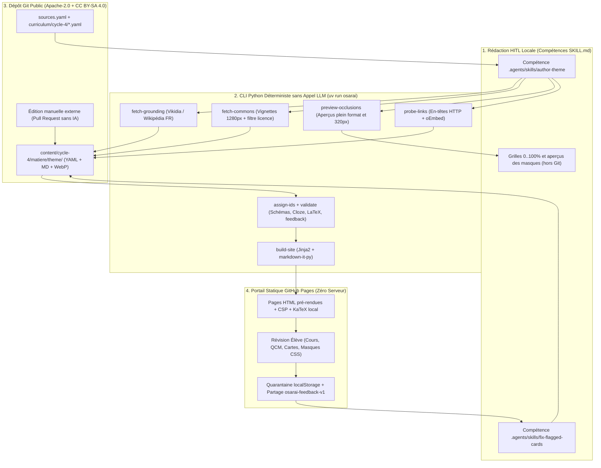

# Osarai MVP : Plateforme Statique de Révisions du Collège à Rédaction Assistée par Agents IA

*   **Auteur** : Severin Ferrand
*   **Statut** : Proposé (*Proposed*)
*   **Date** : 2026-11-15

--------------------------------------------------------------------------------

## Vue d'ensemble

Osarai est une plateforme libre et statique de révisions scolaires pour les élèves du collège français (11 à 15 ans). Elle est lancée en pilote sur le niveau *5ème* (première année du *Cycle 4*, qui regroupe *5ème*, *4ème* et *3ème*) afin de préparer les évaluations en classe en *SVT* (*Sciences de la Vie et de la Terre* : *La Respiration*, *La Digestion*) et en *Histoire-Géographie* (Géographie : *La croissance démographique et ses effets*). Tous les cours, cartes mémoire (*flashcards*), questionnaires à choix multiples (*QCM*) et métadonnées d'illustrations sont stockés sous Git dans des fichiers texte YAML et Markdown sous licence Creative Commons Attribution - Partage dans les Mêmes Conditions 4.0 (`CC BY-SA 4.0`), tandis que le code source est sous licence `Apache-2.0`.

Ce document remplace intégralement les quatre ébauches initiales du dépôt (`docs/designs/00-global-architecture.md` à `03-static-web-portal.md`). Au lieu d'appeler des interfaces de programmation (API) payantes de grands modèles de langage (LLM) depuis Python, la rédaction des contenus et la vérification visuelle des schémas et cartes libres issus de Wikimedia Commons reposent sur des compétences portables au format `SKILL.md` versionnées dans `.agents/skills/` et exécutées avec validation humaine (*Human-in-the-Loop*, ou HITL). Tout mainteneur ou contributeur disposant d'un abonnement d'agent de code compatible (**Antigravity / Gemini, Claude Code / Claude ou OpenAI Codex / ChatGPT**) peut appliquer ce flux sans facturation d'API à l'usage, tandis que les contributions manuelles sans agent IA restent directement prises en charge.

En complément, une interface en ligne de commande (CLI) Python autonome et sans appel LLM (`osarai`) valide les schémas de données, contrôle les licences, attribue des identifiants permanents et compile des pages HTML statiques pré-rendues déployées sur GitHub Pages, sans serveur dorsal, sans compte utilisateur et sans traceur tiers. Cet outillage Python est géré avec [`uv`](https://docs.astral.sh/uv/), un gestionnaire d'environnements virtuels et de dépendances Python remplaçant `pip` et `venv`, qui installe automatiquement la version requise de Python si elle est absente et fige les versions et empreintes des paquets via `uv.lock` (`--frozen`).

--------------------------------------------------------------------------------

## Le Problème

### État de l'art et limites actuelles

Les familles et enseignants du collège se heurtent à quatre limites dans les outils de révision existants :

1.  **Plateformes EdTech commerciales** (*Kartable*, *SchoolMouv*, *Maxicours*) : sur abonnement payant, fermées, sans export ouvert ni identifiants stables permettant la répétition espacée.
2.  **Ressources gratuites publiques ou éditoriales** (*Lumni*, *Lelivrescolaire.fr*, *Vikidia*, *CoopMaths*) : contenus de référence mais dispersés entre plusieurs sites, sans banque unifiée de cartes mémoire actives ni de *QCM* corrigés. De plus, *Lelivrescolaire.fr* diffuse ses manuels sous licence non commerciale (`CC BY-NC-SA`), que les règles Creative Commons interdisent de fusionner dans une œuvre dérivée sous `CC BY-SA 4.0`, tandis que *Lumni* est sous droits réservés.
3.  **Outils libres de la Forge des Communs Numériques Éducatifs** (*cartesMD*, *Markpage*) : fournissent des moteurs d'affichage unitaires à partir d'un fichier Markdown isolé, mais pas un portail multi-matières structuré sur les programmes officiels avec recherche transversale et signalement d'erreurs.
4.  **Paquets partagés Anki existants** : très développés en France pour les études de santé et les classes préparatoires, mais rares au niveau collège, hétérogènes, majoritairement dépourvus de schémas occultés et rarement indexés selon le découpage officiel par cycle et par thème — ce qui complique le ciblage des révisions pour un contrôle précis.

### Limites des quatre ébauches initiales d'Osarai

L'évaluation des quatre documents initiaux face au scénario d'usage cible dès le premier jour — une élève de *5ème* de 12 ans révisant ses contrôles hebdomadaires avec son parent — met en évidence cinq blocages concrets :

1.  **Coût API récurrent face aux forfaits d'agents IA existants** : orchestrer en Python le kit logiciel `google-genai` et des agents autonomes `deep-research` entraîne un coût par thème (de l'ordre de 1 \$ à 7 \$ selon la profondeur de recherche) et consulte librement des pages propriétaires susceptibles de contaminer la licence `CC BY-SA 4.0`, alors que la rédaction interactive dans un agent de code compatible `SKILL.md` s'impute sur l'abonnement déjà souscrit par le contributeur.
2.  **Progression pluriannuelle non séquentielle du Cycle 4** : les *Bulletins Officiels (BO)* et les *Repères annuels de progression* publiés sur *Éduscol* par le ministère de l'Éducation nationale définissent plusieurs disciplines du *Cycle 4* (*SVT*, *Physique-Chimie*, *Technologie*, *Mathématiques*) sur trois ans plutôt qu'en chapitres nationaux numérotés (`Chapitre 1, 2, 3`). Figer l'année et un numéro de chapitre dans les dossiers et identifiants casse les URL et l'historique des cartes dès qu'un enseignant traite un thème dans un autre ordre ou une autre année du cycle.
3.  **Contrainte des schémas et cartes déjà légendés** : les contrôles de sciences et de géographie reposent sur des schémas et des cartes, or une grande partie des schémas didactiques francophones de *SVT* et des cartes thématiques sur Wikimedia Commons affichent directement le nom des organes ou territoires sur l'image — dévoilant la réponse si l'illustration est affichée telle quelle au recto d'une question, tandis que les versions muettes prêtes à l'emploi couvrent inégalement les thèmes du programme.
4.  **Blocage du signalement d'erreurs pour un enfant de 12 ans** : s'appuyer uniquement sur l'ouverture d'une URL GitHub Issues pré-remplie (`/issues/new`) échoue lorsqu'une élève de 12 ans (en dessous de l'âge minimal de 13 ans des conditions d'utilisation de GitHub et du seuil de consentement numérique de 15 ans du *RGPD* — Règlement Général sur la Protection des Données — en France) révise sur une tablette non connectée à GitHub, et échoue avec une erreur `HTTP 414 URI Too Long` dès que la charge utile encodée en pourcentage dépasse la limite pratique d'URI (~5 500 à 8 000 octets).
5.  **Automatisation prématurée** : construire un juge automatique par IA noté sur 100, un exécuteur par lots sur toute une matière et la compilation binaire de paquets Anki (`.apkg`) par thème, matière et classe avant d'avoir éprouvé 3 à 5 thèmes pilotes avec une élève ajoute du code non validé alors que les révisions initiales se font intégralement dans le navigateur web.

--------------------------------------------------------------------------------

## Approche Retenue, Coûts et Critères de Réussite du Pilote

*   **Nouvelle approche** : séparer **la rédaction assistée par agent IA avec validation humaine (HITL)** (compétences portables dans `.agents/skills/`, ancrées sur des extraits officiels sous *Licence Ouverte Etalab 2.0* et des sources compatibles `CC BY-SA 4.0`) et **l'outillage Python déterministe sans appel LLM** (`osarai` validant les schémas, contrôlant les licences, superposant des masques d'occultation CSS non destructifs sur les illustrations Wikimedia Commons et pré-générant les pages HTML statiques).
*   **Coût en ressources** : 0 \$ de coût marginal d'API LLM (couvert par l'abonnement d'agent IA existant du contributeur, ou édition manuelle directe), 0 \$ d'hébergement et d'intégration continue (dépôt public GitHub, GitHub Actions et GitHub Pages), et un seul environnement logiciel local (`Python 3.12+` via [`uv`](https://docs.astral.sh/uv/), sans `Node.js` ni `Ruby`).
*   **Examen de validation du pilote (critères mesurables)** :
    1.  Rédiger et publier 3 à 5 thèmes autonomes de *5ème* couvrant au minimum les *SVT* (*La Respiration*, *La Digestion*) et la *Géographie* (*La croissance démographique et ses effets*), avec zéro notion hors-programme de niveau lycée et 100 % des crédits *TASL* (*Title, Author, Source URL, License* — Titre, Auteur, URL source, Licence) des textes et images vérifiés automatiquement.
    2.  Mener au moins une séance réelle de révision parent-enfant sur tablette ou smartphone sur chacun des `>= 3` thèmes pilotes et valider au moins un cycle complet de bout en bout (mise en quarantaine locale d'un élément, export `osarai-feedback-v1` sans compte GitHub sur l'appareil de l'élève, et correction via `fix-flagged-cards`).
    3.  Exécuter 100 % des validations déterministes hors-ligne (schémas YAML, syntaxe et délimiteurs LaTeX/KaTeX, textes à trous *Cloze* et nommage plat des images) sur chaque *Pull Request* en moins de 30 secondes afin que la compilation Anki `.apkg` en Phase 2 ne nécessite aucune migration des fichiers YAML ou des images.

--------------------------------------------------------------------------------

## Objectifs

*   **Remplacer intégralement les ébauches initiales** : supprimer `docs/designs/00-global-architecture.md` à `03-static-web-portal.md` et aligner `README.md`, `LICENSE-CONTENT` et `CONTRIBUTING.md` sur cette architecture MVP unique.
*   **Structurer les cours en unités thématiques par cycle** : organiser les contenus en thèmes autonomes (`content/cycle-4/<matiere>/<slug-theme>/`, et `content/cycle-3/` pour la *6ème*) étiquetés par repère annuel (`reperes_levels`) et limites explicites (`scope_exclusions`), validés en mode HITL sur les 3 à 5 thèmes pilotes de *5ème*.
*   **Fournir trois compétences portables sans coût marginal d'API** : livrer `init-curriculum`, `author-theme` et `fix-flagged-cards` dans `.agents/skills/`, appuyées sur les extraits officiels *Etalab 2.0* versionnés dans `curriculum/` (~1 000 à 2 000 jetons par thème).
*   **Garantir la conformité stricte aux licences `CC BY-SA 4.0`, `Etalab 2.0` et `MIT`** : vérifier mécaniquement via `sources.yaml` que les textes d'appui et médias intégrés relèvent de licences compatibles `CC BY-SA 4.0` avec attribution complète (auteurs, URL de licence et mention d'adaptation), tandis que les domaines `CC BY-NC-SA` ou propriétaires (*Lelivrescolaire.fr*, *Lumni*, *YouTube*) restent cantonnés aux métadonnées d'en-têtes ou `oEmbed` pour `resources.yaml`.
*   **Permettre les questions visuelles sans dévoiler la réponse** : importer des rendus francisés de Wikimedia Commons au palier standard `1280 px` (cible `<= 150 Ko`, plafond `300 Ko`, noms plats préfixés) et superposer des masques CSS en pourcentage (`occlusions`) distinguant zone interrogée et caches de contexte, contrôlés sur aperçu HITL et agrandissables sur mobile.
*   **Centraliser les contrôles dans une CLI Python sans appel LLM (`osarai`)** : assurer hors-ligne la validation, la numérotation monotone des identifiants et la génération HTML statique uniquement avec `Python` et [`uv`](https://docs.astral.sh/uv/), y compris pour les contributeurs manuels.
*   **Déployer un portail web statique adapté aux mineurs et sans requête tierce** : compiler une page HTML pré-rendue par thème protégée par une politique `Content-Security-Policy` stricte, avec KaTeX embarqué dans le dépôt, recherche transversale insensible aux accents et ligatures, filtre `"À revoir"`, quarantaine locale immédiate des éléments signalés, export/import JSON local et partage mobile ou GitHub Issue (`<= 5 500` octets).

--------------------------------------------------------------------------------

## Hors-Périmètre (Non-Objectifs)

*   **Aucun kit logiciel LLM payant ni clé API** : aucune dépendance `google-genai`, aucun fichier secret `.env`, ni recherche autonome multi-requêtes `deep-research` dans le code Python.
*   **Aucune chaîne d'outils `Node.js` ou `Ruby`** : aucun `package.json`, `node_modules`, Astro ou Jekyll dans le dépôt ou l'intégration continue.
*   **Aucune orchestration automatique par lots en Phase 1 (MVP)** : la génération sans surveillance sur une matière entière et les sous-agents critiques isolés sont reportés en Phase 2 après validation sur des évaluations en classe de *5ème*.
*   **Aucun évaluateur automatique par juge LLM noté sur 100 ni boucle d'auto-correction** : toute notation heuristique par LLM est exclue du MVP ; les contrôles structurels et pédagogiques déterministes s'exécutent dans `osarai validate`.
*   **Aucune compilation binaire Anki `.apkg` (`genanki`) dans le MVP** : la génération des paquets `.apkg` et leur diffusion sur GitHub Releases / AnkiWeb sont reportées en Phase 2 (la Phase 1 impose dès le départ des identifiants, noms d'images plats et syntaxes Cloze/LaTeX compatibles sans migration).
*   **Aucun tracé SVG programmatique ni génération d'images par IA dans le MVP** : reportés en Phase 2 au profit des schémas et cartes Wikimedia Commons vérifiés avec masques d'occultation CSS.
*   **Aucun serveur dorsal, compte utilisateur, ni outil d'audience dans le MVP (Phase 1)** : zéro base de données distante, authentification ou cookie ; l'ajout d'une mesure d'audience agrégée est reporté après la phase de test (Phase 2, lors de l'ouverture au grand public).

--------------------------------------------------------------------------------

## Parcours Utilisateurs Critiques (CUJ)

### CUJ 1 : Élève de 5ème révisant cours, QCM et schémas/cartes masqués avant un contrôle

*   **Étant donné** : Les thèmes pilotes du *Cycle 4* en *SVT* (*La Respiration*, *La Digestion*) et en *Histoire-Géographie* (*La croissance démographique et ses effets*) sont publiés sur GitHub Pages, et une élève de *5ème* ouvre Osarai sur tablette ou smartphone sans compte, avec le filtre de classe réglé par défaut sur `5ème`.
*   **Quand** : L'élève recherche `"digestion"` ou `"croissance démographique"` (ou parcourt `5ème > SVT` / `5ème > Histoire-Géographie`), lit la *Fiche de Synthèse* pré-rendue en HTML (avec illustrations en français et formules KaTeX), et répond à un *QCM* interactif de 10 à 20 questions filtré sur `5ème`. Elle révise ensuite les cartes mémoire (textes à trous *Cloze* et cartes illustrées dont les légendes sont couvertes par des masques CSS, ouvrables en plein écran sur petit écran) et marque les cartes ratées `"À revoir"`.
*   **Alors** : Les masques d'occultation distinguent la zone interrogée des caches de contexte et replient le crédit de l'image au recto, puis révèlent le schéma complet, l'explication et le crédit *TASL* au retournement. La sélection `"À revoir"` persiste dans `localStorage` d'une séance à l'autre (et peut être préservée au-delà de la limite de 7 jours de Safari/iPadOS en installant la Web App d'écran d'accueil ou en exportant une sauvegarde `osarai-backup-v1.json`), sans aucune requête réseau vers un domaine tiers.

### CUJ 2 : Mise en quarantaine d'une question erronée et partage au parent sans compte GitHub

*   **Étant donné** : Lors d'une séance sur une tablette non connectée à GitHub, l'élève (ou son parent à côté d'elle) repère un choix de réponse ambigu ou un masque décalé sur la question `c4-svt-la-respiration-q0004`.
*   **Quand** : L'élève touche **« Signaler une erreur »** sur cet élément, choisit un motif ou saisit une note courte (`<= 300` caractères), puis ouvre le tiroir de signalements et touche **« Copier / Partager le signalement »** (ou **« Ouvrir une Issue GitHub »** depuis l'ordinateur connecté du parent).
*   **Alors** : L'élément `c4-svt-la-respiration-q0004` est immédiatement retiré de la pile active de révision dans `localStorage` (indexé par `(item_id, content_hash)` afin de réapparaître automatiquement dès qu'une correction publiée modifie son empreinte ou d'être marqué résolu s'il figure dans `retired_ids`). Le partage mobile ou presse-papiers produit un bloc JSON balisé `osarai-feedback-v1` exploitable par `fix-flagged-cards`, l'URL GitHub Issue reste plafonnée à `<= 5 500` octets encodés, et le panier n'est vidé qu'après confirmation explicite.

### CUJ 3 : Rédaction interactive d'un nouveau thème via une compétence d'agent IA (HITL)

*   **Étant donné** : Les attendus et exclusions officiels sous *Etalab 2.0* pour le *Cycle 4* (*SVT*, *Histoire-Géographie*) sont enregistrés dans `curriculum/cycle-4/`, et `sources.yaml` sépare les domaines d'appui compatibles `CC BY-SA 4.0` des domaines réservés aux liens sortants.
*   **Quand** : En Phase 1, le contributeur lance `.agents/skills/author-theme/SKILL.md` pour `la-croissance-demographique-et-ses-effets`, exécute `uv run osarai fetch-grounding` et `fetch-commons` (qui génère aussi une grille graduée `0..100 %` d'aide au placement), rédige `meta.yaml`, `summary.md`, `assets.yaml`, `flashcards.yaml` et `quiz.yaml`, puis lance `assign-ids`, `preview-occlusions` et `validate`. En Phase 2, sans retoucher aux fichiers pédagogiques de Phase 1, il vérifie les liens sortants (*Lumni*, *Lelivrescolaire.fr*, *CoopMaths*) via `probe-links` (en-têtes et `oEmbed` uniquement), écrit `resources.yaml`, puis exécute `validate` et `build-site`.
*   **Alors** : Seuls des textes compatibles `CC BY-SA 4.0` et des images à licence autorisée entrent dans le contexte de rédaction et dans Git ; `meta.yaml -> sources_used` et `assets.yaml` sont renseignés automatiquement avec leurs crédits complets ; la relecture HITL confirme sur les aperçus pleine taille et mobile (`320 px`) que chaque masque couvre la légende sans couper les flèches ; et la fusion sur `main` publie la page HTML pré-rendue via GitHub Actions.

### CUJ 4 : Contribution manuelle externe par Pull Request sans agent IA

*   **Étant donné** : Un enseignant ou parent n'utilisant aucun agent IA corrige une formulation dans `content/cycle-4/svt/la-respiration/flashcards.yaml` (ou ajoute une carte manuellement sans renseigner de champ `id`) et ouvre une *Pull Request* sur GitHub en cochant la déclaration de double licence de `.github/PULL_REQUEST_TEMPLATE.md`.
*   **Quand** : GitHub Actions exécute `.github/workflows/ci.yml` (`uv run osarai validate --against-ref origin/main` et `uv run osarai build-site`, en ne lançant `check-urls` sur le réseau que si `resources.yaml` ou `sources.yaml` est modifié).
*   **Alors** : La validation hors-ligne s'achève en moins de 30 secondes sans blocage lié aux pare-feux des sites publics. Si un identifiant manque ou si une balise Cloze/LaTeX est mal formée, le journal indique simultanément l'identifiant complet attendu et la nouvelle valeur de `last_card_seq` / `last_quiz_seq` à reporter dans `meta.yaml` (ou la commande `uv run osarai assign-ids`) avec le fichier et la ligne exacts, et la contribution sur `content/` relève explicitement de `CC BY-SA 4.0`.

--------------------------------------------------------------------------------

## Plan Technique (Architecture)

### 1. Vue d'ensemble des flux et séparation des couches

L'architecture sépare quatre couches distinctes :

1.  **Couche d'édition assistée (optionnelle, locale)** : les compétences `SKILL.md` dans `.agents/skills/` guident un agent IA compatible et l'humain (HITL) pour produire ou corriger un thème en s'appuyant sur les sous-commandes filtrées de la CLI `osarai`.
2.  **Couche déterministe Python (`src/osarai/`)** : pare-feu de licences, téléchargeur d'illustrations Wikimedia Commons, générateur de grilles et d'aperçus d'occultation, validateur hors-ligne (`Pydantic` + `ruamel.yaml`) et compilateur statique (`Jinja2` + `markdown-it-py`).
3.  **Couche référentielle Git (`Content-as-Code`)** : stocke en texte clair les programmes officiels découpés (`curriculum/`), la politique de sources (`sources.yaml`), et les dossiers de thèmes validés (`content/`).
4.  **Couche de diffusion statique (GitHub Pages)** : pages HTML pré-rendues accompagnées de [`KaTeX`](https://katex.org/) embarqué dans le dépôt et d'îlots JavaScript autonomes :
    *   **[`KaTeX`](https://katex.org/) embarqué** : bibliothèque JavaScript libre (licence `MIT`) qui convertit côté navigateur les expressions en syntaxe LaTeX (`\frac{3}{4}`, `10^6`, `\text{CO}_2`) en notation mathématique accessible, en partageant les délimiteurs `\(...\)` / `\[...\]` et le sous-ensemble LaTeX standard (hors extension `\ce{...}`) avec MathJax d'Anki, servie localement depuis le site statique.
    *   **Îlots JavaScript (*Islands Architecture*)** : organisation où le menu, le texte du cours et les crédits légaux sont pré-rendus en HTML statique (lisibles même si JavaScript est désactivé, les formules restant alors affichées sous forme source `\(...\)`), et où seuls les composants interactifs ou de mise en forme dynamique (rendu KaTeX, QCM, cartes mémoire, recherche et tiroir de signalement) exécutent des scripts indépendants.



### 2. Arborescence du dépôt, double licence et portabilité multi-agents

Pour éviter l'effet de la clause 5 de la licence `Apache-2.0` (qui soumet par défaut toute contribution externe à `Apache-2.0` sauf déclaration explicite contraire du contributeur), le dépôt distingue trois périmètres juridiques :

*   `LICENSE` (`Apache-2.0`) : couvre `src/`, `tests/`, `.agents/`, `.claude/`, `AGENTS.md`, `pyproject.toml`, `sources.yaml` et `.github/`. Les fichiers tiers embarqués dans `src/osarai/web_assets/vendor/katex/` conservent leur licence `MIT` d'origine (`vendor/katex/LICENSE` copié dans `dist/assets/vendor/katex/LICENSE`).
*   `LICENSE-CONTENT` (`CC BY-SA 4.0` texte intégral), `CONTRIBUTING.md` et `.github/PULL_REQUEST_TEMPLATE.md` : stipulent et font confirmer explicitement lors de chaque *Pull Request* que toute création ou modification sous `content/` et `curriculum/` est soumise sous `CC BY-SA 4.0`, tandis que les illustrations importées dans `content/**/assets/` conservent leur licence libre d'origine (`CC0-1.0`, `CC-PDM-1.0`, `CC-BY-*`, `CC-BY-SA-*`) documentée dans `assets.yaml` avec mention systématique du redimensionnement/transcodage WebP dans `modifications_note`.

Pour qu'Antigravity, Claude Code et OpenAI Codex lisent les mêmes fichiers de consignes sans duplication :

*   Les compétences canoniques résident dans `.agents/skills/<nom>/SKILL.md` (fichiers Markdown dotés d'un en-tête YAML minimal `name` et `description`, lus nativement par Antigravity et OpenAI Codex).
*   Le dossier `.claude/skills/<nom>` pointe par lien symbolique relatif (`../../.agents/skills/<nom>`) vers ces mêmes compétences pour Claude Code, et un fichier racine `AGENTS.md` (complété par `CLAUDE.md -> AGENTS.md`) rappelle les invariants du projet (`CONTRIBUTING.md` documente l'activation `git config core.symlinks true` requise sous Windows).

```text
osarai/
├── LICENSE                             # Licence Apache-2.0 (code, gabarits, compétences, CI)
├── LICENSE-CONTENT                     # Licence CC BY-SA 4.0 (contenus pédagogiques)
├── CONTRIBUTING.md                     # Règles de contribution, core.symlinks et double licence
├── AGENTS.md                           # Consignes communes aux agents IA (CLAUDE.md -> AGENTS.md)
├── README.md                           # Présentation alignée sur l'architecture MVP
├── pyproject.toml                      # Dépendances Python gérées par uv (Python >= 3.12)
├── uv.lock                             # Verrouillage des versions et empreintes des paquets Python
├── sources.yaml                        # Politique de domaines et licences autorisées
├── .agents/
│   └── skills/
│       ├── init-curriculum/SKILL.md    # Découpage HITL d'une matière depuis les PDF Éduscol
│       ├── author-theme/SKILL.md       # Rédaction HITL séquentielle d'un thème en 2 phases
│       └── fix-flagged-cards/SKILL.md  # Correction ciblée depuis un rapport osarai-feedback-v1
├── .claude/
│   └── skills/                         # Liens symboliques vers ../../.agents/skills/*
├── curriculum/
│   ├── sources/
│   │   └── bo_manifest.yaml            # URL officielles Éduscol, cycles, matières et SHA-256 des PDF BO
│   └── cycle-4/
│       ├── svt.yaml                    # Découpage thématique BO + exclusions hors-programme
│       └── histoire-geographie.yaml
├── content/
│   └── cycle-4/
│       ├── svt/
│       │   ├── la-respiration/
│       │   │   ├── meta.yaml
│       │   │   ├── summary.md
│       │   │   ├── assets.yaml
│       │   │   ├── flashcards.yaml
│       │   │   ├── quiz.yaml
│       │   │   ├── resources.yaml
│       │   │   └── assets/
│       │   │       └── c4-svt-la-respiration--alveoles.webp
│       │   └── la-digestion/
│       └── histoire-geographie/
│           └── la-croissance-demographique-et-ses-effets/
├── src/
│   └── osarai/                         # CLI Python déterministe sans appel LLM, schémas et gabarits
├── tests/                              # Tests unitaires et de bout en bout (pytest)
└── .github/
    ├── PULL_REQUEST_TEMPLATE.md        # Déclaration explicite de double licence Apache-2.0 / CC BY-SA 4.0
    └── workflows/                      # ci.yml, deploy.yml, link-rot.yml
```

*Remarque sur l'indexation des matières* : aucun fichier d'index redondant n'est placé dans `content/cycle-4/svt/` ou `content/cycle-4/histoire-geographie/`. C'est le fichier `curriculum/<cycle>/<matiere>.yaml` correspondant qui fait office d'index canonique et ordonné des thèmes de la matière : lors de la compilation du site, `site_builder.py` suit l'ordre défini dans `curriculum/` pour lister les thèmes dont le dossier est présent sous `content/`, et `osarai validate` rejette tout dossier de thème sous `content/` qui ne serait pas déclaré dans `curriculum/`.

### 3. Modèles de données et contrats YAML (`schemas.py`)

Tous les fichiers YAML sont lus et écrits en mode sûr **YAML 1.2** (`ruamel.yaml`) et validés par `Pydantic v2`. L'usage de YAML 1.2 évite l'ambiguïté implicite de YAML 1.1 (`PyYAML`) où des symboles scientifiques ou rapports non quotés comme `NO` (monoxyde d'azote), `ON` ou `1:20` sont convertis en booléens ou en entiers sexagésimaux.

#### 3.1 Politique de provenance (`sources.yaml`)

`sources.yaml` (`schema_version: 1`) définit la liste blanche des identifiants de licences libres autorisés `allowed_licenses: ["Etalab-2.0", "CC0-1.0", "CC-PDM-1.0", "CC-BY-2.0", "CC-BY-2.5", "CC-BY-3.0", "CC-BY-4.0", "CC-BY-SA-2.0", "CC-BY-SA-2.5", "CC-BY-SA-3.0", "CC-BY-SA-4.0"]` (avec correspondance déterministe depuis les URL et libellés de licence MediaWiki, où `CC-PDM-1.0` représente le domaine public vérifié) et deux listes fermées d'entrées `{domain, allow_grounding, allow_embed_media, adapter}` (en normalisant le préfixe `www.`) :

*   **`grounding_and_media_sources`** : domaines dont les textes ou médias peuvent alimenter la rédaction ou être intégrés au dépôt sous licence figurant dans `allowed_licenses` :
    *   `eduscol.education.gouv.fr`, `eduscol.education.fr`, `education.gouv.fr` et `data.education.gouv.fr` (`allow_grounding: true`, `allow_embed_media: false`, `adapter: "eduscol_bo"`) pour les programmes officiels sous *Etalab 2.0*.
    *   `fr.vikidia.org` et `fr.wikipedia.org` (`allow_grounding: true`, `allow_embed_media: false`, `adapter: "mediawiki_text"`) pour le texte encyclopédique d'appui via `fetch-grounding`.
    *   `commons.wikimedia.org` et `upload.wikimedia.org` (`allow_grounding: false`, `allow_embed_media: true`, `adapter: "wikimedia_commons"`) pour l'import d'illustrations via `fetch-commons`.
*   **`outbound_only_sources`** (`allow_grounding: false`, `allow_embed_media: false`, `adapter: "outbound_probe"`) : domaines autorisés **uniquement** comme hyperliens externes dans `resources.yaml` (`lumni.fr`, `lelivrescolaire.fr`, `coopmaths.fr`, `sesamath.net`, ainsi que `youtube.com` / `youtu.be` restreint à une liste blanche d'URL canoniques de chaînes `allowed_youtube_channel_urls` — ex. `/@Lumni`, `/@YvanMonka` — vérifiées via le champ `author_url` de `oEmbed`).

#### 3.2 Récupération et découpage des programmes officiels (`bo_manifest.yaml` & `curriculum/<cycle>/<matiere>.yaml`)

Sur le portail ministériel [Éduscol — Enseigner au Cycle 4](https://eduscol.education.gouv.fr/4362/enseigner-au-cycle-4), les programmes consolidés du *Cycle 4*, les *Attendus de fin d'année* et les *Repères annuels de progression* sont publiés sous forme de fichiers PDF de 30 à 100 pages par discipline (et non d'une API JSON découpée par thème). Leur récupération et leur structuration s'effectuent une seule fois par matière en trois étapes outillées :

1.  **Découverte des liens PDF sur la page Éduscol** : `uv run osarai sync-bo --discover-url https://eduscol.education.gouv.fr/4362/enseigner-au-cycle-4` télécharge la page sommaire et extrait les hyperliens PDF (URL `.pdf` et routes Drupal `/document/<id>/download` confirmées par `Content-Type: application/pdf`) accompagnés de leur intitulé.
2.  **Téléchargement vérifié et extraction tabulaire hors Git** : les documents retenus sont inscrits dans `curriculum/sources/bo_manifest.yaml` (`{schema_version: 1, subjects: [{cycle, subject, documents: [{title, url, doc_type, publication_date, sha256}]}]}`). La commande `uv run osarai sync-bo --cycle cycle-4 --subject svt` télécharge chaque PDF dans `.osarai_tmp/bo_pdfs/`, vérifie/enregistre son `sha256` et écrit un fichier Markdown structuré par document dans `.osarai_tmp/bo_texts/cycle-4-svt/` (préservant les tableaux multi-colonnes `5e | 4e | 3e` via l'extracteur tabulaire `pdfplumber` sous licence `MIT`, afin d'éviter tout fichier monolithique).
3.  **Découpage thématique HITL** : la compétence `init-curriculum` lit ces fichiers extraits, contrôle avec l'humain (HITL) les colonnes `5e`/`4e`/`3e` sur le PDF officiel, privilégie des thèmes mono-niveau lorsque les repères annuels le permettent, rédige `curriculum/cycle-4/svt.yaml` (~1 000 à 2 000 jetons par thème) et valide le résultat avec `uv run osarai validate` :

```yaml
# Contrat de structure : curriculum/cycle-4/svt.yaml
schema_version: 1
cycle: "cycle-4"
subject: "svt"
subject_code: "svt"
subject_label: "Sciences de la Vie et de la Terre (SVT)"
bo_sources:
  - title: "Programme du Cycle 4 — SVT (BO n°31 du 30 juillet 2020)"
    producer: "Ministère de l'Éducation nationale (Éduscol)"
    publication_date: "2020-07-30"
    url: "https://eduscol.education.gouv.fr/..."
    license_spdx: "Etalab-2.0"
    license_url: "https://www.etalab.gouv.fr/..."
    sha256: "..."
themes:
  - theme_slug: "la-respiration"
    title: "La respiration et les échanges gazeux"
    macro_theme_bo: "Le corps humain et la santé"
    reperes_levels: ["5eme"]
    attendus_bo:
      - "Relier les besoins des cellules d'un organe et l'approvisionnement en dioxygène."
      - "Expliquer le rôle des alvéoles pulmonaires dans les échanges gazeux avec le sang."
    scope_exclusions:
      - "Respiration cellulaire mitochondriale et synthèse d'ATP (programme de Lycée)."
      - "Pressions partielles des gaz et courbes de dissociation de l'hémoglobine."
```

#### 3.3 Contrats des 6 fichiers d'un thème (`content/<cycle>/<matiere>/<slug-theme>/`)

Chaque dossier de thème publié contient exactement six fichiers sources et un sous-dossier optionnel `assets/` :

1.  **`meta.yaml`** :
    *   Identité canonique : `schema_version: 1`, `cycle` (`cycle-3 -> c3`, `cycle-4 -> c4`), `subject` et `subject_code` (`svt -> svt`, `histoire-geographie -> hg`, `mathematiques -> maths`, `physique-chimie -> pc`, `francais -> fr`, `anglais -> en`, `technologie -> techno`), `theme_slug` et `title`.
    *   Calibrage pédagogique : `reperes_levels` (liste non vide parmi `6eme`, `5eme`, `4eme`, `3eme`), `scope_exclusions`, `qa_status` (`hitl_verified` | `field_tested`), et `key_concepts` (`[{concept_id, label, reperes_level}]` avec l'invariant `concept.reperes_level in meta.reperes_levels`).
    *   Traçabilité des sources textuelles (`TASL` complet) : `sources_used` — liste `{title, url, source_domain, authors_or_history_url, license_spdx, license_url, revision_or_date}` alimentée automatiquement par `fetch-grounding --theme` et affichée en pied de page avec lien vers la licence et mention explicite d'adaptation (`CC BY-SA 3.0/4.0`).
    *   Compteurs monotones et retraits d'identifiants : `last_card_seq: int >= 0`, `last_quiz_seq: int >= 0` et `retired_ids: list[str] = []`. Invariants vérifiés par `validate` : `active_ids ∩ retired_ids == ∅`, tout numéro séquentiel actif ou retiré est `<= last_*_seq`, et (avec `--against-ref`) `last_*_seq` ne diminue jamais et aucune entrée déjà présente dans `retired_ids` n'en est retirée.
2.  **`assets.yaml`** (`{schema_version: 1, assets: []}` si le thème n'a pas encore d'image) :
    *   Chaque entrée définit : `asset_id`, `filename` au format plat `<code-cycle>-<subject_code>-<theme_slug>--<asset_id>.<webp|png>` (zéro collision dans `collection.media/` d'Anki en Phase 2), `width`, `height`, `sha256`, `commons_title` (`File:...`), `source_url`, `license_spdx`, `license_url`, `author`, `title`, `modifications_note` (renseigné automatiquement lors du redimensionnement/transcodage WebP) et `hitl_verified` (`false` à l'import `fetch-commons`, passé à `true` après contrôle visuel HITL et exigé à `true` par `validate`).
3.  **`summary.md`** :
    *   Cours synthétique démarrant directement au niveau `##` (sans `# ` afin d'éviter un double `<h1>` dans la page thème) et structuré en sections fixes (`## L'essentiel à retenir`, `## Définitions clés`, `## Schémas et repères`, `## Pièges fréquents au contrôle`) ; sur un thème couvrant plusieurs années du cycle, tout bloc d'approfondissement au-delà du premier niveau est explicitement étiqueté (`### Approfondissement 4ème / 3ème`).
    *   Formules délimitées par `\(...\)` et `\[...\]` (sans `\ce{...}` ni HTML brut) ; illustrations locales `` déclarées dans `assets.yaml` (toute URL distante est rejetée).
4.  **`flashcards.yaml`** (`{schema_version: 1, cards: [...]}`, 20 à 50 cartes couvrant chaque `concept_id` de `meta.yaml` par `>= 1` carte) :
    *   Identité et calibrage : `id` (`<code-cycle>-<subject_code>-<theme_slug>-c<NNNN>`, omis avant `assign-ids`), `concept_id`, `reperes_level` (égal au `reperes_level` du `concept_id` référencé) et `priority` (`essentiel` | `approfondissement`).
    *   Contenu textuel : `type` (`basic` | `cloze`), `front`, `back` (vide uniquement si `type: cloze`, où `front` porte au moins une balise `{{c1::réponse::indice optionnel}}` avec indices distincts contigus `1..K`) et `explanation` (optionnel), autorisant le Markdown en ligne (`**gras**`, `*italique*`, `` `code` ``) et `\(...\)` sans HTML brut (`html=False`).
    *   Illustration et masques : `asset_id` (optionnel), `asset_role` (`front_occluded` | `back_reference` | `none`, `"none"` par défaut si `asset_id` est absent, **`front_occluded` étant réservé à `type: basic`**), et `occlusions` (liste non vide d'objets `{id, x, y, w, h, role: "target" | "mask", badge: str | None}` dans `0..100`, `badge <= 4` car., obligatoire si et seulement si `asset_role == "front_occluded"`).
    *   Invariants syntaxiques et pédagogiques :
        *   Longueur de réponse : avertissement `> 250` caractères et rejet `> 500` caractères sur `back` (`basic`) ou sur chaque segment caché (`cloze`, `front` hors balises restant `<= 500` caractères).
        *   Syntaxe mathématique et Cloze : équilibre de `\(...\)`/`\[...\]` et `{...}`, rejet de `\ce{...}` au profit de `\text{...}`, interdiction de couper un délimiteur mathématique par `{{cN::...}}` (`{{c1::\(\frac{1}{2}\)}}`), et espace avant `}}` si la réponse finit par `}`.
        *   Anti-divulgation : aucun `occlusions[].badge` ne contient la réponse attendue (`cloze`, `basic` ou `quiz`) ; la répétition exacte d'un segment caché ailleurs dans `front` (`cloze`) émet un avertissement HITL.
5.  **`quiz.yaml`** (`{schema_version: 1, questions: [...]}`, 10 à 20 QCM) :
    *   Identité et question : `id` (`...-q<NNNN>`, omis avant `assign-ids`), `concept_id`, `reperes_level` (égal à celui du concept), `difficulty` (`facile` | `moyen` | `difficile`), `question`, `choices` (4 chaînes distinctes après normalisation des espaces, Markdown en ligne + `\(...\)` sans HTML brut), `answer_index` (`0..3`) et `explanation` (obligatoire).
    *   Illustration optionnelle : `asset_id` (optionnel), `asset_role` (`front_occluded` | `explanation_reference` | `none`, `"none"` par défaut) et `occlusions` (obligatoire si et seulement si `asset_role == "front_occluded"` ; rejeté si `asset_id` est absent).
6.  **`resources.yaml`** (`{schema_version: 1, resources: [...]}`, 3 à 6 ressources externes) :
    *   Champs par lien : `title`, `url` (HTTPS uniquement, paramètres `utm_*` / `fbclid` interdits, format canonique `watch?v=<id>` imposé sur YouTube), `source_domain` (appartenant à `outbound_only_sources` ou aux entrées `allow_grounding: true` de `grounding_and_media_sources`, sous-domaines `*.<domain>` inclus), `type` (`video` | `cours` | `exercice` | `article`), `channel_url` (obligatoire sur YouTube, comparé sans sensibilité à la casse à `allowed_youtube_channel_urls` via `oEmbed`), et `last_verified_at` (`YYYY-MM-DD`).

### 4. CLI Python déterministe (`osarai`) et contrat de sous-commandes

Pour faciliter l'approbation par préfixe des commandes réseau dans le bac à sable (*sandbox*) des agents IA sans ouvrir d'accès arbitraire à Internet, toutes les opérations passent par le préfixe fixe `uv run osarai <verbe>`, acceptent `--json` pour renvoyer des diagnostics structurés concis, et utilisent des codes de sortie typés :

*   `0` : Succès.
*   `2` : Erreur de validation de schéma, d'identifiant ou de règle pédagogique.
*   `3` : Limitation de débit ou filtrage anti-robots distant (`HTTP 403` / `429`), incluant `retry_after_seconds` dans la sortie JSON.
*   `4` : Violation de la politique de licence, de redirection ou de domaine (`sources.yaml`).
*   `5` : Ressource distante introuvable (`404` / `410` / Soft-404).

| Sous-commande | Réseau | Rôle | Garde-fous techniques |
| :--- | :---: | :--- | :--- |
| `uv run osarai sync-bo [--discover-url <url>] [--cycle <cycle> --subject <matiere>]` | Oui (`eduscol_bo`) | **Récupérer et extraire les programmes officiels** : liste les PDF d'une page Éduscol (`.pdf` et `/document/<id>/download`) ou extrait les PDF déclarés dans `bo_manifest.yaml` vers `.osarai_tmp/bo_texts/<cycle>-<matiere>/` (un fichier par PDF). | Domaines ministériels de `sources.yaml` (*Etalab 2.0*), vérification `sha256`, PDF hors Git et extraction préservant les tableaux (`pdfplumber`). |
| `uv run osarai fetch-grounding (--search <q> [--domain <d>] \| --url <url> [--section <s>] [--theme <chemin>])` | Oui (`mediawiki_text`) | **Rechercher et récupérer la documentation source** : interroge *Vikidia* / *Wikipédia FR*, renvoie le texte brut nettoyé (plafonné à `<= 40 Ko` par appel) et inscrit les crédits `TASL` complets dans `meta.yaml -> sources_used`. | Domaines `allow_grounding: true` sur chaque saut HTTP `3xx`, API MediaWiki (`siteinfo`/`extracts`), suppression HTML/scripts et résolution de `authors_or_history_url` + `license_url`. |
| `uv run osarai fetch-commons (--search <q> \| --file <File:...> --theme <chemin> --asset-id <slug>)` | Oui (`wikimedia_commons`) | **Rechercher et importer une illustration libre** : télécharge le rendu Wikimedia Commons au palier standard `1280 px`, renseigne `assets.yaml` et génère hors Git une image repère graduée `0..100 %` pour le placement des masques. | `User-Agent` conforme, palier officiel `1280 px` (rendu `langfr` sur SVG multilingues avec repli SVG standard, puis matriciel), compression WebP/PNG cible `<= 150 Ko` (plafond `300 Ko`) et `modifications_note` automatique. |
| `uv run osarai preview-occlusions --theme <chemin> [--item-id <id>]` | Non | **Contrôler visuellement les masques CSS** : trace hors Git les boîtes `target` / `mask` et leur `badge` en pleine taille et en vignette mobile simulée (`320 px`) afin de vérifier le cadrage et la lisibilité sur smartphone. | Écrit uniquement dans `.osarai_tmp/previews/` hors dépôt Git pour ne pas encombrer l'historique Git. |
| `uv run osarai probe-links --url <url> [...]` | Oui (`sources.yaml`) | **Vérifier les liens externes candidats** : contrôle que les pages ou vidéos externes (*Lumni*, *Lelivrescolaire.fr*, *CoopMaths*, *YouTube*) sont actives et conformes avant ajout dans `resources.yaml`. | Lecture HTTP limitée à 64 Ko pour `<title>`/`<h1>`, contrôle de toute redirection `3xx` (`301..308`) contre `sources.yaml`, validation `author_url` via `youtube.com/oembed`, rejet Soft-404, **aucun retour du texte de l'article**. |
| `uv run osarai assign-ids --theme <chemin>` | Non | **Numéroter automatiquement les nouvelles cartes et questions** : attribue `c0001`, `q0001`... à tout élément dépourvu d'identifiant. | Préserve le formatage YAML (`ruamel.yaml`), part de `last_*_seq + 1` et incrémente `meta.yaml` sans modifier les ID existants. |
| `uv run osarai validate [--theme <chemin>] [--against-ref <ref>] [--allow-empty-resources] [--feedback <fichier>]` | Non | **Valider hors-ligne les schémas, identifiants, formules, licences ou un bloc de signalement** : vérifie un thème, le dépôt complet ou l'innocuité structurelle d'un fichier `osarai-feedback-v1` avant traitement. | Schémas Pydantic, couverture `concept_id`, syntaxe LaTeX/Cloze, crédits `TASL`, monotonie `retired_ids` / non-suppression de thèmes contre `<ref>`, diagnostic complet (`id` + `last_*_seq` attendu), et regex strictes anti-`../` sur `--feedback`. |
| `uv run osarai check-urls [--diff <ref>] [--json-report <chemin>]` | Oui (`sources.yaml`) | **Contrôler les liens externes publiés** : vérifie les liens ajoutés/modifiés d'une PR (`--diff`) ou l'ensemble du dépôt en tâche planifiée. | Sur `--diff` (nouveaux liens d'une PR), **tout échec `oEmbed` YouTube est bloquant** ; hors YouTube neuf (et en cron global), `403`/`429`/`5xx` émettent un avertissement tandis que `404`/`410`/Soft-404 échouent. |
| `uv run osarai build-site [--output dist] [--base-url /osarai] [--repo-url <url>]` | Non | **Compiler le portail statique `dist/`** : génère les pages HTML, l'index de recherche, le manifeste Web App et copie KaTeX (avec sa licence `MIT`) sans appel réseau. | Gabarits `Jinja2` + `markdown-it-py`, balise `Content-Security-Policy`, injection de `base_url`, dépliage Cloze avant Markdown et normalisation ligatures/accents. |

### 5. Compétences portables d'agents IA (`.agents/skills/`)

Les trois compétences du MVP sont rédigées sous forme de procédures séquentielles structurées dans `.agents/skills/` :

1.  **`init-curriculum` (`.agents/skills/init-curriculum/SKILL.md`) — Initialisation d'une matière depuis Éduscol** :
    *   Exécute une seule fois par matière le flux en trois étapes détaillé à la section `3.2` (`sync-bo --discover-url`, sélection HITL dans `bo_manifest.yaml`, extraction tabulaire par document dans `.osarai_tmp/bo_texts/<cycle>-<matiere>/`, vérification HITL des colonnes `5e`/`4e`/`3e` sur le PDF original, rédaction de `curriculum/<cycle>/<matiere>.yaml` et `osarai validate`).
2.  **`author-theme` (`.agents/skills/author-theme/SKILL.md`) — Procédure séquentielle en 2 phases** :
    *   **Phase 1 — Cadrage, visuels, rédaction sous `CC BY-SA 4.0` et verrouillage hors-ligne** :
        1.  Lire la tranche du thème dans `curriculum/<cycle>/<matiere>.yaml` (attendus + exclusions hors-programme) et initialiser le squelette de `meta.yaml` et `assets.yaml` (`{schema_version: 1, assets: []}`).
        2.  Rechercher et récupérer le texte d'appui via `uv run osarai fetch-grounding --search ...` puis `--url ... --theme <chemin>` (en privilégiant *Vikidia FR* et en ciblant `--section` sur *Wikipédia FR* dans la limite de `scope_exclusions`).
        3.  Rechercher 1 à 3 illustrations sur Wikimedia Commons via `fetch-commons --search ...`, les importer via `fetch-commons --file ... --theme <chemin> --asset-id <slug>`, et inspecter l'image ainsi que sa grille graduée `0..100 %` générée dans `.osarai_tmp/previews/`.
        4.  Compléter `meta.yaml` (`key_concepts`), rédiger `summary.md`, `flashcards.yaml` (en s'aidant de la grille graduée pour poser `{id, x, y, w, h, role, badge}`, sans renseigner les `id` d'items à la main), `quiz.yaml` et un `resources.yaml` vide (`{schema_version: 1, resources: []}`).
        5.  Exécuter `uv run osarai assign-ids --theme <chemin>`, puis `uv run osarai preview-occlusions --theme <chemin>`, contrôler avec l'humain (HITL) les aperçus pleine taille et mobile (`320 px`) (en ré-exécutant `--item-id <id>` après ajustement éventuel, puis en passant `hitl_verified: true` dans `assets.yaml`), et lancer `uv run osarai validate --theme <chemin> --allow-empty-resources` jusqu'au code `0`.
    *   **Phase 2 — Sélection des ressources externes (`resources.yaml`) sans retouche du cours** :
        1.  Uniquement après le succès de `validate` en Phase 1 — sans plus modifier `summary.md`, `flashcards.yaml` ni `quiz.yaml` — rechercher 3 à 6 liens externes (*Lumni*, *Lelivrescolaire.fr*, *Vikidia*, *CoopMaths*, chaînes YouTube autorisées) et les soumettre à `uv run osarai probe-links`.
        2.  Écrire uniquement `resources.yaml` à partir des URL canoniques validées (`status == 200`), puis exécuter `uv run osarai validate --theme <chemin>` et `uv run osarai build-site`.
3.  **`fix-flagged-cards` (`.agents/skills/fix-flagged-cards/SKILL.md`)** :
    *   Soumet d'abord le fichier ou bloc `osarai-feedback-v1` à `uv run osarai validate --feedback <fichier>` (qui vérifie par expressions régulières strictes `cycle`, `subject`, `theme_slug`, `item_id` et `note <= 300` car. avant lecture par l'agent).
    *   Tronque l'éventuel suffixe `#cK` d'une carte Cloze dépliée pour cibler `<card_id>` dans `flashcards.yaml`, vérifie si `content_hash` correspond toujours à la version courante, corrige l'élément sur place **en conservant le même `id`** (ou déplace l'`id` dans `meta.yaml -> retired_ids`), contrôle l'aperçu via `preview-occlusions --item-id` si nécessaire et valide via `uv run osarai validate`.

### 6. Portail Web Statique (`Jinja2` + KaTeX embarqué + Îlots JS/CSS)

Lors de la construction (`uv run osarai build-site`), le module `site_builder.py` pré-génère une arborescence HTML sans serveur en injectant le préfixe `--base-url` dans `<html data-base-url="...">` et `manifest.webmanifest` :

#### 6.1 Pages HTML pré-rendues, référencement et pied de page légal

*   `dist/index.html` : accueil présentant le sélecteur de classe (activant les niveaux disposant de thèmes publiés, `5ème` par défaut), la barre de recherche transversale et l'accès aux matières disponibles.
*   `dist/<cycle>/<matiere>/index.html` : liste des thèmes de la matière filtrable par repère annuel (`5ème` par défaut).
*   `dist/<cycle>/<matiere>/<slug-theme>/index.html` : page complète du thème dotée de balises `<title>`, `<meta name="description">` et OpenGraph (`og:title`, `og:description`) dédiées. L'onglet *Fiche de Synthèse* est converti en HTML au build via `markdown-it-py` (`html=False`) + jetoniseur `texmath` en mode crochets avec règles de rendu ré-émettant littéralement `\(...\)` et `\[...\]` échappés en HTML (`html.escape`, sans balises `<eq>`), afin que `KaTeX auto-render` et la lecture sans JavaScript fonctionnent à l'identique. Le pied de page affiche automatiquement les crédits *TASL* complets (auteurs, hyperliens vers les licences `CC BY-SA` / `Etalab 2.0` et mention explicite d'adaptation) ainsi que les mentions légales (éditeur et hébergement GitHub Pages).

#### 6.2 Politique `Content-Security-Policy` et KaTeX embarqué

*   Le gabarit de base inclut une balise `<meta http-equiv="Content-Security-Policy">` restreignant scripts, polices, images, manifeste et connexions à `'self'` et limitant `style-src` à `'self' 'unsafe-inline'` (requis par les attributs `style` en ligne de positionnement typographique générés par KaTeX, sans aucun domaine externe ni script en ligne exécutable).
*   Les fichiers `katex.min.js`, `contrib/auto-render.min.js`, `katex.min.css`, les polices `.woff2` et le fichier `LICENSE` (`MIT`) sont copiés localement dans `dist/assets/vendor/katex/`. Un script d'initialisation commun déclenche `renderMathInElement` sur l'onglet *Fiche de Synthèse*, les cartes mémoire et les QCM.

#### 6.3 Expansion Cloze, masques d'occultation CSS et accessibilité

*   Au moment du build, `site_builder.py` déplie chaque note Cloze à `K` indices distincts (`{{c1::...}}`, `{{c2::...}}`) en `K` entrées indépendantes (`<card_id>#c1..#cK`) en découpant le texte brut autour des balises `{{cN::...}}`, en convertissant chaque segment séparément en Markdown en ligne (`html=False`, `\(...\)` échappé préservé), puis en encapsulant les segments rendus dans `<span class="cloze-blank">` et `<strong class="cloze-answer">`. L'ensemble (`assets`, cartes, QCM et liste `retired_ids`) est sérialisé dans `<script type="application/json" id="theme-data">` via le filtre `| tojson` de `Jinja2`. Chaque élément reçoit le `build_sha` Git et une empreinte `content_hash` (8 premiers caractères hexadécimaux du SHA-256 du JSON trié de ses champs canoniques). Sur un thème multi-niveaux, les piles filtrent par défaut les éléments de manière **cumulative** (`reperes_level <= osarai:v1:grade`), avec une bascule *« Tout le thème »*.
*   Les illustrations occultées sont placées dans un conteneur verrouillé sur le ratio `aspect-ratio: <width> / <height>` (sans `object-fit`, largeur bornée proportionnellement à la hauteur maximale d'écran) afin que les boîtes en pourcentages (`left: x%`, `top: y%`, `width: w%`, `height: h%`) restent calées sur les légendes, avec ouverture zoomable en plein écran dans un `<dialog>` sur mobile. Au recto, l'`alt` est neutre, les boîtes `target` affichent un style contrasté avec leur `badge`, les boîtes `mask` forment un cache neutre et le crédit *TASL* est replié dans `<details>` ; au retournement, les caches deviennent transparents et le crédit complet s'affiche.
*   L'interface combine primitives HTML/CSS natives (`<dialog>`, `prefers-color-scheme`, `prefers-reduced-motion`) et critères d'accessibilité WCAG/RGAA (navigation clavier, `aria-expanded`, gestion du focus, cibles tactiles `>= 44 px`, et injection exclusivement via `textContent` pour toute chaîne issue de `localStorage`).

#### 6.4 Recherche transversale Cycle 4 (`dist/search-index.json`)

*   `site_builder.py` génère `dist/search-index.json` (`< 150 Ko` à l'échelle de 350 thèmes, chargé relativement à `data-base-url`) contenant `{url, cycle, subject_label, title, reperes_levels, concepts_text_normalized}` où les chaînes subissent au build Python et dans `search.js` le repli des ligatures (`œ -> oe`, `æ -> ae`) et apostrophes suivi de la suppression des diacritiques Unicode (cible de filtrage `< 50 ms` par frappe sur `"alveole"`, `"coeur"`, `"oesophage"` ou `"demographie"`).

#### 6.5 Persistance `localStorage`, résilience tablette, quarantaine et export

*   Pour atténuer l'effacement périodique sur tablette (voir [Risques, Limites et Atténuations](#risques-limites-et-attenuations)), le site publie `dist/manifest.webmanifest` (avec `start_url` et `scope` préfixés par `base_url`), appelle conditionnellement `navigator.storage.persist()` et fournit dans l'en-tête un export/import de sauvegarde JSON locale (`osarai-backup-v1.json`, validé par schéma strict à l'import).
*   Les clés navigateur sont isolées et versionnées : `osarai:v1:grade` (`5eme` par défaut), `osarai:v1:progress:<cycle>:<subject>:<theme_slug>` et `osarai:v1:flags` (`{cycle, subject, theme_slug, item_id, item_type, content_hash, build_sha, reason, note, status, flagged_at}` avec `note <= 300` car. et suffixe `#cK` conservé sur `item_id`).
*   Dès qu'un élément actif correspond à `(item_id, content_hash)` dans `osarai:v1:flags`, il est retiré de la pile de révision (*quarantaine locale*). Lors de la visite d'un thème, si `content_hash` a changé ou si l'identifiant parent figure dans `retired_ids`, l'entrée passe à l'état résolu/retiré et n'est plus incluse par défaut dans les exports.
*   Le tiroir `<dialog>` de signalement propose :
    1.  **« Copier / Partager le signalement »** : invoque `navigator.share({ title, text })` ou copie dans le presse-papiers un bloc de code JSON balisé ```` ```osarai-feedback-v1 ```` (`{schema: "osarai-feedback-v1", exported_at, items}` ne contenant par défaut que les signalements actifs non résolus).
    2.  **« Ouvrir une Issue GitHub »** : construit `<repo_url>/issues/new?title=...&body=...` (`--repo-url` ou `pyproject.toml -> project.urls.Repository`) ; au-delà de `5 500` octets encodés, copie le bloc complet dans le presse-papiers et ouvre une URL courte listant les identifiants.
    3.  **« Vider la liste »** : suppression explicite avec confirmation.

### 7. Intégration continue, déploiement et contrôle réseau découplés (`.github/workflows/`)

1.  **Validation sur Pull Request (`.github/workflows/ci.yml`)** :
    *   Exécute `actions/checkout` avec `fetch-depth: 0` (requis pour calculer l'ancêtre commun `origin/main...HEAD`), puis `uv sync --frozen`, `ruff check`, `pytest`, `uv run osarai validate --against-ref origin/main` et `uv run osarai build-site`. Durée cible : `< 30` secondes, 100 % hors-ligne pour toute PR ne modifiant ni `sources.yaml` ni `resources.yaml`.
    *   Étape conditionnelle : si `git diff --name-only origin/main...HEAD` inclut `sources.yaml` ou un fichier `**/resources.yaml`, exécute `uv run osarai check-urls --diff origin/main` (**bloquant** sur `404`/`410`/Soft-404, sur toute violation de `sources.yaml` et sur **tout échec `oEmbed` d'un lien YouTube ajouté ou modifié** ; avertissement non bloquant sur `403`/`429` des autres domaines).
2.  **Publication GitHub Pages (`.github/workflows/deploy.yml`)** :
    *   Déclenché à chaque fusion sur `main` (et via `workflow_dispatch`). Exécute `uv run osarai validate` puis `uv run osarai build-site --base-url "/osarai"` (ajusté dynamiquement via `actions/configure-pages`), et déploie l'archive `dist/` avec `actions/upload-pages-artifact` et `actions/deploy-pages` (sans passer par Jekyll).
3.  **Surveillance hebdomadaire des liens morts (`.github/workflows/link-rot.yml`)** :
    *   Tâche planifiée (`cron` hebdomadaire) exécutant `uv run osarai check-urls --json-report link-report.json` sur les liens déjà vérifiés en production : les codes `403`/`429`/`5xx` restent en avertissement et seuls les échecs définitifs (`404`, `410`, `oEmbed 404` ou Soft-404) ouvrent ou mettent à jour une unique Issue `[Maintenance] Liens externes indisponibles`.

--------------------------------------------------------------------------------

## Alternatives Envisagées

### Alternative 1 : CLI Python payante appelant l'API `google-genai` et des agents `deep-research`

*   **Avantages** : exécution scriptable de bout en bout en ligne de commande sans interface d'agent de code ; exploration web autonome multi-requêtes.
*   **Inconvénients** : facturation API récurrente à chaque génération (de l'ordre de 1 \$ à 7 \$ par thème selon la profondeur de recherche), gestion de clés API secrètes, et impossibilité de confiner strictement la navigation autonome d'un agent `deep-research` aux seuls domaines compatibles `CC BY-SA 4.0`.
*   **Raison du rejet** : Entraîne un coût marginal par thème évitable lorsqu'un contributeur dispose déjà d'un abonnement d'agent de code compatible `SKILL.md` (sans empêcher les contributions manuelles gratuites), et expose les synthèses à une contamination par des sources propriétaires ou `CC BY-NC-SA`.

### Alternative 2 : Orchestration automatique par lots sans surveillance sur une matière entière dès le MVP

*   **Avantages** : permettrait d'écouler un reliquat de quota hebdomadaire pour générer d'un trait 15 à 25 thèmes d'une discipline.
*   **Inconvénients** : chaque sous-agent multi-tours décompte son contexte cumulé dans le quota (~200 000 à 400 000 jetons estimés par thème), risquant d'épuiser le quota interactif nécessaire la veille d'un contrôle ; surtout, générer 25 thèmes avant d'en avoir testé 3 à 5 sur des évaluations en classe de *5ème* obligerait à reprendre 25 dossiers au lieu de 3 à 5 dès les premiers ajustements de schéma ou de calibrage.
*   **Raison du rejet** : Reporté à la Phase 2 afin de valider d'abord la compétence de rédaction unitaire avec validation humaine (HITL) sur les thèmes pilotes.

### Alternative 3 : Extraction de sites éducatifs propriétaires ou `CC BY-NC-SA` avec citation et formulaire de retrait (*opt-out*)

*   **Avantages** : accès immédiat aux cours rédigés sur *Lelivrescolaire.fr* (`CC BY-NC-SA`), *Lumni* ou *Les Bons Profs*.
*   **Inconvénients** : en droit d'auteur français, un mécanisme de notification et retrait (*notice and takedown*) ne protège qu'un hébergeur de contenus tiers, pas un éditeur qui ingère et adapte lui-même des textes protégés ; de plus, les clauses *ShareAlike* de `CC BY-SA 4.0` et `CC BY-NC-SA 4.0` sont juridiquement incompatibles dans une même œuvre dérivée.
*   **Raison du rejet** : Risque juridique de contrefaçon et d'incompatibilité de licences ; remplacé par une séparation stricte dans `sources.yaml` entre sources d'appui compatibles `CC BY-SA 4.0` et sources limitées aux liens externes.

### Alternative 4 : Tracé SVG direct par LLM ou génération d'images par IA pour les cartes et l'anatomie dans le MVP

*   **Avantages** : création à la demande d'illustrations sur mesure sans dépendre du catalogue existant de Wikimedia Commons.
*   **Inconvénients** : les LLM générant du code SVG brut produisent régulièrement des coordonnées géométriques fausses (angles inexacts, étiquettes superposées), et les modèles génératifs d'images inventent des frontières historiques, déforment l'anatomie et orthographient mal les légendes en français.
*   **Raison du rejet** : Risque élevé d'enseigner des repères spatiaux ou anatomiques faux à un élève ; reporté au profit de la réutilisation de schémas vérifiés de Wikimedia Commons équipés de masques d'occultation CSS.

### Alternative 5 : Restriction des questions visuelles aux seules images naturellement muettes sur Wikimedia Commons

*   **Avantages** : aucun système de masques d'occultation CSS ni de vérification de coordonnées `{x, y, w, h}` à maintenir.
*   **Inconvénients** : les schémas didactiques francophones de *SVT* et de nombreuses cartes thématiques sur Wikimedia Commons étant déjà légendés, se limiter aux seuls fonds muets priverait une part importante des cartes mémoire et QCM d'illustrations au recto.
*   **Raison du rejet** : Couverture visuelle insuffisante en sciences et géographie ; remplacé par des masques d'occultation CSS en pourcentage sur les illustrations francophones légendées.

### Alternative 6 : Arborescence séquentielle `Chapitre 1, 2, 3` verrouillée par niveau scolaire

*   **Avantages** : navigation linéaire familière calquée sur un sommaire de manuel papier.
*   **Inconvénients** : au *Cycle 4* (*5ème*, *4ème*, *3ème*), le *Bulletin Officiel* laisse aux équipes enseignantes le choix de l'ordre des thèmes et de leur répartition annuelle ; lier les dossiers et les `card_id` (`5e-svt-ch1-c001`) à une année et un numéro de chapitre fausse le ciblage des révisions et casse les URL et identifiants Anki en cas de reclassement.
*   **Raison du rejet** : Inadapté à la progression spiralaire et à la liberté pédagogique au collège ; remplacé par des unités thématiques autonomes recherchables sur l'ensemble du *Cycle 4*.

### Alternative 7 : Évaluateur automatique par juge LLM noté sur 100 et boucle d'auto-correction dans le MVP

*   **Avantages** : fournit une note synthétique automatisée et réécrit sans intervention humaine les cartes jugées hors-programme.
*   **Inconvénients** : calibrer un barème sur 100 avant tout test réel avec une élève de *5ème* optimise un score abstrait, consomme des jetons supplémentaires et risque de dégrader les identifiants de cartes lors des réécritures automatiques.
*   **Raison du rejet** : Prématuré avant les premiers essais pilotes parent-enfant ; remplacé dans le MVP par les validations déterministes sans appel LLM de `osarai validate` et le signalement direct depuis l'application web.

### Alternative 8 : Compilation binaire Anki `.apkg` dès le MVP et téléversement automatisé sur AnkiWeb

*   **Avantages** : offre immédiatement la répétition espacée native dans l'application Anki et la visibilité du catalogue public AnkiWeb.
*   **Inconvénients** : les premières séances de test avec l'élève cible se déroulent intégralement sur le portail web ; par ailleurs, AnkiWeb ne propose aucune API publique de téléversement automatisable en intégration continue et supprime automatiquement les paquets partagés enregistrant peu de téléchargements sur 3 mois.
*   **Raison du rejet** : Non requis pour valider le pilote web initial ; la compilation `genanki` est reportée en Phase 2 (avec diffusion automatisée sur GitHub Releases et dépôt manuel ponctuel de méga-paquets sur AnkiWeb), tout en imposant dès la Phase 1 des identifiants et noms d'images plats compatibles Anki.

### Alternative 9 : Générateur de site statique Jekyll (Ruby + Liquid)

*   **Avantages** : pris en charge historiquement par défaut sur les branches GitHub Pages sans configuration d'action personnalisée.
*   **Inconvénients** : impose d'installer un environnement `Ruby` / `Gemfile` en plus de Python, et la syntaxe des cartes à trous Anki (`{{c1::réponse}}`) entre directement en collision avec les délimiteurs `{{ ... }}` du moteur de gabarits Liquid de Jekyll.
*   **Raison du rejet** : Conflit syntaxique direct avec les cartes Cloze et ajout d'une chaîne logicielle Ruby supplémentaire.

### Alternative 10 : Coquille HTML unique vide chargeant des fichiers JSON côté client

*   **Avantages** : économise ~150 lignes de gabarits HTML en Python en ne générant que des fichiers `.json`.
*   **Inconvénients** : impose des URL à ancre (`#/...`) ou une redirection `404.html` sur GitHub Pages, supprime les titres d'aperçu par leçon lors du partage d'un lien dans WhatsApp/Messages (`og:title`) et dégrade l'indexation des fiches de cours par les moteurs de recherche.
*   **Raison du rejet** : Perte des aperçus de liens par thème et du référencement naturel des pages de cours ; remplacé par le pré-rendu HTML statique en Python décrit à la section [Portail Web Statique (§6)](#6-portail-web-statique-jinja2--katex-embarque--ilots-jscss).

### Alternative 11 : Double chaîne d'outils Python CLI + Astro / `Node.js`

*   **Avantages** : serveur de développement avec rechargement à chaud, découpage en composants `.astro` typés et intégration directe d'outils Node comme `Pagefind`.
*   **Inconvénients** : oblige chaque machine de développement et chaque workflow GitHub Actions à installer et maintenir deux écosystèmes (`Python`/`uv` et `Node.js`/`npm`/`node_modules`), et duplique les schémas de données entre `schemas.py` et TypeScript.
*   **Raison du rejet** : Surcharge de maintenance liée au double environnement logiciel alors que le rendu final pour l'élève est équivalent au pré-rendu 100 % Python `Jinja2` + CSS/JS natifs retenu à la section [Portail Web Statique (§6)](#6-portail-web-statique-jinja2--katex-embarque--ilots-jscss).

### Alternative 12 : Mise à jour incrémentale sur place des quatre documents `docs/designs/00..03` existants

*   **Avantages** : conserve le découpage historique en quatre fichiers thématiques.
*   **Inconvénients** : les quatre ébauches initiales répètent dans chaque fichier les mêmes schémas obsolètes basés sur le kit payant `google-genai`, les chapitres numérotés et les builds `.apkg` dès le premier jour, créant un risque élevé d'incohérences résiduelles lors de la lecture par un contributeur ou un agent IA.
*   **Raison du rejet** : Remplacement complet retenu afin de disposer d'une source de vérité unique et cohérente.

--------------------------------------------------------------------------------

## Exigences Non Fonctionnelles

### Sécurité, vie privée et protection des mineurs (RGPD)

*   **Zéro collecte applicative de données personnelles ni requête tierce dans le MVP** : durant la phase pilote (Phase 1), le code d'Osarai ne dépose aucun cookie, n'exécute aucun script d'analyse d'audience et bloque toute requête externe via `Content-Security-Policy` (polices et bibliothèque [`KaTeX`](https://katex.org/) servies depuis `dist/assets/vendor/katex/`, images servies localement). Les mentions légales en pied de page précisent l'identité de l'éditeur et l'hébergement statique par GitHub Pages (dont le CDN journalise l'adresse IP des requêtes HTTP au titre de la sécurité d'infrastructure).
*   **Prévention XSS et réduction du rayon d'action face à l'injection de prompt** : contre les failles XSS, `fetch-commons`, `fetch-grounding` et `probe-links` suppriment toutes les balises HTML/scripts des métadonnées externes, `markdown-it-py` désactive le HTML brut (`html=False`), `Jinja2` active `autoescape=True`, `#theme-data` utilise `| tojson`, et le client injecte les données locales via `textContent`. Face à une injection de prompt en texte brut issue d'un wiki ouvert ou d'une Issue GitHub, la défense repose sur le filtrage préalable `osarai validate --feedback`, sur les restrictions de bac à sable et d'approbation de commandes de **l'agent de code hôte**, sur `osarai validate` et sur la relecture humaine obligatoire du `git diff` avant tout commit.
*   **Confinement des écritures et des redirections réseau** : les sous-commandes CLI réseau valident le schéma `https` et l'appartenance du nom d'hôte (après normalisation `www.`) à `sources.yaml` sur la requête initiale **et sur chaque saut de redirection HTTP `3xx` (`301, 302, 303, 307, 308`)**, et confinent toute écriture de fichier au dossier cible autorisé (rejet de `../`).

### Performance, empreinte de stockage et budget de quota

*   **Poids des pages et budget GitHub Pages (plafond de 1 Go)** : chaque illustration importée au palier Wikimedia `1280 px` vise `<= 150 Ko` en WebP/PNG avec un plafond bloquant à `300 Ko`. À l'échelle complète du collège (350 thèmes × 3 illustrations ≈ 1 050 fichiers), le volume total des médias demeure compris entre `160 Mo` et `315 Mo`, sous la limite de `1 Go` de GitHub Pages.
*   **Réactivité mobile et recherche** : `dist/search-index.json` est plafonné à `< 150 Ko` non compressé (`< 40 Ko` en gzip) avec une cible de filtrage en mémoire `< 50 ms` par frappe sur 350 thèmes sur smartphone ou tablette d'entrée de gamme.
*   **Budget cible de jetons dans les agents IA** : le découpage préalable de `curriculum/` (~1 000 à 2 000 jetons par thème), le plafond `<= 40 Ko` de `fetch-grounding` et la grille graduée `0..100 %` visent un budget estimatif d'environ `200 000 à 400 000` jetons cumulés par rédaction HITL d'un thème.

### Déploiement, compatibilité ascendante et retour arrière

*   **Invariants de compatibilité Phase 1 → Phase 2 Anki** : les identifiants monotones (`c4-svt-la-respiration-c0001`), la liste `retired_ids`, le nommage plat des images (`c4-svt-la-respiration--alveole.webp`), l'exclusion `cloze` + `front_occluded` et l'encodage LaTeX/Cloze sont figés dès la Phase 1 pour éviter toute migration destructive lors de l'activation de `genanki` en Phase 2.
*   **Retour arrière (*Rollback*)** : le site et les contenus étant intégralement déclaratifs sous Git, annuler une publication défectueuse s'effectue via `git revert <sha>` puis `git push` sur `main`, avec une cible d'exécution du workflow de recompilation inférieure à 60 secondes.

--------------------------------------------------------------------------------

## Risques, Limites et Atténuations

*   **Purge à 7 jours de `localStorage` et cloisonnement Safari / Web App sous iPadOS** : hors Web App d'écran d'accueil, WebKit efface `localStorage` après 7 jours sans visite (et immédiatement en navigation privée) ; de plus, l'ajout sur l'écran d'accueil iPadOS crée une partition de stockage distincte de l'onglet Safari initial. **Atténuation** : publication de `manifest.webmanifest`, appel conditionnel à `navigator.storage.persist()`, et bouton d'export/import de sauvegarde JSON locale (`osarai-backup-v1.json`) permettant à la fois de conserver l'historique pendant les vacances et de le transférer entre Safari et l'icône d'écran d'accueil.
*   **Blocages anti-robots (`HTTP 403` / `429`) sur les adresses IP de GitHub Actions** : certains portails publics (*Éduscol*, *Lumni*, *Wikimedia*, *YouTube*) filtrent le trafic issu de centres de données cloud. **Atténuation** : 100 % des PR sans changement de liens externes s'exécutent hors-ligne ; sur `check-urls --diff`, les nouveaux liens YouTube restent soumis à une validation `oEmbed` bloquante (rejouable ou pré-vérifiable), tandis que le cron `link-rot.yml` traite `403`/`429`/`5xx` en avertissements non bloquants sur les liens déjà vérifiés.
*   **Linéarisation des tableaux PDF ministériels et injection de prompt en texte clair** : un extracteur de texte brut sans analyse de mise en page peut fusionner les colonnes `5e | 4e | 3e` des *Repères annuels*, et un wiki ou une Issue publique peut contenir des instructions parasites. **Atténuation** : extraction tabulaire (`pdfplumber`) par document avec vérification HITL sur le PDF original, filtrage `osarai validate --feedback`, confinement des permissions de l'agent hôte et relecture humaine de chaque `git diff`.
*   **Dépendance à JavaScript côté client pour les exercices et le rendu typographique KaTeX** : sans `Node.js` au build, `KaTeX auto-render` et les îlots QCM/cartes s'exécutent dans le navigateur. **Atténuation** : le texte intégral de la *Fiche de Synthèse* (incluant ses délimiteurs `\(...\)` échappés), les illustrations statiques et les crédits légaux `TASL` sont pré-rendus en HTML et restent consultables sans JavaScript.

--------------------------------------------------------------------------------

## Améliorations Futures (Feuille de route Phase 2)

*   **Compilation binaire Anki (`.apkg`) via `genanki`** : génération automatique de paquets par thème, par matière et par classe (en pré-calculant des images masquées ou en ciblant le type de note *Image Occlusion* natif d'Anki), publiés automatiquement sur **GitHub Releases** à chaque version (sans impacter la limite de 1 Go de GitHub Pages) et déposés manuellement sous forme de méga-paquets semestriels sur **AnkiWeb** pour la découvrabilité.
*   **Orchestration par lots séquentielle bornée** : compétence d'exécution par lots (`--max-themes 3..5`) écrivant dans un dossier de travail atomique (`.osarai_staging/`) et déléguant la vérification du respect strict du *Bulletin Officiel* à un sous-agent critique isolé du texte encyclopédique source.
*   **Figures géométriques et schémas générés par code Python** : génération déterministe de figures de géométrie (triangles, symétries, repères) et circuits électriques en SVG via scripts Python vérifiés visuellement pour couvrir les thèmes de *Mathématiques* et *Physique-Chimie* pauvres en schémas Wikimedia Commons.
*   **Mesure d'audience publique conforme au référentiel CNIL** : après validation du pilote et ouverture au grand public, ajout optionnel dans `base.html` (`--analytics-domain` lors du `build-site`) d'une solution de statistiques agrégées configurée et hébergée conformément au référentiel d'exemption de la CNIL (ex. *Matomo* auto-hébergé dans l'UE en mode exempté). Ce choix mesure l'intérêt par niveau, matière et thème tout en évitant le recueil de consentement mineur de moins de 15 ans (article 45 de la loi Informatique et Libertés).
*   **Répétition espacée dans le navigateur (*SRS*) et courbe de progression** : évolution du module web de cartes mémoire vers un planificateur de répétition espacée côté client inspiré d'**Anki** (algorithme ouvert *FSRS* — *Free Spaced Repetition Scheduler* — ou *SM-2*, appuyé directement sur les `card_id` permanents définis en Phase 1) avec file quotidienne de cartes dues (« À réviser aujourd'hui »), évaluation graduée et graphique d'évolution de la maîtrise par matière/thème stockés dans `IndexedDB` / `localStorage`, en étendant le format d'export/import JSON local introduit dès le MVP.
*   **Page dédiée de gestion des données de progression et de statistiques locales** : création d'une page dédiée (ex. `/progression/`) centralisant l'export (`osarai-backup-v1.json` et versions ultérieures), l'import validé, la réinitialisation (*reset* global ou par matière/thème avec confirmation explicite) et un tableau de bord de statistiques locales (couverture des thèmes par classe et matière, répartition cartes maîtrisées / à revoir / en quarantaine, scores et historique aux QCM), afin d'alléger la barre d'en-tête globale du portail.

--------------------------------------------------------------------------------

## Ressources Complémentaires

*   **Programmes officiels (*Licence Ouverte Etalab 2.0*)** : portail ministériel [Éduscol — Enseigner au Cycle 4](https://eduscol.education.gouv.fr/4362/enseigner-au-cycle-4) et catalogue ouvert [`data.education.gouv.fr`](https://data.education.gouv.fr/).
*   **Outillage technique** : documentation officielle du gestionnaire Python [`uv`](https://docs.astral.sh/uv/), du moteur de rendu mathématique [`KaTeX`](https://katex.org/) et de l'[API MediaWiki `imageinfo` de Wikimedia Commons](https://www.mediawiki.org/wiki/API:Imageinfo).

--------------------------------------------------------------------------------

## Plan d'Implémentation Détaillé

L'implémentation est découpée en quatre jalons incrémentaux ; à l'issue de chaque jalon, le code Python est installable via `uv sync` et vérifié par `ruff` et `pytest` (ainsi que par `osarai build-site` à partir du Jalon 3), `osarai validate` contrôle `sources.yaml`, `bo_manifest.yaml`, `curriculum/` et `content/` dès leur création, et les chartes juridiques, compétences `SKILL.md` et thèmes pilotes font l'objet d'une relecture humaine (HITL) lors de leur jalon respectif.

### Fichiers Cibles à Créer, Modifier ou Supprimer

#### Jalon 1 : Gouvernance légale, socle Python `uv` et validation hors-ligne

##### 1. `docs/designs/00-global-architecture.md`, `docs/designs/01-ai-pipeline-and-evaluation.md`, `docs/designs/02-anki-decks-generation.md`, `docs/designs/03-static-web-portal.md` (`Supprimer`)

*   **Type / Portée** : Documentation d'architecture obsolète.
*   **Modifications prévues** : Suppression des quatre fichiers initiaux basés sur l'API payante `google-genai`, les chapitres séquentiels et la compilation `.apkg` dès le premier jour, afin qu'aucun contributeur ni agent IA ne lise d'instructions contradictoires avec la présente spécification.

##### 2. `LICENSE-CONTENT` (`Créer`)

*   **Type / Portée** : Fichier de licence éditoriale.
*   **Modifications prévues** : Ajout du texte intégral officiel de la licence Creative Commons Attribution - Partage dans les Mêmes Conditions 4.0 International (`CC BY-SA 4.0`) applicable à `curriculum/` et `content/`, à l'exception des illustrations tierces importées sous `content/**/assets/` qui conservent leur licence libre d'origine (`CC0-1.0`, `CC-PDM-1.0`, `CC-BY-*`, `CC-BY-SA-*`) documentée dans `assets.yaml` avec mention de l'adaptation technique dans `modifications_note`.

##### 3. `CONTRIBUTING.md` (`Créer`)

*   **Type / Portée** : Charte de contribution et gouvernance de double licence.
*   **Modifications prévues** : Rédaction en français du guide couvrant (a) la clause explicite écartant l'application de la section 5 de [`LICENSE`](../../LICENSE) (`Apache-2.0`) au profit de `LICENSE-CONTENT` (`CC BY-SA 4.0`) pour toute création ou modification sous `content/` et `curriculum/`, (b) l'activation `git config core.symlinks true` requise sous Windows pour les liens symboliques `.claude/skills/*` et `CLAUDE.md`, (c) la procédure de contribution manuelle sur GitHub sans agent IA (`uv run osarai assign-ids` et `uv run osarai validate`), et (d) l'utilisation optionnelle des compétences `.agents/skills/` sous Antigravity, Claude Code ou Codex.

##### 4. `.github/PULL_REQUEST_TEMPLATE.md` (`Créer`)

*   **Type / Portée** : Gabarit de *Pull Request* et déclaration explicite de double licence.
*   **Modifications prévues** : Création du gabarit Markdown comportant la case à cocher obligatoire par laquelle le contributeur confirme que ses changements sur le code, les tests, les compétences et les workflows relèvent d'`Apache-2.0` (`LICENSE`) et que toute création ou modification sous `content/` et `curriculum/` est soumise à la licence `CC BY-SA 4.0` (`LICENSE-CONTENT`), par dérogation expresse à la section 5 d'`Apache-2.0`.

##### 5. `.gitignore` (`Modifier`)

*   **Type / Portée** : Configuration Git.
*   **Modifications prévues** : Suppression du bloc d'en-tête `# Secrets & Variables d'environnement (Clés API Gemini, etc.)`, de la mention `& Cache IA` et des motifs obsolètes (`.env`, `.env.*`, `!.env.example`, `site/`, `.osarai_cache/` et `tmp/`) ; ajout de `.osarai_tmp/` et conservation de toutes les autres règles existantes du fichier (notamment `dist/`, `*.apkg`, `*.colpkg` et les exclusions Python, packaging, tests, système et IDE).

##### 6. `README.md` (`Modifier`)

*   **Type / Portée** : Documentation racine du dépôt.
*   **Modifications prévues** : Remplacement de « Collège & Lycée » par le périmètre Collège (pilote *5ème*, *Cycle 4*), mise à jour du badge Python (`3.11+` → `3.12+`), retrait du badge `.apkg prêts à l'emploi`, des mentions `*(À venir)*` et des références à `gemini-4-argon`, `deep-research` et `eval.yaml`, cadrage du tableau des matières de Phase 1 sur les disciplines pilotes (*SVT* et *Histoire-Géographie*), alignement du diagramme Mermaid, de l'arborescence cible et des commandes `uv run osarai`, remplacement des liens `docs/designs/00..03-*.md` par `docs/designs/osarai-mvp-architecture.md`, ajout du lien vers `LICENSE-CONTENT` dans la section Licences, et présentation explicite des paquets `.apkg` et du mode SRS navigateur comme évolutions de Phase 2.

##### 7. `pyproject.toml`, `uv.lock` (`Créer`)

*   **Type / Portée** : Configuration de paquet, système de build et verrouillage Python (`uv`).
*   **Modifications prévues** : Définition de `[build-system]` (`requires = ["hatchling>=1.27"]`, `build-backend = "hatchling.build"`) et `[tool.hatch.build.targets.wheel] packages = ["src/osarai"]` ; métadonnées `[project]` (`name = "osarai"`, `version = "0.1.0"`, `requires-python = ">=3.12"`, `license = "Apache-2.0"`, `license-files = ["LICENSE"]` afin de ne pas embarquer `LICENSE-CONTENT` dans la wheel Python), `[project.urls] Repository = "https://github.com/Seburan/osarai"`, point d'entrée `[project.scripts] osarai = "osarai.cli:app"` ; dépendances d'exécution bornées compatibles `Apache-2.0` / `MIT` / `BSD` (excluant `PyMuPDF` sous `AGPL-3.0`) : `pydantic>=2.10,<3`, `ruamel.yaml>=0.18,<1`, `typer>=0.15,<1`, `httpx>=0.28,<1`, `pillow>=11.0,<12`, `pdfplumber>=0.11,<1` (`MIT`), `jinja2>=3.1,<4`, `markdown-it-py>=3.0,<4`, `mdit-py-plugins>=0.4,<1` ; groupe `[dependency-groups] dev` : `pytest>=8.3,<9`, `pytest-cov>=6.0,<7`, `respx>=0.22,<1`, `ruff>=0.9,<1` ; sections `[tool.ruff]` (`target-version = "py312"`, `line-length = 100`) et `[tool.pytest.ini_options]` (`testpaths = ["tests"]`). Génération du fichier verrouillé `uv.lock`.

##### 8. `sources.yaml` (`Créer`)

*   **Type / Portée** : Politique déclarative des domaines et licences (`§3.1`).
*   **Modifications prévues** : Définition de `schema_version: 1`, `allowed_licenses: ["Etalab-2.0", "CC0-1.0", "CC-PDM-1.0", "CC-BY-2.0", "CC-BY-2.5", "CC-BY-3.0", "CC-BY-4.0", "CC-BY-SA-2.0", "CC-BY-SA-2.5", "CC-BY-SA-3.0", "CC-BY-SA-4.0"]`, de `grounding_and_media_sources` avec entrées `{domain, allow_grounding, allow_embed_media, adapter}` (`eduscol.education.gouv.fr`, `eduscol.education.fr`, `education.gouv.fr`, `data.education.gouv.fr` en `true / false / "eduscol_bo"` ; `fr.vikidia.org`, `fr.wikipedia.org` en `true / false / "mediawiki_text"` ; `commons.wikimedia.org` et `upload.wikimedia.org` en `false / true / "wikimedia_commons"`), de `outbound_only_sources` (`lumni.fr`, `lelivrescolaire.fr`, `coopmaths.fr`, `sesamath.net`, `youtube.com`, `youtu.be` en `false / false / "outbound_probe"`), et de la liste blanche initiale `allowed_youtube_channel_urls: ["https://www.youtube.com/@Lumni", "https://www.youtube.com/@YvanMonka", "https://www.youtube.com/@LesBonsProfs", "https://www.youtube.com/@Cestpassorcierofficiel", "https://www.youtube.com/@ARTE"]`.

##### 9. `src/osarai/__init__.py` (`Créer`)

*   **Type / Portée** : Module racine du paquet Python.
*   **Modifications prévues** : Exposition de `__version__ = "0.1.0"`, de la constante HTTP partagée `USER_AGENT = "Osarai/0.1.0 (+https://github.com/Seburan/osarai)"` et de l'énumération `ExitCode(IntEnum)` (`OK = 0`, `VALIDATION_ERROR = 2`, `RATE_LIMITED = 3`, `LICENSE_DISALLOWED = 4`, `UPSTREAM_NOT_FOUND = 5`).

##### 10. `src/osarai/yaml_io.py` (`Créer`)

*   **Type / Portée** : Lecture/écriture YAML 1.2, positions de lignes et calcul canonique d'empreintes.
*   **Modifications prévues** :
    *   `load_yaml(path: Path) -> Any` (`YAML(typ="safe")` en norme YAML 1.2) et `load_yaml_with_lines(path: Path) -> Any` (`YAML(typ="rt")` en lecture pure conservant `.lc.line` pour les diagnostics par ligne de `validator.py`).
    *   `dump_yaml_roundtrip(path: Path, updater_fn: Callable[[Any], None]) -> None` (`YAML(typ="rt")` avec `preserve_quotes = True`, préservant commentaires et indentation).
    *   `compute_content_hash(canonical_fields: Mapping[str, Any]) -> str` : calcule `hashlib.sha256(json.dumps(canonical_fields, sort_keys=True, ensure_ascii=False, separators=(",", ":")).encode("utf-8")).hexdigest()[:8]` à partir de la sortie `model_dump(mode="json")` du modèle Pydantic validé (texte source brut avant expansion Cloze/Markdown, coordonnées `occlusions` en `float` et `[]` si absentes, champs optionnels à `None`) sur les clés `{type, front, back, explanation, asset_id, asset_role, occlusions, active_cloze_index}` pour une carte (`None` en `basic`, `1..K` en `cloze`) et `{question, choices, answer_index, explanation, asset_id, asset_role, occlusions}` pour un QCM.

##### 11. `src/osarai/schemas.py` (`Créer`)

*   **Type / Portée** : Modèles de validation `Pydantic v2`.
*   **Modifications prévues** :
    *   Enveloppes YAML racines et sous-modèles : `DomainRule`, `SourcesPolicy`, `BoDocumentEntry` (`sha256: str | None = None` avant le premier `sync-bo`), `BoSubjectEntry`, `BoManifest` (`{schema_version: Literal[1], subjects: list[BoSubjectEntry]}`), `BoSourceRef`, `CurriculumTheme`, `CurriculumFile` (`{schema_version: Literal[1], ..., themes: list[CurriculumTheme]}`), `ConceptEntry`, `TextSourceCredit` (`TASL` complet : `title`, `url`, `source_domain`, `authors_or_history_url`, `license_spdx`, `license_url`, `revision_or_date`), `ThemeMeta` (`schema_version: Literal[1]`, `last_card_seq`, `last_quiz_seq`, `retired_ids`), `AssetEntry` (`license_url`, `modifications_note` non vide, `hitl_verified: bool = False`), `AssetsFile` (`{schema_version: Literal[1], assets: list[AssetEntry]}`), `OcclusionBox` (`{id, x, y, w, h, role: Literal["target", "mask"], badge: str | None}` dans `0..100` avec `w > 0`, `h > 0`, `x + w <= 100`, `y + h <= 100` et `len(badge) <= 4`), `Flashcard` (`id: str | None = None` avant `assign-ids`), `FlashcardsFile` (`{schema_version: Literal[1], cards: list[Flashcard]}`, `20..50`), `QuizQuestion` (`id: str | None = None`, `asset_id`, `asset_role: Literal["front_occluded", "explanation_reference", "none"] = "none"`, `occlusions`), `QuizFile` (`{schema_version: Literal[1], questions: list[QuizQuestion]}`, `10..20`), `ResourceEntry` (`https://`, rejet `utm_*`/`fbclid`, `https://www.youtube.com/watch?v=<11-car>` et `channel_url` obligatoire sur YouTube), `ResourcesFile` (`{schema_version: Literal[1], resources: list[ResourceEntry]}`, `3..6` par défaut et `0..6` lorsque `ValidationInfo.context` contient `allow_empty_resources=True`).
    *   Modèles d'échange client : `FeedbackItem` (`item_type: Literal["flashcard", "quiz"]`, `reason: Literal["erreur_factuelle", "hors_programme", "formulation_ambigue", "masque_decale", "coquille", "autre"]`, `status: Literal["open", "resolved", "retired"]`, regex strictes sans `..` ni `/` et `note <= 300` car.), `FeedbackPayload` (`{schema: Literal["osarai-feedback-v1"], exported_at: datetime, items: list[FeedbackItem]}`), `CardProgress`, `QuizProgress`, `ThemeProgress` et `BackupPayload` (`{schema: Literal["osarai-backup-v1"], exported_at: datetime, grade: GradeLevel, progress: dict[str, ThemeProgress], flags: list[FeedbackItem]}` avec clés `"<cycle>:<subject>:<theme_slug>"`).
    *   Validateurs déterministes : interdiction de `type == "cloze"` avec `asset_role == "front_occluded"` ; `occlusions` non vide si et seulement si `asset_role == "front_occluded"` ; indices `{{cN::...}}` distincts et contigus `1..K` (`K >= 1`) sur `cloze` ; rejet de `\ce{...}` et de tout HTML brut ; équilibre de `\(...\)`/`\[...\]`/`{...}` sans coupure par `{{cN::...}}` et espace avant `}}` ; plafond `<= 500` car. (avertissement `> 250`) ; anti-divulgation testant `len(answer_norm) > 0 and answer_norm in badge_norm` sur `occlusions[].badge` (`cloze`, `basic`, `quiz`) et avertissement non bloquant en cas de répétition d'un segment Cloze caché ailleurs dans `front`.

##### 12. `src/osarai/id_manager.py` (`Créer`)

*   **Type / Portée** : Gestionnaire d'identifiants monotones et d'immuabilité Git.
*   **Modifications prévues** : Implémentation de `assign_missing_ids(theme_dir: Path) -> AssignResult` (attribue les `id` manquants dans `flashcards.yaml` et `quiz.yaml` à partir de `last_*_seq + 1` et incrémente `meta.yaml`) et `check_immutable_ids_against_git(repo_root: Path, git_ref: str) -> list[ValidationIssue]`. Cette fonction résout d'abord `base_sha = git merge-base <git_ref> HEAD` (en tolérant un ancêtre ne contenant pas encore `content/`), et rejette toute suppression de dossier de thème sous `content/`, toute décroissance de `last_card_seq` / `last_quiz_seq`, toute suppression d'une entrée présente dans `retired_ids`, toute disparition d'un `id` actif non déplacé dans `retired_ids`, la réapparition comme actif d'un `id` retiré, ou le changement de `Flashcard.type` (`basic` ↔ `cloze`) sur un `id` conservé.

##### 13. `src/osarai/validator.py` (`Créer`)

*   **Type / Portée** : Moteur de validation hors-ligne du dépôt et des blocs de signalement.
*   **Modifications prévues** :
    *   `validate_target(repo_root: Path, theme_dir: Path | None = None, against_ref: str | None = None, allow_empty_resources: bool = False) -> ValidationReport` : tolère l'absence de `curriculum/` et `content/` aux Jalons 1 à 3 ; vérifie `sources.yaml`, `bo_manifest.yaml` (`sha256` non vide exigé) et `curriculum/` ; vérifie pour chaque thème sa déclaration et sa cohérence (`title`, `subject_code`, `reperes_levels`) avec `curriculum/<cycle>/<matiere>.yaml`, la présence d'`id` non nuls sur toutes les cartes et questions (en indiquant fichier, ligne via `load_yaml_with_lines`, `id` complet attendu et nouveau `last_*_seq`), l'égalité `item.reperes_level == concept.reperes_level`, la couverture de 100 % des `key_concepts` par `>= 1` carte et la validité des `concept_id` des QCM, les invariants `active_ids ∩ retired_ids == ∅` et `seq <= last_*_seq`, la conformité hors-ligne à `sources.yaml` (`allowed_licenses`, `allow_grounding: true` pour `sources_used`, `outbound_only_sources ∪ {allow_grounding: true}` et `*.<domain>` pour `resources.yaml`, `channel_url` dans `allowed_youtube_channel_urls`), le statut `hitl_verified == True`, le nommage plat, la concordance `sha256`, les dimensions réelles `width`/`height` via `Pillow`, l'absence d'images orphelines ou manquantes et le poids de `assets/` (avertissement `> 150 Ko`, erreur `> 300 Ko`), ainsi que `summary.md` (absence de `# `, sections obligatoires, `### Approfondissement ...` si multi-niveaux, absence d'URL distante ou de HTML brut, syntaxe LaTeX sans `\ce{...}`), et `check_immutable_ids_against_git` si `against_ref` est fourni.
    *   `validate_feedback_file(feedback_path: Path) -> FeedbackPayload` : accepte soit un fichier JSON brut, soit un fichier texte/Markdown dont il extrait l'unique bloc balisé ```` ```osarai-feedback-v1 ... ``` ````, puis valide `FeedbackPayload`.

##### 14. `src/osarai/cli.py` (`Créer`)

*   **Type / Portée** : Point d'entrée CLI `Typer` initial (commandes hors-ligne du Jalon 1).
*   **Modifications prévues** : Création de `app = typer.Typer(no_args_is_help=True)` avec option `--json` acceptée sur chaque sous-commande, conversion centralisée des erreurs métier vers `ExitCode`, et câblage initial de `assign-ids` (`--theme`) et `validate` (`--theme`, `--against-ref`, `--allow-empty-resources`, `--feedback`), afin que `uv sync` et la commande `osarai` soient fonctionnels dès la fin du Jalon 1.

##### 15. `tests/conftest.py`, `tests/test_schemas_and_validator.py`, `tests/test_cli.py` (`Créer`)

*   **Type / Portée** : Fixtures partagées et tests unitaires du Jalon 1 (`pytest`).
*   **Modifications prévues** : `conftest.py` fournit les fabriques d'un dépôt miniature valide dans `tmp_path` (20 cartes, 10 QCM, image `.webp` synthétique aux dimensions et `sha256` exacts, PDF tabulaire minimal pour le Jalon 2, et dépôt Git temporaire configurant localement `git config user.name` et `user.email` avant de créer la référence `origin/main` sur un runner CI vierge). `test_schemas_and_validator.py` vérifie : préservation de `NO` et `1:20` en YAML 1.2, rejet `cloze` + `front_occluded`, continuité `1..K` des indices Cloze, rejet `\ce{...}`, rejet Cloze coupant `\(...\)`, anti-divulgation `badge` (acceptant `"1"` quand la réponse contient `1`, rejetant la réponse dans `badge`), avertissement Cloze non bloquant, `active_ids ∩ retired_ids == ∅`, numérotation monotone après suppression (`c0030` dans `retired_ids` → `c0031`), `--against-ref origin/main` via `merge-base` (suppression de thème, retrait sans `retired_ids`, mutation `basic` ↔ `cloze`, décroissance de `last_*_seq`), `--allow-empty-resources`, seuils et orphelins d'images (`200 Ko` avertissement, `310 Ko` rejet) et `validate --feedback` (JSON brut et bloc Markdown ```` ```osarai-feedback-v1 ````, rejet de `../` et notes `> 300` car.). `test_cli.py` teste `assign-ids` et `validate` via `typer.testing.CliRunner` (modes texte et `--json`, codes `0` et `2`).

#### Jalon 2 : Utilitaires réseau filtrés, import Wikimedia Commons et aperçu d'occultation

##### 16. `src/osarai/bo_sync.py` (`Créer`)

*   **Type / Portée** : Découverte, téléchargement vérifié et extraction tabulaire des programmes Éduscol.
*   **Modifications prévues** :
    *   `discover_eduscol_pdfs(page_url: str, sources: SourcesPolicy) -> list[DiscoveredPdfLink]` : interroge la page sommaire Éduscol via `httpx` (`USER_AGENT`, `follow_redirects=False`, validation de chaque saut `3xx` contre `adapter == "eduscol_bo"`), analyse le HTML avec `html.parser.HTMLParser` (bibliothèque standard) et retient les liens `.pdf` ainsi que les routes Drupal `/document/<id>/download` confirmées par `Content-Type: application/pdf`.
    *   `sync_and_extract_bo(manifest_path: Path, cycle: str, subject: str, sources: SourcesPolicy) -> list[PdfExtractionMetadata]` : télécharge chaque PDF du couple `(cycle, subject)` dans `.osarai_tmp/bo_pdfs/`, vérifie ou inscrit son `sha256` dans `bo_manifest.yaml`, et extrait page par page via `pdfplumber` (`extract_tables()` convertis en tableaux Markdown + `extract_text(layout=True)` hors zones tabulaires) un fichier nommé `<idx:02d>-<doc_slug>.md` par PDF dans `.osarai_tmp/bo_texts/<cycle>-<subject>/`.

##### 17. `src/osarai/grounding_fetcher.py` (`Créer`)

*   **Type / Portée** : Client HTTP de récupération documentaire filtré par liste blanche (`CC BY-SA` / *Etalab 2.0*).
*   **Modifications prévues** :
    *   `search_grounding(query: str, sources: SourcesPolicy, domain: str | None = None, limit: int = 5) -> list[MediaWikiSearchHit]` : interroge `action=query&list=search` sur `domain` (ou séquentiellement sur tous les domaines `adapter == "mediawiki_text"` : `fr.vikidia.org` puis `fr.wikipedia.org` si `domain` est omis).
    *   `fetch_grounding(url: str, sources: SourcesPolicy, section: str | None = None, theme_dir: Path | None = None) -> GroundingDocument` : valide l'URL initiale et chaque saut `3xx` (`USER_AGENT`, `follow_redirects=False`, max 5 sauts) contre `allow_grounding: true` (`ExitCode.LICENSE_DISALLOWED` sinon). Appelle l'API MediaWiki `action=query&prop=extracts|revisions&meta=siteinfo&siprop=rightsinfo&explaintext=1&exsectionformat=wiki&rvprop=ids|timestamp&format=json`. Si `section` est fourni, découpe côté Python la sous-section `== <section> ==` correspondante (`ExitCode.UPSTREAM_NOT_FOUND` si absente), nettoie tout HTML résiduel, tronque la sortie à `<= 40 Ko` UTF-8, résout `license_spdx` / `license_url` depuis `query.rightsinfo` et `authors_or_history_url` vers `Special:History/<titre>`, puis met à jour de manière idempotente `meta.yaml -> sources_used` lorsque `theme_dir` est fourni.

##### 18. `src/osarai/commons_fetcher.py` (`Créer`)

*   **Type / Portée** : Recherche, import au palier `1280 px` et validation d'illustrations Wikimedia Commons.
*   **Modifications prévues** :
    *   `search_commons(query: str, sources: SourcesPolicy, limit: int = 8) -> list[CommonsCandidate]` (`generator=search&gsrnamespace=6`) et `fetch_commons_image(commons_file: str, theme_dir: Path, asset_id: str, sources: SourcesPolicy) -> AssetEntry` avec `USER_AGENT` et validation de chaque saut `3xx` contre `allow_embed_media: true` (`commons.wikimedia.org`, `upload.wikimedia.org`).
    *   Inspecte le type MIME via `imageinfo` (`iiprop=url|size|sha1|mime|extmetadata`) et applique au palier officiel **`1280 px`** la chaîne de repli : pour `image/svg+xml`, essai `iiurlwidth=1280&iiurlparam=langfr-1280px` puis repli `iiurlwidth=1280` sans `iiurlparam` ; pour les formats matriciels (`png`/`jpeg`/`webp`), appel `iiurlwidth=1280` sans `iiurlparam` (ou original si `width <= 1280`).
    *   Normalise `extmetadata` vers `allowed_licenses` (`CC-PDM-1.0` pour le domaine public vérifié, rejet `GFDL-only` avec `ExitCode.LICENSE_DISALLOWED`), nettoie le HTML des métadonnées via `HTMLParser`, encode en `.webp` via `Pillow` (`quality=85, method=6`, avec paliers dégressifs `75, 65` si `> 150 Ko`, avertissement au-delà de `150 Ko` et rejet `> 300 Ko`), inscrit l'entrée dans `assets.yaml` avec `modifications_note`, `license_url` et `hitl_verified: false`, et génère hors Git la grille graduée `0..100 %` dans `.osarai_tmp/previews/<filename>--grid.png`.

##### 19. `src/osarai/occlusion_preview.py` (`Créer`)

*   **Type / Portée** : Générateur local d'aperçus visuels pleine taille et mobile des masques CSS.
*   **Modifications prévues** : Fonction `generate_occlusion_previews(theme_dir: Path, out_dir: Path, item_id: str | None = None) -> list[Path]`. Elle trace via `Pillow.ImageDraw` les boîtes `OcclusionBox` des cartes (`basic` avec `front_occluded`) et QCM (`front_occluded`), filtrées optionnellement sur `item_id`. Les zones `role == "target"` reçoivent un cadre et un remplissage contrasté ambre/rouge avec leur `badge` centré, tandis que les zones `role == "mask"` reçoivent un cache gris opaque neutre avec leur `badge` éventuel (sans afficher l'`id` interne). Deux fichiers sont écrits hors Git dans `.osarai_tmp/previews/` par élément : `<item_id>--full.png` et `<item_id>--mobile-320w.png` (`320 px` de large).

##### 20. `src/osarai/url_checker.py` (`Créer`)

*   **Type / Portée** : Vérificateur HTTP de liens externes, contrôleur de redirections `3xx` et sonde d'en-têtes/`oEmbed`.
*   **Modifications prévues** :
    *   Fonctions asynchrones `probe_urls(urls: Sequence[str], sources: SourcesPolicy) -> list[UrlProbeResult]` et `check_repository_urls(repo_root: Path, sources: SourcesPolicy, diff_ref: str | None = None, json_report: Path | None = None) -> UrlCheckSummary` (résolvant `git merge-base <diff_ref> HEAD` lorsque `diff_ref` est fourni).
    *   Sur `youtube.com` / `youtu.be`, extrait l'identifiant vidéo de 11 caractères (en purgeant `?si=`, `feature=`, `utm_*`, `fbclid`), construit l'URL canonique `https://www.youtube.com/watch?v=<11-car>` et interroge **exclusivement** `https://www.youtube.com/oembed?url=...&format=json` (sans charger la page HTML `watch`, évitant la redirection `consent.youtube.com`) en comparant sans sensibilité à la casse `author_url` à `allowed_youtube_channel_urls`.
    *   Sur les autres domaines (appartenant à `outbound_only_sources` ou `allow_grounding: true`, sous-domaines `*.<domain>` admis), utilise `httpx.AsyncClient(follow_redirects=False)` (`USER_AGENT`, `asyncio.Semaphore(2)` par domaine, max 5 sauts `301, 302, 303, 307, 308` validés contre `https://` et `sources.yaml`). Lit au maximum les 64 premiers Ko du flux HTML uniquement pour extraire `<title>` et le premier `<h1>` via `HTMLParser`, puis interrompt le flux sans renvoyer le corps de l'article ; qualifie de `Soft-404` toute redirection d'un chemin profond vers `/`, tout `<title>` vide ou la présence insensible à la casse de `"404"`, `"page introuvable"`, `"page non trouvée"`, `"not found"` ou `"erreur 404"` dans `<title>` ou `<h1>`.
    *   En mode `--diff`, tout échec `oEmbed` d'un lien YouTube neuf ou modifié est bloquant ; hors YouTube neuf (et en `--json-report`, schéma `{checked_at, dead_links: [{theme, url, status, reason}], warnings: [...]}`), `403`/`429`/`5xx` émettent un avertissement tandis que `404`/`410`/Soft-404 retournent `ExitCode.UPSTREAM_NOT_FOUND`.

##### 21. `src/osarai/cli.py` (`Modifier`)

*   **Type / Portée** : Extension du point d'entrée CLI `Typer` aux sous-commandes du Jalon 2.
*   **Modifications prévues** : Enregistrement avec `--json` par sous-commande de `sync-bo` (`--discover-url`, `--cycle`, `--subject`), `fetch-grounding` (`--search`, `--domain`, `--url`, `--section`, `--theme`), `fetch-commons` (`--search`, `--file`, `--theme`, `--asset-id`), `preview-occlusions` (`--theme`, `--item-id`), `probe-links` (`--url: list[str]` répétable, retournant le tableau des résultats avec code `0` pour tri HITL sauf erreur d'argument) et `check-urls` (`--diff`, `--json-report`).

##### 22. `tests/test_network_and_media_helpers.py` (`Créer`), `tests/test_cli.py` (`Modifier`)

*   **Type / Portée** : Tests unitaires simulés (`pytest` + `respx`) du Jalon 2.
*   **Modifications prévues** : Appels exécutés via `asyncio.run(...)` sous `@respx.mock` pour les coroutines HTTP. Couvre : découverte `.pdf` + `/document/<id>/download` et extraction tabulaire `pdfplumber` dans `<idx:02d>-<doc_slug>.md` ; résolution `query.rightsinfo` (`CC-BY-SA-3.0` vs `4.0`), découpage de section `== ... ==`, plafond `40 Ko` et rejet d'une redirection `302` hors liste dans `grounding_fetcher` ; chaîne de repli `1280px` (`langfr-1280px` → `1280px` sur SVG, sans `iiurlparam` sur PNG/JPEG), `CC-PDM-1.0`, rejet `GFDL-only`, nettoyage `<script>`, `hitl_verified == False` initial, plafond `300 Ko` et `--grid.png` dans `commons_fetcher` ; génération de `--full.png` et `--mobile-320w.png` dans `occlusion_preview` ; sondage YouTube exclusivement via `oEmbed` (canonisation `youtu.be/<id>?si=...`), détection des motifs Soft-404 sur 64 Ko et schéma `link-report.json` dans `url_checker` ; et sous-commandes CLI correspondantes dans `test_cli.py`.

#### Jalon 3 : Portail statique `Jinja2`, KaTeX auto-hébergé et îlots CSS/JS

##### 23. `src/osarai/site_builder.py` (`Créer`)

*   **Type / Portée** : Compilateur du site statique.
*   **Modifications prévues** : Fonction `build_site(repo_root: Path, output_dir: Path, base_url: str = "", repo_url: str | None = None) -> BuildSummary` :
    *   Normalise `base_url` (`""` si `base_url` vaut `""` ou `"/"`, sinon `"/" + base_url.strip("/")`), lit `[project.urls].Repository` via `tomllib` si `repo_url` est omis, et tolère l'absence de `curriculum/` ou `content/` au Jalon 3 (générant un portail vide valide avec `search-index.json` à `[]`).
    *   Configure `markdown-it-py` (`html=False`, table activée) + `texmath_plugin(..., delimiters="brackets")` en surchargeant les trois règles `math_inline`, `math_block` et `math_block_eqno` pour ré-émettre tels quels `\(...\)` et `\[...\]` échappés via `html.escape` (sans balise `<eq>` ni `<eqn>`).
    *   Déplie chaque carte Cloze à `K` indices distincts (`1..K`) en entrées `<card_id>#c1..#cK` : découpe la chaîne source brute autour des jetons `{{cN::réponse::indice}}`, convertit séparément chaque segment de texte, de réponse et d'indice via `renderInline` (`html=False`), puis encapsule les segments rendus dans `<span class="cloze-blank">[indice ou ...]</span>` (trou actif `K` au recto ; réponse rendue sur les trous `!= K`) et `<strong class="cloze-answer">réponse</strong>` (au verso).
    *   Sérialise `<script type="application/json" id="theme-data">` avec `{cycle, subject, subject_code, theme_slug, build_sha, repo_url, retired_ids, assets, flashcards, quiz}` où `assets` est le dictionnaire `dict[str, AssetEntry]` indexé par `asset_id` (`filename`, `width`, `height` et crédits `TASL`) et où `flashcards` / `quiz` exposent `item_id`, `parent_id`, `content_hash`, `front_html`, `back_html`, `explanation_html`, `question_html` et `choices_html`.
    *   Passe les entrées validées de `resources.yaml` au contexte `Jinja2` (`autoescape=True`) pour le 4ème onglet, génère `dist/manifest.webmanifest` (`{name, short_name, lang: "fr", display: "standalone", start_url, scope, background_color, theme_color}` préfixés par `base_url`, sans fichier d'icône additionnel), génère `dist/search-index.json` (`url` stocké sans `base_url`, ex. `"/cycle-4/svt/la-respiration/"`, textes en minuscules après repli `œ -> oe`, `æ -> ae`, apostrophes et `NFKD` sans diacritiques), et copie `dist/assets/{css,js,vendor}/` (incluant `vendor/katex/LICENSE`) ainsi que `dist/<cycle>/<matiere>/<theme_slug>/assets/<filename>`.

##### 24. `src/osarai/templates/base.html`, `src/osarai/templates/home.html`, `src/osarai/templates/subject.html`, `src/osarai/templates/theme.html` (`Créer`)

*   **Type / Portée** : Gabarits HTML5 `Jinja2`.
*   **Modifications prévues** :
    *   `base.html` : définit `<html lang="fr" data-base-url="{{ base_url }}">`, `<link rel="manifest" href="{{ base_url }}/manifest.webmanifest">`, la balise `<meta http-equiv="Content-Security-Policy" content="default-src 'none'; script-src 'self'; style-src 'self' 'unsafe-inline'; font-src 'self'; img-src 'self'; connect-src 'self'; manifest-src 'self'; base-uri 'self'; form-action 'none'">`, le chargement `<script defer>` des scripts UMD `katex.min.js` et `contrib/auto-render.min.js` avant `<script type="module" src="{{ base_url }}/assets/js/app.js">`, le sélecteur global de classe (`6ème`–`3ème`, `5ème` par défaut), le champ de recherche, l'export/import `osarai-backup-v1.json`, le `<dialog>` du panier de signalements et le pied de page légal *TASL* complet.
    *   `home.html` et `subject.html` : affichent les cartes matières et la liste ordonnée des thèmes dotées d'attributs `data-reperes-levels="5eme,..."` filtrés côté client selon `osarai:v1:grade`.
    *   `theme.html` : inclut les métadonnées OpenGraph (`og:title`, `og:description`), les 4 onglets accessibles (*Fiche de Synthèse*, *Cartes mémoire*, *Quiz QCM*, *Ressources externes* pré-rendant les liens de `resources.yaml` avec `target="_blank" rel="noopener noreferrer"`), `#theme-data` et le `<dialog>` de zoom plein écran des schémas sur mobile.

##### 25. `src/osarai/web_assets/css/main.css` (`Créer`)

*   **Type / Portée** : Feuille de style CSS native (sans framework externe).
*   **Modifications prévues** : Mise en page mobile-first : variables CSS clair/sombre (`color-scheme: light dark`), conteneur `.asset-container` verrouillé sur `aspect-ratio: var(--asset-w) / var(--asset-h)` sans `object-fit` (largeur bornée proportionnellement à la hauteur maximale d'écran et fond clair `#ffffff` conservé en mode sombre afin que les schémas SVG Wikimedia à fond transparent restent lisibles), calques `.occlusion-box` en pourcentages avec modificateurs `.occlusion-box--target` (bordure et fond contrastés + badge centré) et `.occlusion-box--mask` (cache neutre opaque) masqués par `opacity: 0` à l'état `.is-revealed`, styles `.cloze-blank` et `.cloze-answer`, retournement respectant `@media (prefers-reduced-motion: reduce)`, habillage des `<dialog>` natifs et cibles tactiles `>= 44 px`.

##### 26. `src/osarai/web_assets/js/app.js`, `src/osarai/web_assets/js/search.js`, `src/osarai/web_assets/js/quiz.js`, `src/osarai/web_assets/js/flashcards.js`, `src/osarai/web_assets/js/feedback.js` (`Créer`)

*   **Type / Portée** : Îlots JavaScript autonomes (ES Modules natifs).
*   **Modifications prévues** :
    *   `app.js` : lecture de `data-base-url`, persistance `osarai:v1:grade` (`"5eme"` par défaut, ordre cumulatif `6eme < 5eme < 4eme < 3eme`) et filtrage des cartes `[data-reperes-levels]`, navigation clavier des onglets (`role="tablist"`), appel conditionnel `navigator.storage.persist()`, ouverture du `<dialog>` de zoom des schémas, exécution de `window.renderMathInElement` (`\(...\)` / `\[...\]`, `throwOnError: false`) sur la *Fiche de Synthèse*, et export/import validé `osarai-backup-v1.json` (`{schema: "osarai-backup-v1", exported_at, grade, progress, flags}`).
    *   `search.js` : chargement paresseux de `${baseUrl}/search-index.json`, préfixage unique `${baseUrl}${hit.url}` et même normalisation en minuscules `œ -> oe`, `æ -> ae` + `NFKD` sans diacritiques que `site_builder.py`.
    *   `quiz.js` : filtrage cumulatif `reperes_level <= grade` (avec bascule *« Tout le thème »*) et exclusion des éléments en quarantaine, résolution des dimensions et crédits via `#theme-data.assets[asset_id]`, affichage `.occlusion-box--target` / `--mask` si `asset_role == "front_occluded"`, relance des erreurs, `window.renderMathInElement` et sauvegarde dans `osarai:v1:progress:<cycle>:<subject>:<theme_slug>` (`{cards: {[item_id]: {state: "connu"|"a_revoir", updated_at}}, quiz: {best_score, total, missed_ids, updated_at}}`).
    *   `flashcards.js` : filtrage cumulatif `reperes_level <= grade` (avec bandeau si des niveaux supérieurs sont filtrés), filtres *Toutes* / *Essentielles* / *À revoir uniquement*, dévoilement `.is-revealed` et ouverture du `<details>` de crédit *TASL* (issu de `#theme-data.assets[asset_id]`) au verso, persistance dans `osarai:v1:progress:<cycle>:<subject>:<theme_slug>.cards`, et appel à `window.renderMathInElement` (sur des délimiteurs contrôlés hors-ligne par `osarai validate`).
    *   `feedback.js` : mise en quarantaine immédiate dans `osarai:v1:flags` par `(item_id, content_hash)` (conservant `#cK`), réconciliation au chargement avec `#theme-data` (`content_hash` modifié → `"resolved"`, parent dans `retired_ids` → `"retired"`), injection DOM via `textContent`, export `navigator.share` / presse-papiers ```` ```osarai-feedback-v1 ```` des signalements `"open"`, URL `<repo_url>/issues/new` plafonnée à `<= 5 500` octets encodés, et confirmation explicite avant vidage.

##### 27. `src/osarai/web_assets/vendor/katex/LICENSE`, `src/osarai/web_assets/vendor/katex/katex.min.js`, `src/osarai/web_assets/vendor/katex/katex.min.css`, `src/osarai/web_assets/vendor/katex/contrib/auto-render.min.js`, `src/osarai/web_assets/vendor/katex/fonts/*.woff2` (`Créer`)

*   **Type / Portée** : Ressources tierces libres embarquées (licence `MIT`, version figée `v0.16.21`).
*   **Modifications prévues** : Intégration locale des fichiers JS/CSS minifiés, du fichier `LICENSE` (`MIT`) et des 20 polices `.woff2` officielles de [`KaTeX`](https://katex.org/) (`v0.16.21`, les navigateurs retenant le premier format `woff2` déclaré dans `@font-face`) afin d'éliminer toute requête vers un CDN externe pour le rendu mathématique.

##### 28. `src/osarai/cli.py` (`Modifier`), `tests/test_site_builder.py` (`Créer`), `tests/test_cli.py` (`Modifier`)

*   **Type / Portée** : Activation CLI de `build-site` et tests d'intégration du générateur statique (`pytest`).
*   **Modifications prévues** : Câblage de `build-site` (`--output`, `--base-url`, `--repo-url`, `--json`) dans `cli.py`. Tests dans `tmp_path` vérifiant : compilation à vide sans `curriculum/`/`content/`, normalisation de `--base-url /` (absence de `//manifest.webmanifest`) et injection de `--base-url /osarai` (`data-base-url` et `manifest.webmanifest`, sans double préfixe dans `search-index.json`), balise `Content-Security-Policy` et `dist/assets/vendor/katex/LICENSE`, absence d'URL `http(s)://` dans `src`/`href` des ressources chargées, préservation de `\(...\)` et `\[...\]` sans `<eq>`/`<eqn>`, non-échappement de `<span class="cloze-blank">` lors du dépliage Cloze 2 indices (`#c1`, `#c2`), présence de `assets` et `retired_ids` dans `#theme-data`, pré-rendu du 4ème onglet `resources.yaml`, crédits *TASL* en pied de page, et recherche sur `"coeur"`, `"oesophage"` et `"alveole"`.

#### Jalon 4 : Compétences d'agents IA, CI/CD GitHub Actions et thèmes pilotes *5ème*

##### 29. `AGENTS.md`, `CLAUDE.md` (`Créer`)

*   **Type / Portée** : Instructions permanentes pour les agents IA du dépôt.
*   **Modifications prévues** : Rédaction de `AGENTS.md` (et création du lien symbolique relatif `CLAUDE.md -> AGENTS.md`) documentant les règles permanentes du projet : utilisation exclusive des commandes `uv run osarai ...`, interdiction de modifier les `id` existants ou les compteurs monotones à la main, respect de `sources.yaml` et de la double licence `Apache-2.0` / `CC BY-SA 4.0`, et conformité WCAG/RGAA et `Content-Security-Policy` dans les gabarits, feuilles CSS et scripts JS.

##### 30. `.agents/skills/init-curriculum/SKILL.md`, `.agents/skills/author-theme/SKILL.md`, `.claude/skills/init-curriculum`, `.claude/skills/author-theme` (`Créer`)

*   **Type / Portée** : Compétences portables d'initialisation de matière et de rédaction HITL d'un thème.
*   **Modifications prévues** :
    *   `init-curriculum` : procédure d'initialisation d'une discipline depuis `https://eduscol.education.gouv.fr/4362/enseigner-au-cycle-4` via `uv run osarai sync-bo --discover-url ...`, sélection HITL dans `bo_manifest.yaml` (`sha256` initial à `null`), extraction par document via `uv run osarai sync-bo --cycle <cycle> --subject <matiere>`, contrôle HITL des tableaux `5e`/`4e`/`3e` sur le PDF original, rédaction de `curriculum/<cycle>/<matiere>.yaml` et `uv run osarai validate`.
    *   `author-theme` : procédure séquentielle en 2 phases conforme à `§5.2` (Phase 1 : lecture de `curriculum/`, initialisation du squelette `meta.yaml` et `assets.yaml`, `fetch-grounding`, `fetch-commons` avec grille `0..100 %`, rédaction de `summary.md`, `flashcards.yaml`, `quiz.yaml` et `resources.yaml` vide, `assign-ids`, revue HITL pleine taille + `320 px` via `preview-occlusions` avec passage de `hitl_verified: true`, et `validate --theme <chemin> --allow-empty-resources` ; Phase 2 : sans retoucher aux fichiers de Phase 1, sondage des liens candidats via `probe-links`, écriture de `resources.yaml`, `validate --theme <chemin>` et `build-site`).
    *   Liens symboliques correspondants sous `.claude/skills/` pointant vers `../../.agents/skills/*`.

##### 31. `.agents/skills/fix-flagged-cards/SKILL.md`, `.claude/skills/fix-flagged-cards` (`Créer`)

*   **Type / Portée** : Compétence portable de correction depuis un signalement élève/parent.
*   **Modifications prévues** : Procédure exécutant d'abord `uv run osarai validate --feedback <fichier>`, tronquant l'éventuel suffixe `#cK` vers `<card_id>`, vérifiant `content_hash`, corrigeant l'élément sur place sans changement d'`id` ni de `type` (ou déplaçant l'`id` dans `meta.yaml -> retired_ids` sans décrémenter `last_*_seq`), contrôlant les masques via `preview-occlusions --theme <chemin> --item-id <id>` si nécessaire et revalidant via `uv run osarai validate --theme <chemin>`, avec lien symbolique `.claude/skills/fix-flagged-cards -> ../../.agents/skills/fix-flagged-cards`.

##### 32. `.github/workflows/ci.yml`, `.github/workflows/deploy.yml`, `.github/workflows/link-rot.yml` (`Créer`)

*   **Type / Portée** : Pipelines d'intégration et de déploiement continus GitHub Actions.
*   **Modifications prévues** :
    *   `ci.yml` : sur `pull_request` et `push` (`main`), `permissions: { contents: read }`, `actions/checkout@v4` avec `fetch-depth: 0`, `astral-sh/setup-uv@v5`, `uv sync --frozen`, `uv run ruff check src/ tests/`, `uv run ruff format --check src/ tests/`, `uv run pytest --cov=osarai --cov-branch --cov-fail-under=85`, `uv run osarai validate --against-ref origin/main` (sur PR ; `uv run osarai validate` sur `push` `main`) et `uv run osarai build-site` ; étape conditionnelle `uv run osarai check-urls --diff origin/main` uniquement si `git diff --name-only origin/main...HEAD` touche `sources.yaml` ou `**/resources.yaml`.
    *   `deploy.yml` : sur `push` (`branches: [main]`) et `workflow_dispatch`, `permissions: { contents: read, pages: write, id-token: write }`, `concurrency: { group: "pages", cancel-in-progress: false }`, `environment: { name: github-pages, url: "${{ steps.deployment.outputs.page_url }}" }`, exécutant `actions/checkout@v4`, `astral-sh/setup-uv@v5`, `actions/configure-pages@v5` (`id: pages`), `uv sync --frozen`, `uv run osarai validate`, `uv run osarai build-site --output dist --base-url "${{ steps.pages.outputs.base_path }}"`, `actions/upload-pages-artifact@v3` et `actions/deploy-pages@v4` (`id: deployment`).
    *   `link-rot.yml` : sur `schedule` (`cron: "15 5 * * 1"`) et `workflow_dispatch`, `permissions: { contents: read, issues: write }`, exécutant `actions/checkout@v4`, `astral-sh/setup-uv@v5`, `uv sync --frozen`, puis `uv run osarai check-urls --json-report link-report.json` avec `continue-on-error: true`, suivi d'une étape `gh issue` (`GITHUB_TOKEN`) qui ouvre ou met à jour l'unique Issue `[Maintenance] Liens externes indisponibles` lorsqu'un lien présente un échec définitif (`404`, `410`, `oEmbed 404` ou Soft-404) dans `dead_links`, et referme l'Issue ouverte si `dead_links` est vide.

##### 33. `curriculum/sources/bo_manifest.yaml`, `curriculum/cycle-4/svt.yaml`, `curriculum/cycle-4/histoire-geographie.yaml` (`Créer`)

*   **Type / Portée** : Référentiels officiels des programmes scolaires (*Etalab 2.0*).
*   **Modifications prévues** : Production via la compétence `init-curriculum` et `uv run osarai sync-bo` à partir de `https://eduscol.education.gouv.fr/4362/enseigner-au-cycle-4` : enregistrement des URL PDF officielles et empreintes `sha256` des *Bulletins Officiels* et *Repères annuels* du *Cycle 4* dans `bo_manifest.yaml`, et découpage structuré des thèmes de *SVT* et d'*Histoire-Géographie* incluant leurs attendus et `scope_exclusions` pour le niveau *5ème*.

##### 34. `content/cycle-4/svt/la-respiration/meta.yaml`, `content/cycle-4/svt/la-respiration/summary.md`, `content/cycle-4/svt/la-respiration/assets.yaml`, `content/cycle-4/svt/la-respiration/flashcards.yaml`, `content/cycle-4/svt/la-respiration/quiz.yaml`, `content/cycle-4/svt/la-respiration/resources.yaml`, `content/cycle-4/svt/la-respiration/assets/*.{webp,png}`, `content/cycle-4/svt/la-digestion/meta.yaml`, `content/cycle-4/svt/la-digestion/summary.md`, `content/cycle-4/svt/la-digestion/assets.yaml`, `content/cycle-4/svt/la-digestion/flashcards.yaml`, `content/cycle-4/svt/la-digestion/quiz.yaml`, `content/cycle-4/svt/la-digestion/resources.yaml`, `content/cycle-4/svt/la-digestion/assets/*.{webp,png}`, `content/cycle-4/histoire-geographie/la-croissance-demographique-et-ses-effets/meta.yaml`, `content/cycle-4/histoire-geographie/la-croissance-demographique-et-ses-effets/summary.md`, `content/cycle-4/histoire-geographie/la-croissance-demographique-et-ses-effets/assets.yaml`, `content/cycle-4/histoire-geographie/la-croissance-demographique-et-ses-effets/flashcards.yaml`, `content/cycle-4/histoire-geographie/la-croissance-demographique-et-ses-effets/quiz.yaml`, `content/cycle-4/histoire-geographie/la-croissance-demographique-et-ses-effets/resources.yaml`, `content/cycle-4/histoire-geographie/la-croissance-demographique-et-ses-effets/assets/*.{webp,png}` (`Créer`)

*   **Type / Portée** : Contenus pédagogiques pilotes validés en mode HITL (`CC BY-SA 4.0`).
*   **Modifications prévues** : Production via la compétence `author-theme` des 18 fichiers sources (6 par thème) et des illustrations locales vérifiées (`.webp`/`.png`) des trois thèmes pilotes de *5ème* (*La Respiration*, *La Digestion*, et *La croissance démographique et ses effets*), validés hors-ligne par `uv run osarai validate` et visuellement via `preview-occlusions`.

### Plan de Vérification

*   **Validation et compilation statique** : `uv sync --frozen && uv run osarai validate && uv run osarai build-site --output dist --base-url /osarai` (code de retour `0`, validation hors-ligne des schémas YAML et des délimiteurs LaTeX/Cloze, et génération complète de `dist/` incluant `manifest.webmanifest` et `assets/vendor/katex/LICENSE`).
*   **Tests Unitaires et d'Intégration** : `uv run pytest` appuyé sur les fixtures de `tests/conftest.py` et exécutant `tests/test_schemas_and_validator.py`, `tests/test_network_and_media_helpers.py`, `tests/test_site_builder.py` et `tests/test_cli.py` (couvrant YAML 1.2, la monotonie des ID et `retired_ids`, les simulations HTTP/redirections/Wikimedia/oEmbed, les aperçus d'occultation, le générateur HTML `Jinja2` et les sous-commandes `Typer`).
*   **Analyse Statique et Formatage** : `uv run ruff check src/ tests/ && uv run ruff format --check src/ tests/`.
*   **Exigence de Couverture de Tests** : `>= 85 %` de couverture de branches sur `src/osarai/` vérifiée via `uv run pytest --cov=osarai --cov-branch --cov-fail-under=85`.
*   **Vérification Manuelle Navigateur sur les Thèmes Pilotes** : recompilation à la racine `uv run osarai build-site --output dist --base-url ""` puis ouverture locale via `uv run python -m http.server -d dist 8000` sur ordinateur et tablette/smartphone pour vérifier : (1) zéro requête réseau externe ni violation `Content-Security-Policy` lors du rendu KaTeX dans l'inspecteur navigateur, (2) la lisibilité en modes clair et sombre ainsi que l'alignement des masques `.occlusion-box--target` / `.occlusion-box--mask` et leur zoom `<dialog>` sur les schémas de *SVT* et cartes de *Géographie*, et (3) la mise en quarantaine immédiate d'un élément signalé, la réception du bloc `osarai-feedback-v1` par partage mobile et l'export/import `osarai-backup-v1.json`.

--------------------------------------------------------------------------------

<!-- Provenance: Indicates initial structural drafting via the Elephant-Goldfish Model (EGM). -->

*Drafted with the Elephant-Goldfish Model (EGM)*
